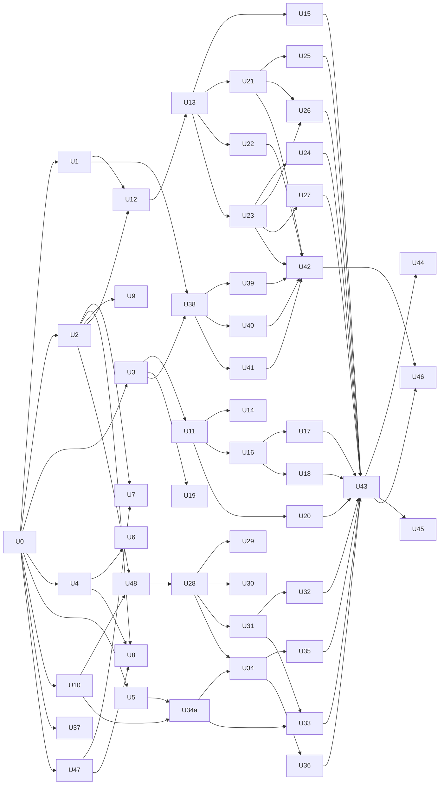

# Retroscope Next: unified architecture design

Target repo: `retroscope-next` (new sibling repo).
Inputs: `scratchpad/understand/*.md` (reverse-engineering reports), `scratchpad/orig` (read-only original), and the three candidate designs `design/A-realtime.md`, `design/B-footprint.md` and `design/C-security.md`.
The locked decisions from the user are taken as given and are not re-argued here.

The design rests on one rule: **every piece of shared room state has exactly one writer, a single-threaded room actor, which commits to Postgres before anyone hears about the change.** A process holds the global leader lease before it may run actors, and every actor write is fenced inside SQL by the leader epoch. Clients send intents, never rows, and every overwrite intent carries a precondition. Everything below follows from that rule. The one documented exception is spotlight *movement*, which is ephemeral-durable (§c.8).

Facts not checked against a primary source in this session are marked **(unverified)**. Each has a named implementation unit that checks it before code depends on it (§12).

**Revision 2.** This version applies the three critiques (`critique-feasibility.md` F1–F26, `critique-realtime-correctness.md` R1–R28 + coverage gaps, `critique-security-import.md` S1–S33). Every finding's disposition is in the **Critique resolution** table at the end. Facts re-verified in this revision: Coolify does not do rolling updates for compose apps (coolify.io/docs/knowledge-base/rolling-updates, fetched); ASP.NET Core `WebSocketOptions.KeepAliveTimeout` / `WebSocketAcceptContext.KeepAliveTimeout` provide server PING/PONG liveness (learn.microsoft.com websockets doc, fetched); the drawer accepts half points (`JiraIssueDrawer.tsx:1328,1968`) and never uses `splitFrom`.

### Deployment precondition (must be confirmed by the user before U0)

The locked decision is "1 vCPU / 1 GB RAM total (app + Postgres)". Coolify's own control plane needs 2 CPU / 2 GB (coolify.io install docs, per critique F2). This design therefore assumes **the Coolify control plane runs on a different machine and this VPS is registered as a Coolify remote server** running only `coolify-proxy` (Traefik) plus our stack. If the control plane must live on this VPS, the honest options are a 2 GB VPS or dropping Coolify; no tuning makes it fit. The orchestrator must surface this to the user; it is not a RUNBOOK tip.

---

## 0. How the three designs were scored and merged

Scores run from 1 to 5 on Correctness, Simplicity, Performance and Security. "Base" is the design used as the skeleton for that section; "Grafts" are the ideas taken from the other two.

| Section | A (realtime) | B (footprint) | C (security) | Base | Grafts |
|---|---|---|---|---|---|
| (a) Repo layout | 4/3/4/4 | 4/5/4/3 | 4/3/4/5 | B (3 src projects) | C's pure `Core` contents (ids, protocol, markup, authz, crypto); B's "U0 stubs every module and freezes `Program.cs`" rule |
| (b) Schema | 5/3/4/5 | 3/5/5/3 | 5/3/4/5 | A | C: unified `blobs`, idle+absolute session expiry, grant `password_epoch`, `system_state`; B: `mentions_seen_at`; A: no vote counter column |
| (c) Protocol and actors | 5/3/4/5 | 4/4/5/4 | 4/4/4/5 | A | C: global leader lease (simpler than A's per-room leases), one transaction per command; B: boot snapshot in HTML, mutable actor state; A: epoch fencing on every write, durable client cursors, per-command tx frames, warm-up before auto-reveal |
| (d) HTTP API | 5/4/4/4 | 4/5/4/3 | 4/3/4/5 | A | C: problem+json, mandatory per-route policy metadata, `Disallow` unknown JSON members, invite tokens in POST bodies, write-only Jira host change requires re-entering the token |
| (e) Auth | 4/3/4/4 | 4/5/5/4 | 5/3/4/5 | B (opaque cookie, bcrypt, hand-rolled OIDC) | C: pre-hijack account-linking rules, Entra tenant allow-list, magic link creates account; A: durable email outbox; B: custom header + Origin CSRF |
| (f) Jira proxy | 5/4/4/5 | 4/4/5/5 | 5/3/4/5 | A | B: no hot-linked Jira images (local pixel glyphs); C: attachment proxy validated against the issue's own attachment list, host change requires token; all: never lossy description writes |
| (g) Front end | 4/3/4/5 | 4/5/5/4 | 4/3/4/5 | B | A: early socket, golden transcripts, keyboard shortcuts; C: contenteditable editor normalized through the markup parser, Trusted Types; B: no service worker, system font for long text |
| (h) Importer | 4/4/4/4 | 4/5/4/3 | 5/2/3/5 | A (JIT, AngleSharp, one transaction) | C: REPEATABLE READ source snapshot, tag histogram that fails on unknown HTML, sealing of credentials to an offline key, `cutover_at` lock, `team` visibility for imported private team boards |
| (i) Compose | 4/4/4/4 | 4/5/5/3 | 4/4/4/5 | A | B: CPU limits, swap guidance; C: read-only root filesystem, data checksums |
| (j) Testing | 5/3/4/5 | 4/4/4/4 | 5/3/4/5 | A | C: golden vectors from the original TS scoring, route inventory test, wire-tap secrecy check; B: perf budgets in CI |
| (k) Plan | 5/4/–/– | 4/4/–/– | 4/4/–/– | A | B: stub-first ownership; C: protocol contract unit first |

### 0.1 Decisions on open questions

| Question | Decision | Reason |
|---|---|---|
| Notifications | **Dropped.** The table goes to the archive. Mentions are kept as a `mentions` index table, a "Mentions" page and an unread badge computed from `users.mentions_seen_at`. | Today mentions never created notifications; the account page found them with a LIKE scan. None of the existing notification producers carry over. A pull-only index needs no fan-out and no push channel. |
| Guests | Server principals with an HttpOnly cookie. They may join quick poker sessions and retro boards with `link` or `password` visibility. They may never join team poker sessions or `team` boards. Guests post under their guest name; the "Post anonymously" option is for signed-in users only (parity). | Identity must be server-issued. |
| Quick-session expiry | Quick sessions and quick boards are purged after 30 days with no activity, and never while anyone is subscribed. | The original 1-hour cron deleted sessions mid-meeting. |
| Team deletion | Soft delete (`teams.deleted_at`). Everything the team owns becomes inaccessible at once; a hard cascade runs after 30 days. | A deleted team's boards must stop being reachable together with the team. |
| Topic badges on the team poker tab | Parent **keys** are persisted per round; parent **summaries** are resolved live through the Jira cache; key-only badges when Jira is unreachable. | Locked decision: no Jira titles in Postgres. |
| Pre-reveal votes | Persisted in `poker_votes` (crash safety), never projected to other principals before reveal. | "No lost updates" plus "hidden until reveal" is a wire property. |
| Private boards | `visibility ∈ {link, team, password}`. Board passwords are bcrypt-hashed and checked on the server; a correct password writes a durable grant that a password change invalidates. New team boards default to `team`. | §8.2 covers the import mapping. |
| Poker chat panel | Chat is dropped (locked). The right-hand panel becomes a **Round panel** with two tabs: "Issue" (the Jira details drawer, inline on wide screens) and "History" (every round's result, with "Revealed by X · 14:02" lines that replace the old system chat messages). | Keeps the layout balanced and gives "history" a home. |
| Cards moving between columns | Not added. | It is not parity. |
| Retro "Create JIRA ticket" on action items | Replaced by a real create through the Jira proxy for team boards with Jira configured; the hard-coded employer Jira URL is gone. Owned by U26 (route reuse: `POST issues`) and U36 (button on action-item cards). | Parity of intent without the hard-coded org. |
| Timer music | Alarm kept. One default background track ships as a static asset **only if** its licence permits redistribution (checked in U37); music uploads are dropped. Track position is derived from `durationMs − remainingMs` so every client plays in sync; pause/resume preserve it. | Locked list says "shared timer", not music uploads. |
| Endorsement admin "impersonation" | Dropped. | Locked: impersonation dropped. |
| Jira "split" | Dropped (only caller was the dropped local advisor, F16). Clone stays. | Not parity. |
| Jira story points | Decimal (`numeric(6,2)`, 0–1000, step 0.5 in the drawer); poker submit chips stay integers. | Drawer parity (F15). |
| Jira write scope | Any issue the team token can reach (parity: rounds accept any project key). Team admins get a toggle "members may edit Jira issues" (default on). | S33: a hard project restriction would break multi-project sessions. |
| Deploys | Stop-and-recreate (Coolify compose has no rolling updates). No standby mode; the epoch fence stays as a guard against accidental double starts. Target: redeploy mid-vote loses zero acked commands and clients reconnect in under 15 s. | F9, verified. |
| Images | Built in CI (GitHub Actions) and pulled from GHCR by digest. The VPS never compiles. | F1. |

---

## (a) Repository layout and projects

```
retroscope-next/
  global.json                     # sdk 10.0.302, rollForward: latestFeature
  Directory.Build.props           # net10.0, Nullable, TreatWarningsAsErrors, AnalysisLevel latest-recommended,
                                  # InvariantGlobalization, IsAotCompatible (Core, Server)
  Directory.Packages.props        # central versions; every version pinned in U0 after checking nuget.org
  .editorconfig                   # OutSystems C# defaults: 4 spaces, same-line braces, file-scoped namespaces
  Retroscope.slnx
  build.sh                        # restore, build, test (dotnet + node), web build, AOT publish check
  .github/workflows/
    ci.yml                        # build + test + AOT smoke on every PR
    images.yml                    # on main/tag: build app + importer for linux-x64, AOT smoke, push to GHCR by digest
  db/
    migrations/0001_init.sql      # embedded into Retroscope.Server
  src/
    Retroscope.Core/              # PURE: no IO, no clock, no ASP.NET, no Npgsql. AOT-compatible.
      Ids/                        # PrincipalId, TeamId, SessionId, RoundId, BoardId, ColumnId, CardId… (readonly record structs),
                                  # RoomKey, RoomCode (Crockford base32 generator + legacy parser), UuidV5
      Protocol/                   # Frames.cs, Commands.cs, Events.cs, NackCode.cs, WireJsonContext.cs (STJ source gen),
                                  # Catalog.cs (single list of every command/event kind; drives protocol.gen.js and the
                                  # generated two-phase envelope parser), IdConverters.g.cs (one converter per id type)
      Room/                       # IRoomDomain, Decision<T>, CommandContext, Viewer, PresenceView, AccessView,
                                  # Ports.cs (IPokerJiraPort, ITeamNotices: interfaces implemented in Server)
      Text/                       # NaturalCompare (ordinal, digit runs numeric; no ICU under InvariantGlobalization)
      Poker/                      # PokerState, PokerDecider, PokerApply, PokerProjection, Scoring, Deck, AutoReveal
      Retro/                      # RetroState, RetroDecider, RetroApply, RetroProjection, StageRules, TimerRules
      Team/                       # TeamState, TeamDecider, TeamApply, TeamProjection
      Authz/                      # Capability.cs + ResourceFacts.cs + Policy.Can signature (contract, U2);
                                  # PolicyImpl (exhaustive switch, default deny; U9)
      Markup/                     # MarkupParser, DocNode, MarkupWriter, Mentions, MarkupLimits
      Adf/                        # AdfToDoc, MarkupToAdf, AdfLossiness
      Security/                   # Keyring (HKDF subkeys), AeadBox (AES-256-GCM+AAD), Sealer (RSA-OAEP wrap), OpaqueToken,
                                  # TokenHash, AnonTagger, Bcrypt (wrapper over BCrypt.Net-Next), IpClassifier, JiraHostPolicy
    Retroscope.Server/            # ASP.NET Core minimal API host, PublishAot=true, binary name "retroscope"
      Program.cs                  # composition root; written once in U0, then frozen: calls every module's
                                  # AddServices → HostingModule.UsePipeline → every module's Map, in a fixed order
      Hosting/                    # SecurityHeaders, Csp, StaticAssets, Shell (index.html + boot JSON), Forwarded,
                                  # Problem, RoutePolicy filter, CsrfFilter, RateLimits, EmailBudget, RoomResolver,
                                  # Health, ShutdownCoordinator, SpotLoadCommand
      Json/                       # one JsonSerializerContext partial per module, chained in Program.cs
      Data/                       # Db (NpgsqlSlimDataSourceBuilder), Migrator, Leader (lease + fence), Repos/*.cs
      Auth/                       # Sessions, Guests, Passwords, AccountClaims, Oidc, Tokens, Email/ (Outbox, SmtpSender, Templates)
      Realtime/
        Transport/                # WsEndpoint, Connection, OutboundQueue, ConnectionRegistry, ConnRateLimit
        Actors/                   # RoomActor<TState,TCmd,TEvt>, ActorRegistry, ByteBoundedRing, PresenceTable, ActorTimers, IRoomStore
        Rooms/                    # PokerRoom, RetroRoom, TeamRoom (store + projection + timer adapters)
        Stores/                   # PokerStore, RetroStore, TeamStore (load + persist events, SQL only)
      Jira/                       # JiraClient, JiraThrottle, JiraCache, Jql, BrowseService, JiraMap, Credentials,
                                  # PokerJiraPort (implements IPokerJiraPort; runs the meta loop), IslandStore
      Endpoints/                  # Auth, Me, Guest, Dashboard, Teams, Invites, Templates, Endorsements, Retro, Poker, Jira, Blobs, Admin
      Jobs/                       # RetentionJob, EmailWorker, TokenSweepJob, TeamPurgeJob
    Retroscope.Importer/          # JIT console (not AOT), binary "retroscope-import"; references Core only; AngleSharp for HTML
      Program.cs  Source/  Archive/  Map/  Html/  Storage/  Verify/
  web/
    package.json                  # devDependencies: esbuild only (exact pin)
    build.mjs                     # bundle, split, hash, brotli+gzip, manifest.json, csp.json, budgets, innerHTML ban
    src/ (§g)  styles/  assets/
  tests/
    Retroscope.Core.Tests/        # xunit.v3 + FsCheck: deciders, projections, scoring, markup, ADF, authz matrix, crypto
    Retroscope.Sim/               # deterministic simulation of actors + virtual network + crashes
    Retroscope.Integration.Tests/ # Testcontainers Postgres, in-proc server, real WebSockets, fake Jira/OIDC/SMTP
    Retroscope.Importer.Tests/    # fake Supabase source DB (dump + migrations + quirk fixtures) → import → verify
    Retroscope.Soak/              # console: N WebSocket clients, chaos, convergence checker
    fixtures/                     # markup/*.json, adf/*.json, html/*.html shared by C# and JS tests
    golden/                       # src/*.ts (verbatim copies of pure functions from orig, with source path, commit
                                  # 7f48a79 and sha256 header), make-golden.mjs, poker-scoring.json, transcripts/*.json
    web-unit/                     # node --test: markup, store rebase, outbox, reducers vs golden transcripts
    web-fake-server/              # node WS server replaying golden transcripts + scripted frames (front-end units' checks)
    Fakes/                        # FakeJira, FakeOidc (Kestrel, in-proc and as containers for compose.test.yml)
    e2e/                          # Playwright (JS), multi-context realtime specs, visual baselines
  deploy/
    Dockerfile                    # node build → dotnet AOT publish → runtime-deps chiseled (CI only)
    Dockerfile.importer           # dotnet sdk build → runtime (JIT) image (CI only)
    docker-compose.yml            # Coolify target: image: ghcr.io/…@sha256:… only, never build:
    compose.build.yml             # local/CI override that builds the images
    compose.test.yml              # e2e/soak stack: app + db + mailpit + fake-jira + fake-oidc + toxiproxy
    RUNBOOK.md                    # Coolify setup, env, swap, backups, cutover, key rotation
  docs/protocol.md                # generated from Core/Protocol/Catalog.cs
```

**Dependency rule.** `Core` depends on nothing but the BCL and BCrypt.Net-Next. `Server` depends on `Core` and Npgsql. `Importer` depends on `Core`, Npgsql and AngleSharp. `web/src/net/protocol.gen.js` is generated from `Core/Protocol/Catalog.cs` by `ProtocolCatalogTests.GenerateJs`; CI fails if the committed file is stale, so client and server kinds cannot drift.

**AOT rules.** `WebApplication.CreateSlimBuilder`, the Request Delegate Generator, STJ source-generated contexts only, no reflection, no `dynamic`, no `Activator`. `Retroscope.Importer` is the only JIT project.
- **Wire frames are not STJ-polymorphic.** In `{"t":"cmd","k":"poker.vote.set","d":{…}}` the type of `d` depends on the sibling `k`, which `[JsonDerivedType]` cannot express. `Catalog.cs` drives a generated two-phase parser: read the envelope with `Utf8JsonReader` (any property order), capture `d` as a raw slice, then deserialize with `WireJsonContext.Default.<KindDto>` chosen by a generated `switch (k)`. Tx events (`ev:[{k,d}]`) use the same switch for writing.
- **Id types** (`readonly record struct PrincipalId(Guid Value)` etc.) each get a generated converter (as a bare string) including `ReadAsPropertyName`/`WriteAsPropertyName` for dictionary keys, registered in `[JsonSourceGenerationOptions(Converters = …)]`.
- **Npgsql slim builder opt-ins:** `Db.cs` calls `.EnableArrays()` and `.EnableJsonTypes()`; jsonb is passed as `string` with `NpgsqlDbType.Jsonb`. Transport security is deliberately off for the in-compose DB (the importer's source connection is a JIT process using the full builder with `SSL Mode=VerifyFull`).

**Parallel-work rule.** U0 creates every module file as a stub with three hooks:
```csharp
public static class TeamsModule {
    public static void AddServices(IServiceCollection s, IConfiguration c) {}   // DI: singletons, hosted services, options
    public static void Map(IEndpointRouteBuilder app) {}                        // routes
}
// HostingModule additionally has UsePipeline(WebApplication app): forwarded headers → security headers →
// static files → CSRF → rate limits → WebSockets, in that order (owned by U11).
```
plus every JSON context partial and its entry in the resolver chain, and `Program.cs` calling `AddServices` for every module, then `HostingModule.UsePipeline`, then every `Map`, in a fixed order. Every front-end screen module exports `mount()`. After U0 nobody edits `Program.cs` or the route table, so units never collide on shared files.

---

## (b) Postgres schema (DDL)

Conventions:
- App ids are UUIDv7 (`Guid.CreateVersion7()`); imported ids keep their source UUIDs; synthetic imported identities use UUIDv5 under fixed namespaces.
- No triggers, no RLS, no LISTEN/NOTIFY. Authorization lives in exactly one place, `Core/Authz/Policy`.
- Counters are never stored (vote counts are computed by actors from vote rows).
- The app connects as `retroscope_app` (DML grants on `public`, `EXECUTE` on `rs_fence`, no access to `archive`). Migrations and the importer run as `retroscope_owner`.
- **Timeouts are per role, never server-wide** (S2): `alter role retroscope_app set statement_timeout = '5s'`, `alter role retroscope_app set idle_in_transaction_session_timeout = '30s'`; `retroscope_owner` keeps both at 0 so migrations and the one-transaction import are never cut off.
- Entity versions (`poker_rounds.version`, `retro_cards.version`, `retro_columns.version`) are the preconditions overwrite commands carry (§c.4).
- `0001_init.sql` stays editable (owned by U1, change requests by PR) until U43 freezes it before the first production deploy; until then CI and Testcontainers always use fresh databases, so the migrator's sha guard never trips during development.

```sql
-- db/migrations/0001_init.sql
create schema if not exists archive;

create table schema_migrations (
  version    int primary key,
  name       text not null,
  sha256     bytea not null,                 -- migrator refuses to start if an applied file changed
  applied_at timestamptz not null default now()
);

create table system_state (                  -- single row
  id              boolean primary key default true check (id),
  leader_epoch    bigint not null default 0, -- bumped by every instance that becomes leader; fences all actor writes
  leader_instance uuid,
  leader_since    timestamptz,
  cutover_at      timestamptz                -- set by `retroscope-import cutover`; importer refuses afterwards
);
insert into system_state default values;

-- Epoch fence (R1, F3). First statement of every actor transaction: `select rs_fence($epoch)`.
-- Takes a SHARED transaction-level advisory lock (shared memory, no tuple lock, no WAL, no MultiXact)
-- and raises inside SQL on mismatch, so the rest of the batch aborts and nothing commits.
-- A new leader bumps the epoch under the EXCLUSIVE xact lock on the same key, which waits for
-- every in-flight fenced transaction of the old leader to finish.
create function rs_fence(expected bigint) returns void language plpgsql as $$
begin
  perform pg_advisory_xact_lock_shared(1381123153);         -- K_FENCE
  if (select leader_epoch from system_state) <> expected then
    raise exception 'fencing_lost' using errcode = 'RS001';
  end if;
end $$;

------------------------------------------------------------------------------- identity
create table principals (
  id           uuid primary key,
  kind         text not null check (kind in ('user','guest','external')),   -- external = imported Slack voter
  display_name text check (display_name is null or char_length(display_name) between 1 and 60),
  created_at   timestamptz not null default now(),
  check (kind = 'user' or display_name is not null)                         -- users derive names from users row
);

create table blobs (                          -- avatars and pasted board images; bytes in Postgres (no bind mounts)
  id           uuid primary key,
  purpose      text not null check (purpose in ('avatar','board_image')),
  board_id     uuid,                          -- FK added after retro_boards
  content_type text not null check (content_type in ('image/png','image/jpeg','image/gif','image/webp')),
  byte_size    int  not null check (byte_size between 1 and 2097152),
  sha256       bytea not null check (octet_length(sha256) = 32),
  bytes        bytea not null,
  created_by   uuid references principals(id) on delete set null,   -- NULL for images in anonymous cards/comments (S6)
  attached_at  timestamptz,                    -- set when a committed card/comment references it; GC deletes
                                               -- unattached board images after 24 h (S7)
  created_at   timestamptz not null default now(),
  check ((purpose = 'board_image') = (board_id is not null)),
  check (purpose <> 'avatar' or byte_size <= 262144)
);
alter table blobs alter column bytes set storage external;      -- already-compressed media: skip TOAST compression
create index blobs_board_ix on blobs (board_id) where board_id is not null;
create index blobs_unattached_ix on blobs (created_at) where purpose = 'board_image' and attached_at is null;

create table users (
  id                uuid primary key references principals(id) on delete cascade,
  email             text not null check (email = lower(email) and char_length(email) between 3 and 254
                                         and position('@' in email) > 1),
  email_verified_at timestamptz,               -- set only on proven ownership; imported password accounts start NULL (S1)
  password_hash     text check (password_hash ~ '^\$2[aby]\$\d\d\$[./A-Za-z0-9]{53}$'),  -- bcrypt only
  full_name         text not null default '' check (char_length(full_name) <= 100),
  nickname          text check (nickname is null or char_length(nickname) between 1 and 40),
  avatar_blob_id    uuid references blobs(id) on delete set null,
  theme             text not null default 'system' check (theme in ('light','dark','system')),
  is_admin          boolean not null default false,
  disabled_at       timestamptz,
  mentions_seen_at  timestamptz not null default now(),
  created_at        timestamptz not null default now(),
  updated_at        timestamptz not null default now()
);
create unique index users_email_uq on users (email);
create index users_name_prefix_ix on users (lower(full_name) text_pattern_ops);   -- admin search

create table external_identities (
  provider   text not null check (provider in ('google','entra')),
  subject    text not null check (char_length(subject) <= 200),   -- google: sub; entra: "<tid>:<oid>"
  user_id    uuid not null references users(id) on delete cascade,
  linked_at  timestamptz not null default now(),
  primary key (provider, subject)
);
create index external_identities_user_ix on external_identities (user_id);

create table sessions (
  id_hash         bytea primary key check (octet_length(id_hash) = 32),  -- sha256(cookie token)
  user_id         uuid not null references users(id) on delete cascade,
  auth_method     text not null check (auth_method in ('password','google','entra','magic_link')),
  created_at      timestamptz not null default now(),
  last_seen_at    timestamptz not null default now(),                    -- written at most every 5 min
  idle_expires_at timestamptz not null,                                  -- sliding 30 days
  abs_expires_at  timestamptz not null,                                  -- hard 90 days
  user_agent      text check (char_length(user_agent) <= 200)
);
create index sessions_user_ix on sessions (user_id);
create index sessions_expiry_ix on sessions (idle_expires_at);

create table guest_tokens (
  token_hash   bytea primary key check (octet_length(token_hash) = 32),
  principal_id uuid not null references principals(id) on delete cascade,
  expires_at   timestamptz not null                                      -- 180 days, slid at most daily
);
create index guest_tokens_principal_ix on guest_tokens (principal_id);

create table auth_tokens (                    -- magic link, password reset, email verification
  token_hash  bytea primary key check (octet_length(token_hash) = 32),
  purpose     text not null check (purpose in ('magic_link','password_reset','verify_email')),
  user_id     uuid references users(id) on delete cascade,                -- null: magic link for a new email
  email       text not null,
  expires_at  timestamptz not null,
  consumed_at timestamptz,
  created_at  timestamptz not null default now()
);
create index auth_tokens_expiry_ix on auth_tokens (expires_at);

create table email_outbox (                   -- written in the same tx as the token; row deleted after send
  id              bigint generated always as identity primary key,
  to_address      text not null,
  subject         text not null check (subject !~ '[\r\n]'),
  body_text       text,                       -- nulled after the final failed attempt (live link must not linger, S23)
  attempts        int not null default 0,
  next_attempt_at timestamptz not null default now(),
  last_error      text,
  created_at      timestamptz not null default now()
);
create index email_outbox_due_ix on email_outbox (next_attempt_at);

------------------------------------------------------------------------------- teams
create table teams (
  id                         uuid primary key,
  name                       text not null check (char_length(name) between 1 and 100),
  description                text check (char_length(description) <= 500),
  created_by                 uuid references principals(id) on delete set null,
  point_descriptions         jsonb not null default '{}' check (jsonb_typeof(point_descriptions) = 'object'),
  max_endorsements_per_board smallint not null default 3 check (max_endorsements_per_board between 0 and 50),
  deleted_at                 timestamptz,
  created_at                 timestamptz not null default now(),
  updated_at                 timestamptz not null default now()
);

create table team_members (
  team_id   uuid not null references teams(id) on delete cascade,
  user_id   uuid not null references users(id) on delete cascade,
  role      text not null check (role in ('owner','admin','member')),
  joined_at timestamptz not null default now(),
  primary key (team_id, user_id)
);
create unique index team_members_one_owner_uq on team_members (team_id) where role = 'owner';
create index team_members_user_ix on team_members (user_id);

create table team_favorites (
  user_id    uuid not null references users(id) on delete cascade,
  team_id    uuid not null references teams(id) on delete cascade,
  created_at timestamptz not null default now(),
  primary key (user_id, team_id)
);

create table team_invites (
  id          uuid primary key,
  team_id     uuid not null references teams(id) on delete cascade,
  kind        text not null check (kind in ('email','link')),
  email       text check (email = lower(email)),
  role        text not null default 'member' check (role in ('member','admin')),
  token_hash  bytea not null unique check (octet_length(token_hash) = 32),
  token_box   bytea,                         -- link invites only: AES-GCM(token), AAD = invite id; admins can re-copy
  created_by  uuid references principals(id) on delete set null,
  created_at  timestamptz not null default now(),
  expires_at  timestamptz not null,
  revoked_at  timestamptz,
  accepted_at timestamptz,                   -- email invites: single use
  accepted_by uuid references users(id) on delete set null,
  use_count   int not null default 0,
  check ((kind = 'email') = (email is not null)),
  check ((kind = 'link') = (token_box is not null)),
  check (kind = 'email' or role = 'member')    -- link invites never grant admin (S19)
);
create index team_invites_team_ix on team_invites (team_id) where revoked_at is null;

create table team_jira_config (
  team_id         uuid primary key references teams(id) on delete cascade,
  site_host       text not null check (site_host ~ '^[a-z0-9]([a-z0-9-]{0,61}[a-z0-9])?(\.[a-z0-9]([a-z0-9-]{0,61}[a-z0-9])?)+$'),
  credentials_box bytea not null,            -- AES-256-GCM({"email","token"}), AAD = "jira:v1:" || team_id
  key_id          text not null,             -- keyring id, for rotation
  token_last4     text not null check (char_length(token_last4) = 4),
  email_masked    text not null,             -- "j•••@acme.com", display only
  project_key     text check (project_key ~ '^[A-Z][A-Z0-9_]{0,19}$'),
  board_id        bigint check (board_id > 0),
  ticket_prefix   text check (ticket_prefix ~ '^[A-Z][A-Z0-9_]{0,19}$'),
  points_field_id text check (points_field_id ~ '^customfield_[0-9]{1,8}$'),
  points_field_overridden boolean not null default false,
  sprint_field_id text check (sprint_field_id ~ '^customfield_[0-9]{1,8}$'),
  status          text not null default 'needs_test'
                  check (status in ('ok','needs_test','auth_failed','unreachable','rotate_required')),  -- imported → rotate_required (S10)
  members_can_edit boolean not null default true,   -- admin toggle: members may write to Jira issues (S33)
  last_checked_at timestamptz,
  updated_by      uuid references principals(id) on delete set null,
  updated_at      timestamptz not null default now()
);

create table recent_activity (
  user_id     uuid not null references users(id) on delete cascade,
  entity_kind text not null check (entity_kind in ('team','board','poker')),
  entity_id   uuid not null,
  last_at     timestamptz not null default now(),
  primary key (user_id, entity_kind, entity_id)
);
create index recent_activity_user_ix on recent_activity (user_id, last_at desc);

------------------------------------------------------------------------------- realtime infrastructure
create table client_cursors (                 -- exactly-once command application per (room, tab)
  room_key     text not null,                 -- 'poker:<uuid>' | 'board:<uuid>' | 'team:<uuid>'
  client_id    uuid not null,
  principal_id uuid not null,                 -- cid is bound to one principal; another principal's use is refused (S16)
  last_cseq    bigint not null check (last_cseq > 0),
  updated_on   date not null default current_date,   -- day granularity, unindexed: updates stay HOT (F23)
  primary key (room_key, client_id)
);
-- upsert: on conflict do update set last_cseq = greatest(client_cursors.last_cseq, excluded.last_cseq),
--         updated_on = excluded.updated_on   (never regresses, R28)

------------------------------------------------------------------------------- poker
create table poker_sessions (
  id                  uuid primary key,
  code                text not null check (code ~ '^[A-Za-z0-9-]{4,36}$'),   -- imported codes verbatim (incl. uuid text)
  team_id             uuid references teams(id) on delete cascade,             -- null = quick session
  created_by          uuid references principals(id) on delete set null,
  presence_enabled    boolean not null default true,
  follow_spotlight    boolean not null default true,
  spotlight_holder_id uuid,                                                    -- FK below: NO ACTION DEFERRABLE (R9)
  spotlight_client_id uuid,                                                    -- tab that may move the spotlight
  spotlight_round_id  uuid,
  current_round_id    uuid,                                                    -- "latest" pointer
  next_round_number   int not null default 1 check (next_round_number >= 1),
  last_activity_at    timestamptz not null default now(),                      -- bumped at most once a minute
  created_at          timestamptz not null default now(),
  check ((spotlight_holder_id is null) = (spotlight_round_id is null))
);
create unique index poker_sessions_code_uq on poker_sessions (code);
create index poker_sessions_code_ci_ix on poker_sessions (upper(code));
create index poker_sessions_team_ix on poker_sessions (team_id, created_at desc) where team_id is not null;
create index poker_sessions_quick_idle_ix on poker_sessions (last_activity_at) where team_id is null;

create table poker_observers (
  session_id   uuid not null references poker_sessions(id) on delete cascade,
  principal_id uuid not null references principals(id) on delete cascade,
  primary key (session_id, principal_id)
);

create table poker_rounds (
  id               uuid primary key,
  session_id       uuid not null references poker_sessions(id) on delete cascade,
  number           int not null check (number >= 1),                        -- stable "Round N" label, server-allocated
  sort_key         int not null,
  ticket_key       text check (ticket_key ~ '^[A-Z][A-Z0-9_]{0,19}-[1-9][0-9]{0,8}$'),  -- null = placeholder
  parent_key       text check (parent_key ~ '^[A-Z][A-Z0-9_]{0,19}-[1-9][0-9]{0,8}$'),  -- key only, never a title
  state            text not null default 'voting' check (state in ('voting','revealed')),
  is_active        boolean not null default true,
  is_pending       boolean not null default false,
  pending_owner_id uuid references principals(id) on delete set null,
  version          int not null default 1,                                  -- precondition for setTicket (R5)
  auto_reveal      boolean not null default true,
  winner_points    smallint check (winner_points in (0,1,2,3,5,8,13,21)),  -- plurality; 0 = everyone abstained
  revealed_at      timestamptz,
  revealed_by      uuid references principals(id) on delete set null,       -- null with revealed_at set = auto
  jira_points      numeric(6,2) check (jira_points between 0 and 1000),     -- last points written to Jira (decimal, F15)
  jira_points_at   timestamptz,
  jira_points_by   uuid references principals(id) on delete set null,
  created_at       timestamptz not null default now(),
  constraint poker_rounds_number_uq unique (session_id, number),
  constraint poker_rounds_sort_uq unique (session_id, sort_key) deferrable initially deferred,
  check (state = 'revealed' or (winner_points is null and revealed_at is null)),
  check (not is_pending or pending_owner_id is not null)
);
alter table poker_sessions
  add constraint poker_sessions_current_fk foreign key (current_round_id)
      references poker_rounds(id) on delete set null deferrable initially deferred,
  -- Spotlight FKs are NO ACTION DEFERRABLE (R9): a SET NULL action fires at statement end even when
  -- deferrable and would null one column, violating the holder/round CHECK. The store must repair the
  -- spotlight explicitly (clearAll, delete, principal deletion); a missed repair fails loudly at COMMIT.
  add constraint poker_sessions_spot_fk foreign key (spotlight_round_id)
      references poker_rounds(id) deferrable initially deferred,
  add constraint poker_sessions_spot_holder_fk foreign key (spotlight_holder_id)
      references principals(id) deferrable initially deferred;

create table poker_votes (                    -- pre-reveal rows persisted for crash safety, never projected to others
  round_id     uuid not null references poker_rounds(id) on delete cascade,
  principal_id uuid not null references principals(id) on delete cascade,
  points       smallint check (points in (1,2,3,5,8,13,21)),
  high_points  smallint check (high_points in (2,3,5,8,13,21)),           -- "between": adjacency checked in Core
  locked       boolean not null default false,
  abstained    boolean not null default false,
  updated_at   timestamptz not null default now(),
  primary key (round_id, principal_id),
  check (abstained = (points is null)),
  check (not abstained or (locked and high_points is null)),
  check (high_points is null or high_points > points)
);

------------------------------------------------------------------------------- retro
create table retro_boards (
  id                   uuid primary key,
  code                 text not null check (code ~ '^[A-Za-z0-9-]{3,64}$'),   -- new: 10-char Crockford (S9); imported verbatim
  team_id              uuid references teams(id) on delete cascade,
  title                text not null check (char_length(title) between 1 and 200),
  created_by           uuid references principals(id) on delete set null,
  visibility           text not null check (visibility in ('link','team','password')),
  password_hash        text check (password_hash ~ '^\$2[aby]\$\d\d\$[./A-Za-z0-9]{53}$'),
  password_set_at      timestamptz,
  stage                text not null default 'thinking' check (stage in ('thinking','voting','discussing','closed')),
  focus_card_id        uuid,
  -- config (1:1, inlined)
  allow_anonymous      boolean not null default true,
  voting_enabled       boolean not null default true,
  max_votes_per_user   smallint check (max_votes_per_user between 1 and 99),   -- null = unlimited
  show_author_names    boolean not null default true,
  stages_enabled       boolean not null default false,
  enforce_readiness    boolean not null default false,
  allow_self_votes     boolean not null default true,
  vote_emoji           text not null default '👍' check (char_length(vote_emoji) between 1 and 8),
  sort_chronologically boolean not null default false,
  -- timer (server clock)
  timer_state          text not null default 'idle' check (timer_state in ('idle','running','paused')),
  timer_duration_ms    int not null default 900000 check (timer_duration_ms between 1000 and 7200000),
  timer_ends_at        timestamptz,
  timer_remaining_ms   int check (timer_remaining_ms >= 0),
  timer_alarm          boolean not null default true,
  timer_music          boolean not null default false,
  archived_at          timestamptz,
  archived_by          uuid references principals(id) on delete set null,
  deleted_at           timestamptz,
  last_activity_at     timestamptz not null default now(),
  created_at           timestamptz not null default now(),
  updated_at           timestamptz not null default now(),
  check ((visibility = 'password') = (password_hash is not null)),
  check ((password_hash is null) = (password_set_at is null)),
  check (visibility <> 'team' or team_id is not null),
  check ((timer_state = 'running') = (timer_ends_at is not null)),
  check ((timer_state = 'paused') = (timer_remaining_ms is not null))
);
create unique index retro_boards_code_uq on retro_boards (code);
create index retro_boards_code_ci_ix on retro_boards (upper(code));
create index retro_boards_team_ix on retro_boards (team_id, created_at desc) where team_id is not null and deleted_at is null;
create index retro_boards_quick_idle_ix on retro_boards (last_activity_at) where team_id is null;
alter table blobs add constraint blobs_board_fk foreign key (board_id) references retro_boards(id) on delete cascade;

create table board_access_grants (            -- password unlocked by this principal
  board_id       uuid not null references retro_boards(id) on delete cascade,
  principal_id   uuid not null references principals(id) on delete cascade,
  password_epoch timestamptz not null,        -- = retro_boards.password_set_at at grant time; a change invalidates
  granted_at     timestamptz not null default now(),
  primary key (board_id, principal_id)
);

create table retro_columns (
  id              uuid primary key,
  board_id        uuid not null references retro_boards(id) on delete cascade,
  title           text not null check (char_length(title) between 1 and 100),
  color           text not null check (color in ('green','red','blue','yellow','purple','pink','indigo','orange','gray')),
  sort_key        int not null,
  is_action_items boolean not null default false,
  version         int not null default 1,     -- precondition for column.update (R5)
  created_at      timestamptz not null default now(),
  constraint retro_columns_sort_uq unique (board_id, sort_key) deferrable initially deferred
);
create unique index retro_columns_one_action_uq on retro_columns (board_id) where is_action_items;

create table retro_cards (
  id            uuid primary key,
  board_id      uuid not null references retro_boards(id) on delete cascade,
  column_id     uuid not null references retro_columns(id) on delete cascade,
  body          text not null check (char_length(body) between 1 and 8000),   -- Retro Markup, never HTML
  author_id     uuid references principals(id) on delete set null,
  anon_tag      bytea check (anon_tag is null or octet_length(anon_tag) = 32),  -- HMAC(k_anon, board || principal)
  legacy_author text check (char_length(legacy_author) <= 100),                 -- imported label when no principal
  version       int not null default 1,
  created_at    timestamptz not null default now(),
  updated_at    timestamptz not null default now(),
  check (num_nonnulls(author_id, anon_tag) <= 1)
);
create index retro_cards_board_ix on retro_cards (board_id);
create index retro_cards_column_ix on retro_cards (column_id);
alter table retro_boards add constraint retro_boards_focus_fk
  foreign key (focus_card_id) references retro_cards(id) on delete set null deferrable initially deferred;

create table retro_votes (
  card_id    uuid not null references retro_cards(id) on delete cascade,
  voter_id   uuid not null references principals(id) on delete cascade,
  board_id   uuid not null references retro_boards(id) on delete cascade,
  created_at timestamptz not null default now(),
  primary key (card_id, voter_id)
);
create index retro_votes_board_voter_ix on retro_votes (board_id, voter_id);

create table retro_comments (
  id            uuid primary key,
  card_id       uuid not null references retro_cards(id) on delete cascade,
  board_id      uuid not null references retro_boards(id) on delete cascade,
  body          text not null check (char_length(body) between 1 and 4000),
  author_id     uuid references principals(id) on delete set null,
  anon_tag      bytea check (anon_tag is null or octet_length(anon_tag) = 32),
  legacy_author text check (char_length(legacy_author) <= 100),
  created_at    timestamptz not null default now(),
  check (num_nonnulls(author_id, anon_tag) <= 1)
);
create index retro_comments_card_ix on retro_comments (card_id, created_at);
create index retro_comments_board_ix on retro_comments (board_id);

create table retro_readiness (
  board_id     uuid not null references retro_boards(id) on delete cascade,
  stage        text not null check (stage in ('thinking','voting','discussing','closed')),
  principal_id uuid not null references principals(id) on delete cascade,
  ready_at     timestamptz not null default now(),
  primary key (board_id, stage, principal_id)
);

create table mentions (                       -- derived from markup on every card/comment write
  source_kind text not null check (source_kind in ('card','comment')),
  source_id   uuid not null,                  -- card or comment id (cleaned by the store on delete)
  board_id    uuid not null references retro_boards(id) on delete cascade,
  user_id     uuid not null references users(id) on delete cascade,
  created_at  timestamptz not null default now(),
  primary key (source_kind, source_id, user_id)
);
create index mentions_user_ix on mentions (user_id, created_at desc);

create table board_templates (
  id                 uuid primary key,
  team_id            uuid not null references teams(id) on delete cascade,
  name               text not null check (char_length(name) between 1 and 100),
  is_default         boolean not null default false,
  allow_anonymous    boolean not null default true,
  voting_enabled     boolean not null default true,
  max_votes_per_user smallint check (max_votes_per_user between 1 and 99),
  show_author_names  boolean not null default true,
  stages_enabled     boolean not null default false,
  enforce_readiness  boolean not null default false,
  allow_self_votes   boolean not null default true,
  vote_emoji         text not null default '👍' check (char_length(vote_emoji) between 1 and 8),
  created_at         timestamptz not null default now(),
  updated_at         timestamptz not null default now()
);
create unique index board_templates_one_default_uq on board_templates (team_id) where is_default;
create index board_templates_team_ix on board_templates (team_id);

create table template_columns (
  id              uuid primary key,
  template_id     uuid not null references board_templates(id) on delete cascade,
  title           text not null check (char_length(title) between 1 and 100),
  color           text not null check (color in ('green','red','blue','yellow','purple','pink','indigo','orange','gray')),
  sort_key        int not null,
  is_action_items boolean not null default false,
  unique (template_id, sort_key)
);
create unique index template_columns_one_action_uq on template_columns (template_id) where is_action_items;

------------------------------------------------------------------------------- team action items & endorsements
create table team_action_items (
  id              uuid primary key,
  team_id         uuid not null references teams(id) on delete cascade,
  text            text not null check (char_length(text) between 1 and 8000),   -- markup, mirrors the source card
  source_board_id uuid references retro_boards(id) on delete set null,
  source_card_id  uuid references retro_cards(id) on delete set null,
  source_version  int not null default 0,     -- monotonic copy guard from retro_cards.version
  assigned_to     uuid references users(id) on delete set null,
  done_at         timestamptz,
  done_by         uuid references principals(id) on delete set null,
  created_by      uuid references principals(id) on delete set null,   -- NULL when the source card is anonymous (S6)
  created_at      timestamptz not null default now()
);
-- Column-scoped writes only (R24): BoardActor's card/column deletes run ON DELETE SET NULL on source_card_id,
-- so TeamStore never writes whole rows from memory; it UPDATEs exactly the columns a command changed.
create unique index team_action_items_source_uq on team_action_items (source_card_id) where source_card_id is not null;
create index team_action_items_open_ix on team_action_items (team_id, created_at desc) where done_at is null;
create index team_action_items_team_ix on team_action_items (team_id, created_at desc);
create index team_action_items_assignee_ix on team_action_items (assigned_to) where assigned_to is not null;

create table endorsement_types (
  id          uuid primary key,
  team_id     uuid not null references teams(id) on delete cascade,
  name        text not null check (char_length(name) between 1 and 60),
  description text check (char_length(description) <= 200),
  emoji       text not null check (char_length(emoji) between 1 and 8),
  sort_key    int not null,
  is_default  boolean not null default false,
  archived_at timestamptz,                    -- "delete" archives, keeping history
  created_at  timestamptz not null default now()
);
create index endorsement_types_team_ix on endorsement_types (team_id, sort_key);

create table endorsements (
  id           uuid primary key,
  board_id     uuid not null references retro_boards(id) on delete cascade,
  team_id      uuid not null references teams(id) on delete cascade,
  type_id      uuid not null references endorsement_types(id) on delete cascade,
  from_user_id uuid not null references users(id) on delete cascade,
  to_user_id   uuid not null references users(id) on delete cascade,
  created_at   timestamptz not null default now(),
  unique (board_id, from_user_id, to_user_id, type_id),
  check (from_user_id <> to_user_id)
);
create index endorsements_team_ix on endorsements (team_id, created_at desc);
create index endorsements_to_ix on endorsements (to_user_id, created_at desc);

------------------------------------------------------------------------------- audit (keys and actions only)
create table audit_log (
  id       bigint generated always as identity primary key,
  at       timestamptz not null default now(),
  actor_id uuid,
  team_id  uuid,
  action   text not null,      -- 'jira.points', 'jira.transition', 'team.role.set', 'admin.user.disable', 'auth.login.fail'…
  target   text,               -- issue key, user id, board id
  meta     jsonb not null default '{}'   -- ids, codes, counts, email_hmac (HKDF subkey 'audit-email', S22);
                                         -- never content, tokens, passwords or plain email hashes
);
create index audit_log_at_ix on audit_log (at);
create index audit_log_team_ix on audit_log (team_id, at desc) where team_id is not null;

------------------------------------------------------------------------------- archive (importer-owned)
create table archive.import_runs (
  id                 uuid primary key,
  started_at         timestamptz not null default now(),
  finished_at        timestamptz,
  status             text not null check (status in ('running','succeeded','failed')),
  source_fingerprint text not null,          -- sha256(system_identifier || server_version || per-table counts)
  seal_key_id        text,                   -- fingerprint of the offline public key; null = secrets stripped
  report             jsonb
);

create table archive.rows (                  -- dropped tables, and dropped columns of kept tables
  source_table text not null,                -- 'public.poker_session_chat', 'public.teams#dropped', 'auth.users#meta'
  source_pk    text not null,                -- canonical pk text; composite pks joined with '|'
  row          jsonb not null,               -- secret fields replaced by {"sealed":"<b64>"} or {"stripped":true}
  import_run   uuid not null references archive.import_runs(id),
  primary key (source_table, source_pk)
);

create table archive.storage_objects (       -- manifest of every Supabase storage object
  bucket      text not null,
  path        text not null,
  byte_size   bigint not null,
  sha256      bytea,
  disposition text not null check (disposition in ('imported','manifest_only','skipped')),
  blob_id     uuid,
  import_run  uuid not null references archive.import_runs(id),
  primary key (bucket, path)
);

create table archive.storage_cache (         -- staged downloads, committed BEFORE the main import tx (S2); makes
  bucket text not null,                      -- storage resumable across runs (the importer image has no volume)
  path   text not null,
  sha256 bytea not null,
  bytes  bytea not null,
  primary key (bucket, path)
);

create table archive.excluded_tables (       -- foreign / non-Retroscope data: counted, never copied
  source_table text primary key,
  row_count    bigint not null,
  reason       text not null,
  import_run   uuid not null references archive.import_runs(id)
);

-- grants (run by the migrator as owner)
-- grant usage on schema public to retroscope_app;
-- grant select, insert, update, delete on all tables in schema public to retroscope_app;
-- revoke all on schema archive from retroscope_app;  (DBA/admin access only)
```

**Retention** (`RetentionJob`, hourly, only on the leader):
- Quick poker sessions and quick boards: delete when `last_activity_at < now() - 30 days`, through `ActorRegistry.TryPurge(roomKey, deleteFn)`, which atomically holds the room key closed (no `GetOrStart` can load it) while it re-checks "no subscribers", runs the delete and releases (R18).
- Expired sessions, guest tokens, auth tokens, revoked or expired invites.
- `client_cursors` with `updated_on < current_date - 14` (sequential scan of a small table; no index, F23).
- Board images with `attached_at is null and created_at < now() - 24 h` (S7).
- `email_outbox` rows with `body_text is null` older than 7 days.
- Teams with `deleted_at < now() - 30 days` are hard-deleted (cascade).
- `audit_log` older than 180 days.

**Display names.** A user's room name is `coalesce(nullif(nickname,''), nullif(full_name,''), 'User')` and is **never** the email. Guests and external principals use `principals.display_name`.

---

## (c) Domain types, realtime protocol, actors, persistence, crash recovery

### c.1 Core types

```csharp
public readonly record struct PrincipalId(Guid Value);
public enum PrincipalKind : byte { User, Guest, External }
public sealed record Principal(PrincipalId Id, PrincipalKind Kind, string DisplayName, Guid? AvatarBlobId, bool IsAppAdmin);

public enum RoomKind : byte { Poker, Board, Team }
public readonly record struct RoomKey(RoomKind Kind, Guid Id);   // wire: "poker:<uuid>", "board:<uuid>", "team:<uuid>"
public readonly record struct ClientId(Guid Value);              // per tab (sessionStorage)
public readonly record struct ConnectionId(Guid Value);          // per socket

public enum TeamRole : byte { Member, Admin, Owner }
// Viewer carries identity only. Role and grant are resolved at DECIDE time (R12), never cached at subscribe,
// so a demotion or an invalidated password grant takes effect on the very next command.
public sealed record Viewer(Principal Who, ClientId Client, ConnectionId Conn);
public interface IAccessView {                       // backed by the versioned TeamMembershipCache + grant table
    TeamRole? RoleIn(Guid teamId, PrincipalId p);
    bool HasCurrentGrant(Guid boardId, PrincipalId p, DateTimeOffset? passwordSetAt);
}
public sealed record CommandContext(Viewer Viewer, DateTimeOffset Now, PresenceView Presence, IAccessView Access);
// PresenceView: present principals (grace-smoothed) AND present ClientIds per principal (R7).

public abstract record Decision<TEvent> {
    public sealed record Accept(IReadOnlyList<TEvent> Events) : Decision<TEvent>;
    public sealed record NoOp : Decision<TEvent>;
    public sealed record Reject(NackCode Code, string? Detail = null) : Decision<TEvent>;
}

public interface IRoomDomain<TState, TCmd, TEvt> {
    Decision<TEvt> Decide(TState s, TCmd c, CommandContext ctx);       // pure; never mutates s
    void Apply(TState s, TEvt e);                                       // mutates; called only after commit
    IReadOnlyList<TEvt> OnPresence(TState s, PresenceDelta d, PresenceView p, DateTimeOffset now); // spotlight unbind, pending discard
    IReadOnlyList<TimerRequest> Timers(TState s, PresenceView p, DateTimeOffset now);  // auto-reveal, retro timer, SpotlightCheck
    IReadOnlyList<TEvt> OnWarm(TState s, PresenceView p, DateTimeOffset now);          // at WarmUntil (R7, R8, R14)
}
```

State is plain mutable classes owned by one actor thread (B). `Decide` is pure and only reads; `Apply` runs after the commit succeeds, so a failed transaction never leaves half-applied state. `Policy.Can(viewer, capability, facts, access)` in `Core/Authz` makes every permission decision; deciders call it first. The `Capability` enum, `ResourceFacts` and the `Policy.Can` signature are part of the U2 contract so the domain units can compile against them; U9 supplies the implementation and matrix.

**Poker state**

```csharp
public sealed class PokerState {
    public Guid SessionId; public string Code = ""; public Guid? TeamId; public PrincipalId? CreatedBy;
    public bool PresenceEnabled, FollowSpotlight;
    public HashSet<PrincipalId> Observers = new();
    public Spotlight? Spotlight;                       // Holder, HolderClient (ClientId?), RoundId, Dirty (unpersisted move)
    public List<Guid> Order = new();                   // rounds by sort_key (dense)
    public Dictionary<Guid, Round> Rounds = new();
    public Guid? CurrentRoundId; public int NextRoundNumber;
    public Dictionary<PrincipalId, Seat> Roster = new(); // team members (team); quick: trimmed to present ∪ voted (R27)
    public DateTimeOffset WarmUntil;                   // load time + 15 s: no auto-reveal while clients reconnect
}
public sealed class Round {
    public Guid Id; public int Number; public int Version; public string? TicketKey, ParentKey;
    public RoundState State; public bool Active, Pending, AutoReveal; public PrincipalId? PendingOwner;
    public Dictionary<PrincipalId, Vote> Votes = new(); public short? Winner;
    public DateTimeOffset? RevealedAt; public PrincipalId? RevealedBy; public JiraPoints? Jira; public int AutoRevealGen;
}
// JiraPoints(decimal Points, DateTimeOffset At, PrincipalId By, JiraSubmitStatus Status) — decimal (F15).
public readonly record struct Vote(short? Points, short? High, bool Locked, bool Abstained);
public static class Deck { public static readonly short[] Values = [1, 2, 3, 5, 8, 13, 21]; }  // "between": High is the next deck value
```

`Scoring.Winner` is a line-for-line port of `getWinningVoteFromSelections` (`orig/src/hooks/usePokerSession.ts:52-85`): abstains excluded; a between vote adds weight 1 to each endpoint; plurality wins; ties go to the higher value; no participants gives 0. It is checked against golden vectors produced by running the original TypeScript (§j).

**Retro state** holds board meta, config, stage, focus, timer, archived flag, `List<Column>`, `Dictionary<Guid, Card>` (each card keeps `HashSet<PrincipalId> Voters`), `Dictionary<Guid, List<Comment>>`, `HashSet<PrincipalId> ReadyThisStage`, endorsements for the board, and the team's member list (from the team membership cache). The member list, mention candidates and endorsements are **projected only to team members** (S12); guests and non-members on `link`/`password` team boards never receive the roster. Anonymous ownership is checked through an injected `IAnonTagger` (HMAC-SHA256 with `k_anon`, per board), so the key never lives in state.

**Team state** holds members and roles, open and recently closed action items, and endorsement types.

### c.2 Rooms and ownership

| Room key | Actor | Single-writer tables | Subscribers |
|---|---|---|---|
| `poker:<sessionId>` | PokerActor | `poker_sessions`, `poker_observers`, `poker_rounds`, `poker_votes` | participants |
| `board:<boardId>` | BoardActor | `retro_boards`, `retro_columns`, `retro_cards`, `retro_votes`, `retro_comments`, `retro_readiness`, `board_access_grants`, `mentions`, `endorsements`, `blobs` (board images, insert only) | board viewers |
| `team:<teamId>` | TeamActor | `team_members`, `team_action_items` (after creation), `endorsement_types`, `board_templates`, `teams.max_endorsements_per_board` | team pages; board pages of that team (for live action items); poker pages of that team (roster) |

Cross-room rules:
- **Actors never `Ask` other actors and never await another actor's queue.** Each actor has two queues (R10): an **unbounded internal queue** (actor-to-actor posts, timer callbacks, HTTP `Ask`s, presence) drained with priority, and a **bounded external queue** (client commands and subscribes) written with non-blocking `TryWrite`. Actor-to-actor `Post` is always a synchronous enqueue to the internal queue, so no cycle of waits can form.
- **Create in place.** An actor may insert a brand-new row into a table another actor owns, inside its own transaction, because nobody can be writing a row that does not exist yet. BoardActor inserts `team_action_items` when a card is added to the action-items column of a team board, then posts `ActionItemCreated` to the TeamActor, which applies it **idempotently by id** (a TeamActor reloaded after eviction may already hold the row, R24).
- **Team-owned writes outside actors are forbidden.** `/api/invites/accept` and admin membership repair post to TeamActor, which inserts `team_members`, bumps the `TeamMembershipCache` version and emits `team.members` (R24).
- **Team settings fan out.** PATCH of `point_descriptions` or `max_endorsements_per_board` posts `TeamSettingsChanged` to the team's live poker and board actors, which emit `team.settings {…}` (R15c).
- **Every later mutation goes to the owner.** Assign and done, even from the board page, are sent by the client to `team:<id>`; board pages of team members subscribe to both rooms. Comments on action items from the team page are an HTTP call that the server routes to the source board's actor (`ActorRegistry.Ask` from an HTTP handler, never from an actor).
- **Derived copies are monotonic.** BoardActor posts `SyncActionText(cardId, text, cardVersion)`; TeamActor applies it only if `cardVersion > source_version`. On load TeamActor repairs any copy left stale by a crash between the two commits:
  `update team_action_items t set text = c.body, source_version = c.version from retro_cards c where c.id = t.source_card_id and t.team_id = $1 and c.version > t.source_version`.
- **Access changes fan out.** Member removal, role change, board visibility or password change, team deletion, session revocation and user disable post `AccessChanged` to affected live actors. Each actor re-runs `Policy.Can(Subscribe)` for its subscribers and sends `kick` where it now fails. Elevated rights need no refresh because deciders resolve role and grant at decide time through `IAccessView` (R12). A process-wide `TeamMembershipCache` (versioned, immutable map per team) backs both.

### c.3 Wire protocol

One same-origin WebSocket per tab at `GET /ws`, authenticated by the session or guest cookie on upgrade, with an exact `Origin` check. Frames are UTF-8 JSON produced by STJ source generation. Inbound frames are capped at **64 KiB** (an 8,000-character card of emoji or CJK is up to 32 KB of UTF-8 before escaping, S32); body limits are enforced in characters by the deciders. permessage-deflate is not negotiated (frames are 50–400 bytes; snapshots go out once per subscription). All timestamps are Unix milliseconds of server time.

**Liveness is server-driven (R6).** The server accepts with `WebSocketAcceptContext { KeepAliveInterval = 15 s, KeepAliveTimeout = 30 s }` (protocol PING/PONG; browsers answer without running JS, so throttled background tabs stay connected; API verified in the ASP.NET Core WebSockets doc, AOT behaviour confirmed in U14). The app-level `ping` exists only for clock samples.

Field glossary: `t` type, `r` room key, `e` epoch (string), `s` seq, `q` client command sequence, `k` kind, `d` data.

**Client → server**

| Frame | Shape | Notes |
|---|---|---|
| hello | `{"t":"hello","v":1,"cid":"<uuid>","subs":[{"r":"poker:…","e":"…","s":42}]}` | Must arrive within 5 s or the socket closes with 4400. `subs` resumes every room in one frame. A `cid` already bound to another live connection, or bound to a different principal, closes with **4409 `cid_in_use`**; the client mints a new cid and reconnects (R4, S16). |
| sub | `{"t":"sub","r":"board:…","e":"…","s":17}` | `e`/`s` optional. Idempotent. |
| unsub | `{"t":"unsub","r":"board:…"}` | |
| cmd | `{"t":"cmd","r":"poker:…","q":1093,"k":"poker.vote.set","d":{…}}` | `q` strictly increases per `cid`. Requires an active sub to `r`. |
| ping | `{"t":"ping","c":<clientMs>}` | Clock sample only: right after `welcome`, every 60 s while visible, and on `visibilitychange→visible`/`online`. |

**Server → client**

| Frame | Shape | Notes |
|---|---|---|
| welcome | `{"t":"welcome","conn":"…","me":{"pid","kind","name","avatar"},"n":<serverMs>}` | `n` seeds the clock offset. |
| snap | `{"t":"snap","r","e","s","lastQ","d":{…}}` | Full projection for this viewer at seq `s`. `lastQ` = persisted cursor for this `(room, cid)`; the client sets `cseq = max(cseq, lastQ)` before sending to the room (R4). Built as one shared public document plus a small per-viewer overlay (R11). |
| replay | `{"t":"replay","r","e","from":43,"lastQ","txs":[{"s":43,"ev":[…]},…]}` | Missed tx frames re-projected for this viewer. Empty `txs` means "you are current". |
| tx | `{"t":"tx","r","s":44,"ev":[{"k":"poker.vote.state","d":{…}},…]}` | One committed command or one internal transition, applied atomically by the client. `ev` may be empty for this viewer (redacted); the seq still advances. |
| ack | `{"t":"ack","r","q":1093,"s":44}` | Sent **after** the tx frame it produced, on the same ordered queue. `{"dup":true}` for an already-applied `q`. |
| nack | `{"t":"nack","r","q":1093,"code":"round_revealed","retry":false,"msg":"…","d":{…}}` | Stable codes (§c.6). `retry:true` codes keep the outbox entry; `stale` carries `d.current`. |
| x | `{"t":"x","r","k":"jira.meta","d":{…}}` | Unsequenced, idempotent, overwrite-only cache fill. Never needed for correctness. |
| pong | `{"t":"pong","c":<clientMs>,"n":<serverMs>}` | Clock offset estimation. |
| kick | `{"t":"kick","r","code":"access_revoked"}` | Room dropped; the client shows why. |
| bye | `{"t":"bye","code":"restart","retryMs":2600}` | Before a graceful close, fencing loss or DB outage. `retryMs` is drawn per connection from a window that widens with the live connection count (0.5–8 s), so a restart does not cause a synchronized reconnect storm (R11). |

Close codes: `1012` restart/fencing loss/DB outage/outcome-unknown commit, `4400` protocol violation or no hello, `4401` unauthenticated or session revoked, `4403` bad Origin, `4008` slow consumer, `4409` cid in use, `4429` rate limited, `4413` frame too large. There is no standby close code (no standby mode, F9).

**Seq and epoch rules**
- `epoch` is 64 random bits per actor incarnation. `seq` starts at 0 on load and increments by exactly 1 per tx frame.
- A tx frame is emitted for every accepted command that changed state and for every internal transition (auto-reveal, timer expiry, presence change, spotlight release, access change, Jira result). A NoOp command is acked at the current seq without a frame.
- On `sub` with `(e, s)`: `e == epoch && s == seq` → empty replay; `e == epoch && s >= ring.FirstSeq − 1` → replay from the ring; otherwise → snapshot. The ring is bounded in **bytes** (256 KB per room) under a global ring budget (16 MB) that trims the coldest rooms first; a trimmed ring just means a snapshot (R11).
- Client rule: apply a tx only if `s == last + 1`; ignore `s <= last`; on `s > last + 1` drop the frame and send `sub {e, s:last}`.

**Boot snapshot (from B).** `GET /poker/{code}`, `/teams/{tid}/poker/{code}` and `/retro/{code}` resolve the room through the shared `RoomResolver` (same per-IP code-lookup limit and identical miss/forbidden response as `by-code`, S9), check access and ask the actor (`ActorRegistry.Ask(Query(viewer))`, 400 ms timeout) for the viewer's projection plus `(epoch, seq)`. The shell embeds it in `<script type="application/json" id="boot">` (with `<` escaped as `\u003c`). The client paints from it immediately and sends `hello` with `{e, s}`; the server normally answers with an empty replay. On timeout the boot JSON simply omits the snapshot and the socket delivers it. This removes one long-haul round trip (the WebSocket's own TCP+TLS setup) from first paint.

### c.4 Command and event catalogue

Every command lists its payload, server rules and the events of its tx frame. All commands are set-semantics (no toggles), creates carry client-minted UUIDv7 ids, and all ids are validated against room state.

#### Poker (`poker:<sessionId>`)

General rules for every poker command: the caller must not be an observer for `vote/lock/abstain` (nack `observer`); vote-type commands on a **pending** round are rejected with `round_pending` (R8); overwrite commands carry a precondition (R5).

| Command `k` | `d` | Server rules | Events |
|---|---|---|---|
| `poker.vote.set` | `{roundId, points, high?, lock?}` | Not an observer; round active, voting, not pending; caller's vote not locked (an identical re-send is a NoOp); deck valid; `high` must be the next deck value. `lock:true` is drag-to-play (select and lock at once). Bumps `AutoRevealGen`. | `poker.vote.state` |
| `poker.lock.set` | `{roundId, locked}` | Not an observer; has a vote with points; not abstained; round voting, not pending. Bumps `AutoRevealGen`. | `poker.vote.state` |
| `poker.abstain.set` | `{roundId, abstain}` | Not an observer; round voting, not pending. Abstain = `{abstained, locked}`. Un-abstain deletes the vote row (empty slot). Bumps `AutoRevealGen`. | `poker.vote.state` |
| `poker.round.reveal` | `{roundId}` | Round voting, not pending (already revealed → NoOp). Every unlocked vote becomes abstain; seats with no row stay absent. Winner computed. | `poker.round.revealed {roundId, votes:[{pid,points,high,abstained}], winner, by, at}` |
| `poker.round.replay` | `{roundId}` | Round revealed. State → voting, winner cleared, `auto_reveal=false`, non-abstain votes kept and forced locked, round reactivated, `version+1`. | `poker.round.replayed {roundId}` + owner-only `poker.vote.state` per voter |
| `poker.round.create` | `{roundId, ticketKey?, pending?, forceNew?}` | Number allocated by the server. `pending` requires the spotlight holder; a pending round is a preview that nobody can vote on. Without `forceNew`, if the current round has no ticket, is voting and has no votes, the key is written onto it instead ("fill placeholder", parity). Non-pending: pointer moves with `nav:true`. Pending: pointer moves with `nav:false` and the spotlight follows (followers see the preview via spotlight follow, matching `usePokerSession.ts:811-897`). | `poker.round.created {round}` or `poker.round.updated`, `poker.pointer`, (`poker.spotlight`) |
| `poker.round.createMany` | `{rounds:[{roundId, ticketKey}]}` (≤ 50) | Batch add from a Jira bucket; the first fills the placeholder (same rule). Pointer → last, `nav:true`. | `poker.round.created`×n, `poker.pointer` |
| `poker.round.next` | `{fromRoundId, newRoundId, ticketKey?}` | `fromRoundId` must still be active, else nack `stale` (double click or two users → one new round). One transaction: **discard** pending rounds (delete), deactivate all other active rounds, create the new round, move the pointer with `nav:true`; the spotlight follows only if the holder issued it. | `poker.round.deleted`×p, `poker.round.updated`×n, `poker.round.created`, `poker.pointer`, (`poker.spotlight`) |
| `poker.round.end` | `{roundId}` | Round active. (UI "End", "Continue" = end + client opens New Round dialog, and "Next Round" with other active rounds = end + client navigates to the next active round.) | `poker.round.updated {roundId, active:false}` |
| `poker.round.activate` | `{roundId}` | Round inactive and voting, not pending. | `poker.round.updated` |
| `poker.round.setTicket` | `{roundId, ticketKey\|null, baseVersion}` | Round voting and active; `baseVersion == round.version` else nack `stale {current:{ticketKey, version}}` (R5). Upper-cased; a bare number gets the team prefix; validated. Client debounces 500 ms and flushes on blur. `version+1`; `parent_key` is cleared and refilled by the Jira meta loop. | `poker.round.updated {roundId, ticketKey, parentKey:null, version}` |
| `poker.round.commitPending` | `{roundId}` | Caller is the pending owner; round pending. | `poker.round.updated {pending:false}`, `poker.pointer {nav:true}` |
| `poker.round.discardPending` | `{roundId}` | Caller is the owner; round still pending. Deletes it; pointer repaired (`cause:'repair'`). | `poker.round.deleted {roundId}`, (`poker.pointer`), (`poker.spotlight`) |
| `poker.round.delete` | `{roundId}` | Team session: team admin/owner (resolved at decide time). Quick session: any signed-in participant. At least one other round remains. Spotlight repaired **before** the delete in the same transaction (moved to the pointer round, or released), then pointer repaired. | `poker.round.deleted`, (`poker.pointer`), (`poker.spotlight`) |
| `poker.round.reorder` | `{order:[roundId…]}` | Must be a permutation of the current rounds, else nack `stale` (client rebases its intent once and retries). `sort_key` rewritten densely under the deferred unique constraint. | `poker.round.order {order}` |
| `poker.rounds.clearAll` | `{newRoundId}` | Team: admin/owner. Quick: any signed-in participant. In one transaction: repair the spotlight (holder keeps it on the new round 1; if none, stays released), delete all rounds, create round 1, pointer `nav:true` (R9). | `poker.rounds.reset {round}`, `poker.pointer`, (`poker.spotlight`) |
| `poker.settings.update` | `{presenceEnabled?, followSpotlight?, expected:{…}}` | Any participant (parity). Each changed field's `expected` value must equal the current one, else nack `stale {current}` (R5). | `poker.settings {…}` |
| `poker.observer.set` | `{principalId, observer}` | Any participant for anyone (parity). Becoming an observer deletes that principal's votes in voting rounds and bumps `AutoRevealGen` of every affected round (removing a blocker re-evaluates auto-reveal, R28). | `poker.observers {ids}`, `poker.vote.state`×n |
| `poker.spotlight.take` | `{roundId, force}` | If another principal, or another bound tab of mine, holds it and `force` is false → nack `spotlight_held {holder}` (client shows "Take spotlight?"). Taking or losing the spotlight discards the previous holder's pending rounds in the same tx (R8). | `poker.spotlight {holder, roundId}`, (`poker.round.deleted`) |
| `poker.spotlight.move` | `{roundId}` | Only from the holder's bound `(principal, clientId)`; binds `HolderClient` when it is null. Client trails at 150 ms. **Ephemeral-durable** (§c.8): applied, sequenced and fanned out immediately; persisted on settle. | `poker.spotlight` |
| `poker.spotlight.give` | `{principalId}` | Holder, or anyone when nobody holds it (parity). Target must be present. `HolderClient` = null. Discards the giver's pending rounds. | `poker.spotlight`, (`poker.round.deleted`) |
| `poker.spotlight.release` | `{}` | Holder (any tab). Discards the holder's pending rounds. | `poker.spotlight {holder:null}`, (`poker.round.deleted`) |
| `poker.jira.submitPoints` | `{roundId, points}` | Team session, Jira configured, round revealed, real ticket key, team member, `members_can_edit` or admin. Rejected with `jira_pending` while a submit for this round is in flight (R15a). Actor emits `pending` and calls Jira through `IPokerJiraPort` **off-actor** (10 s timeout); the result returns as internal `JiraPointsResult`. | `poker.jira.points {roundId, key, points, status:'pending'\|'ok'\|'failed', code?, by}` (`ok` persists `jira_points*`) |
| internal `AutoRevealDue{roundId, gen}` | | Fires only if `gen == round.AutoRevealGen`, the condition still holds, ≥ 600 ms since the last vote change, and `now >= WarmUntil`. | `poker.round.revealed {by:null}` |
| internal `Warm` (at `WarmUntil`) | | `OnWarm`: arm `AutoRevealDue` for every active voting round; run `SpotlightCheck` (release if the holder is not present); discard pending rounds whose owner is absent (R7, R8, R14). | as applicable |
| internal presence change | | Principal first connection / last connection + 10 s grace → `join`/`leave`; every presence change re-arms `AutoRevealDue` (R14). The holder's **bound client** gone for 10 s → `HolderClient = null` (any tab of the holder may bind). The holder principal absent for **3 min** (`SpotlightGraceDue`) → release + discard their pending rounds (R6, R7). A pending owner absent past the 10 s grace → discard their pending rounds. | `presence.join/leave/update`, (`poker.spotlight`), (`poker.round.deleted`) |
| internal `RosterChanged` / `TeamSettingsChanged` | | Team membership or point descriptions changed. | `poker.roster {seats}` / `team.settings {pointDescriptions}` |
| internal `JiraMetaLoaded` / `JiraMetaInvalidated(key)` | | Loaded: persists `parent_key` only when it changed; titles stay in memory. Invalidated (after any PATCH/transition/points through the proxy, R15b): refetch that key. | `poker.round.updated {parentKey}` + unsequenced `x jira.meta` |
| internal `SessionDeleted` (HTTP) | | Team admin, or quick creator. | `poker.session.deleted`, then `kick` everyone |

**Pointer and navigation (R13).** `poker.pointer {roundId, cause:'next'|'create'|'createMany'|'commit'|'reset'|'repair', nav}`.
- `nav:true` (next, non-pending create, createMany, commitPending, clearAll): **every** client navigates to `roundId` (parity with `POKER_FOLLOW_CURRENT_ROUND_EVENT`, fix `32a5363`), including followers of a spotlight held by someone else. The spotlight itself does not move unless its holder issued the command; followers re-snap to the spotlight only when `poker.spotlight.roundId` next changes (parity: `context.tsx:913-929` reacts to *changes* of the spotlight round).
- `nav:false` (pending create, repair): only clients whose viewed round no longer exists navigate, to `roundId`.
- The rule lives in `poker/model.js` `navTarget(prev, tx, viewer)` and is covered by golden transcripts plus an e2e spec.

**Vote secrecy projection** (`PokerProjection.ForViewer`):
- To the voter's own principal (all tabs): `{roundId, pid, points, high, locked, abstained}`.
- To everyone else while the round is voting: `{roundId, pid, status:'empty'|'selected'|'locked'}`. Abstain shows as `locked` until reveal (matches the card-back display). Values are never included.
- After reveal, `poker.round.revealed` carries every vote with values.
- Snapshots follow the same rule. A property test and a soak wire-tap both assert that no frame to viewer A ever carries B's points while B's round is voting. Command payloads (`d`) are never logged (S33).

**Auto-reveal (server only, R14).** `eligible = (present − observers) ∪ {absent principals whose vote is locked or abstained}`, where `present` is the grace-smoothed presence set, or `Roster ∪ present` when `presence_enabled=false`. An absent principal with an *unlocked* vote does not block. Fires when the round is active, voting, not pending, has `auto_reveal`, `eligible ≠ ∅`, every eligible principal is locked or abstained, and at least one vote is not abstained or everyone abstained. Any vote change or presence change bumps/re-arms `AutoRevealDue` 600 ms later; `OnWarm` arms it after load. It runs for every active round, not just the one someone is viewing. Deliberate change from the original: an absent teammate no longer blocks auto-reveal; a manual reveal still treats unlocked votes as abstains.

**Seats shown** = `Roster ∪ present ∪ voted − observers` for team sessions, `present ∪ voted − observers` for quick sessions. Absent seats are dimmed. Guest seats carry a "guest" badge (S21). Pure projection; nothing is written.

#### Retro (`board:<boardId>`)

Stage gates (`Core/Retro/StageRules.cs`, applied only when `stages_enabled`):

| Action | thinking | voting | discussing | closed |
|---|---|---|---|---|
| card add/edit/delete, comment add/delete | ✓ | ✗ | action-items column only | ✗ |
| vote | ✗ | ✓ (if `voting_enabled`) | ✗ | ✗ |
| focus | ✗ | ✗ | ✓ | ✗ |
| voter identities in projection | hidden | hidden | shown | shown |

With stages off everything is allowed (subject to `voting_enabled`) and voters are shown. An archived board rejects every content command with `board_archived` and shows voters.

**Facilitator (S12).** Boards with a `team_id`: **team members only**, whatever the visibility; non-members (signed-in or guest) on `link`/`password` team boards may add, edit their own, vote and comment, nothing more. Quick boards (no team): any signed-in principal with access (parity). Guests are never facilitators. Role is resolved at decide time (R12).

| Command | `d` | Rules | Events |
|---|---|---|---|
| `retro.card.add` | `{cardId, columnId, body, anonymous}` | Stage gate; `anonymous` requires `allow_anonymous` and a signed-in user; markup validated; mentions extracted (team members only); `` refs must be board images of this board and are marked `attached_at` in the same tx (and `created_by` nulled if `anonymous`, S6/S7). Action-items column on a team board also inserts `team_action_items` (create in place; `created_by` null when anonymous). | `retro.card.added {card}` |
| `retro.card.edit` | `{cardId, body, baseVersion}` | Author or anon-tag match; stage gate; `baseVersion == card.version` else nack `stale {current:{body, version}}` (client shows a merge prompt with both texts, R5); `version+1`. Post-commit `SyncActionText`. | `retro.card.edited {cardId, body, version}` |
| `retro.card.delete` | `{cardId}` | Author or anon-tag; or a facilitator in the action-items column. If it is the focused card, focus is cleared in the same tx (R21). | `retro.card.deleted {cardId}`, (`retro.focus {cardId:null}`) |
| `retro.vote.set` | `{cardId, on}` | Stage gate, `voting_enabled`, self-vote rule (author or anon-tag), `max_votes_per_user` counted from the actor's vote sets. Same state → NoOp (set semantics, no precondition needed). | `retro.vote {cardId, count, voters?}` (+ per-viewer `mine`) |
| `retro.comment.add` | `{commentId, cardId, body, anonymous}` | Stage gate on the card's column; same blob and mention rules as cards. | `retro.comment.added {comment}` |
| `retro.comment.delete` | `{commentId}` | Author or anon-tag. | `retro.comment.deleted` |
| `retro.column.add` | `{columnId, title, color}` | Facilitator. | `retro.column.added` |
| `retro.column.update` | `{columnId, title?, color?, baseVersion}` | Facilitator; `baseVersion` precondition → `stale {current}`. `version+1`. | `retro.column.updated` |
| `retro.column.delete` | `{columnId}` | Facilitator. Cards cascade; linked action items keep their text (`source_card_id` → null); focus cleared if it pointed into the column. | `retro.column.deleted`, (`retro.focus`) |
| `retro.column.reorder` | `{order:[columnId…]}` | Facilitator; permutation check → `stale`. | `retro.column.order` |
| `retro.column.setActionItems` | `{columnId\|null}` | Facilitator; one transaction (clear old flag, set new). | `retro.column.actionItems {columnId}` |
| `retro.board.rename` | `{title, expected}` | Facilitator; `expected == title` precondition. | `retro.board.meta {title}` |
| `retro.config.update` | `{patch:{allowAnonymous?, votingEnabled?, maxVotes?, showAuthorNames?, stagesEnabled?, enforceReadiness?, allowSelfVotes?, voteEmoji?, sortChronologically?}, expected:{…same keys…}}` | Facilitator. Only present fields apply (fixes the stale-dialog overwrite); each field's `expected` must equal the current value, else `stale {current}` and the dialog shows the fresh values (R5). | `retro.config {patch}` |
| `retro.stage.set` | `{from, to}` | Facilitator. `from == stage` (compare-and-set). With `enforce_readiness`, `to` must be the next stage and every present participant must be ready; Reset (→thinking), Reopen (closed→discussing) and Restart (→thinking) are always allowed. Deletes the old stage's readiness rows. | `retro.stage {stage}`, `retro.readiness {stage, ready:[]}` |
| `retro.ready.set` | `{stage, ready}` | `stage == current`. | `retro.readiness {stage, ready:[pids]}` |
| `retro.focus.set` | `{cardId\|null, from}` | Discussing stage when stages are on; any participant (parity). `from == current focus` precondition (a stale focus is discarded silently by the client). Persisted. | `retro.focus {cardId}` |
| `retro.timer.start` | `{durationMs, alarm, music, from}` | Signed-in. `from == timer_state` (compare-and-set, R5). `ends_at = now + duration`. | `retro.timer {state, endsAt, remainingMs, durationMs, alarm, music}` |
| `retro.timer.pause` / `.resume` / `.reset` / `.setFlags` | `{from}` / `{from}` / `{from}` / `{alarm?, music?}` | Signed-in; compare-and-set on `from`. | `retro.timer` |
| internal `TimerDue{gen}` | | `state == running && now >= ends_at`. | `retro.timer {state:'idle', expired:true, endsAt}` |
| `retro.endorse.give` | `{endorsementId, toUserId, typeId}` | Team board; giver and target are members; not self; per-board limit (live from `team.settings`); unique. | `retro.endorsement.added` (recipient projection adds `celebrate:true`; members only) |
| `retro.endorse.revoke` | `{endorsementId}` | Giver. | `retro.endorsement.removed` |
| internal `TeamSettingsChanged` | | `max_endorsements_per_board` changed. | `team.settings {maxEndorsements}` |
| HTTP-originated (via Ask) | unlock grant, archive, unarchive, visibility/password, delete, action-item comment add | §d | `retro.board.meta`, `retro.comment.added`; `kick` on delete or lost access |

**Card projection**: `{id, columnId, body, author:{pid,name,avatar,guest}|null, anonymous, mine, version, createdAt}`. `author` is null when anonymous or when `show_author_names` is off; `mine` is computed per viewer (author id or anon-tag match) and travels in the per-viewer overlay. Comments project the same way. Vote voter lists are included only when the stage rule shows identities.

**Timer music sync.** The track position is `durationMs − remainingMs` (derived, never stored), so every client plays in sync; pause and resume preserve it.

#### Team (`team:<teamId>`)

| Command | `d` | Rules | Events |
|---|---|---|---|
| `team.action.assign` | `{itemId, userId\|null}` | Team member; assignee must be a member. Set semantics. | `team.action.updated` |
| `team.action.done` | `{itemId, done}` | Team member. Set semantics. | `team.action.updated` |
| `team.action.delete` | `{itemId}` | Team admin/owner. | `team.action.deleted` |
| internal `ActionItemCreated` (idempotent by id), `SyncActionText` (monotonic by card version), `CardDeleted` | | from BoardActor | `team.action.added` / `team.action.text` / `team.action.updated` |
| internal `MemberAdded` / `MemberRoleSet` / `MemberRemoved` | | from invites accept, members HTTP, admin repair | `team.members`; bumps `TeamMembershipCache`; posts `RosterChanged`/`AccessChanged` |
| internal notices | | from Board/Poker actors and HTTP | `team.boards.changed {boardId}`, `team.poker.changed {sessionId, pointed, total}`, `team.action.comments {itemId, count}` (the client refetches `GET …/action-items/{itemId}/comments`, R22), `team.settings {…}` |

Team room snapshot: members (id, name, avatar, role), open action items plus those closed in the last 30 days, endorsement types. List pages fetch their lists over HTTP and apply the `*.changed` notices.

#### Presence (poker and board rooms, sequenced)

`presence.join {pid, kind, name, avatar}`, `presence.leave {pid}`, `presence.update {pid, name, avatar}`; the snapshot carries `presence:[…]`.
- `PresenceTable` maps principal → set of connections, each with its `ClientId`; `PresenceView` exposes both present principals and present clients (R7).
- First connection of a principal → `join`, unless a pending leave timer exists, which is cancelled silently (no flicker).
- Last connection gone → `PresenceGraceDue(pid, gen)` 10 s later → `leave`.
- Dead sockets are detected by the server's protocol-level PING/PONG (`KeepAliveInterval` 15 s, `KeepAliveTimeout` 30 s), which browsers answer even in throttled background tabs, so a dead socket becomes a leave within ~55 s and a merely hidden tab never does (R6). iOS Safari suspending a page closes its socket; that user leaves after the grace, and the spotlight survives 3 minutes (above).
- Profile or guest rename → `presence.update` to every room the principal is in (via `ConnectionRegistry`).
- Readiness counts only present principals: `all_ready = (present − observers) ⊆ ready`.

### c.5 Recent activity

On the first `sub` of a signed-in user to a board, session or team, the server upserts `recent_activity`, debounced in memory to once per 5 minutes per (user, entity). The client never writes it.

### c.6 Nack codes (stable)

**Final** (domain rejects; the client drops the entry, rolls back and explains): `forbidden`, `not_subscribed`, `not_found`, `invalid`, `stale` (carries `d.current`), `round_revealed`, `round_not_voting`, `round_inactive`, `round_pending`, `vote_locked`, `observer`, `stage_forbids`, `board_archived`, `vote_limit`, `self_vote`, `endorse_limit`, `spotlight_held`, `not_holder`, `jira_not_configured`, `jira_pending`, `too_large`, `cid_reuse`, `internal` (a constraint violation: a bug, logged by kind).

**Retryable** (`retry:true`; the client keeps the entry and resends after backoff or after the next snap/replay, R3): `rate_limited`, `server_busy`, `jira_unavailable`.

**No nack at all** for infrastructure failure: fencing loss, DB unreachable and outcome-unknown commits send `bye` and close with 1012, so the normal reconnect-and-resend path runs and the persisted cursor dedupes (R2, R3).

`cid_reuse`: a `dup` whose payload hash differs from the hash recorded for that `(cid, q)` (in-memory LRU of the last 256 `(cid,q)→hash` per room) means two tabs shared a cid; the client mints a new cid and resends its pending entries with new `q`s (R4). After a restart the LRU is empty and a dup is acked normally; `lastQ` sync and `cid_in_use` make that residual case require a duplicated tab whose original never reconnects.

### c.7 Actor runtime

```csharp
public sealed class RoomActor<TState, TCmd, TEvt> where TState : class {
    readonly Channel<IActorMsg> _internal = Channel.CreateUnbounded<IActorMsg>(new() { SingleReader = true });
    readonly Channel<IActorMsg> _external = Channel.CreateBounded<IActorMsg>(
        new BoundedChannelOptions(256) { SingleReader = true, FullMode = BoundedChannelFullMode.DropWrite });
    // writers use TryWrite on _external; failure → immediate retryable nack server_busy (R10, R26)
    TState _state; long _seq; readonly ulong _epoch = RandomULong();
    readonly ByteBoundedRing<TxRecord<TEvt>> _ring;                // 256 KB/room under a 16 MB global budget (R11)
    readonly Dictionary<ConnectionId, Subscriber> _subs = new();
    readonly PresenceTable _presence = new();
    readonly LruCache<ClientId, Cursor> _cursors = new(ttl: 15 min); // DB stays authoritative (R27)
    readonly LruCache<(ClientId, long), uint> _recentHashes = new(256);
}
// internal: Subscribe(Resume) | Unsubscribe | ConnectionClosed | Ask | Query | TimerFired | External | Evict | Shutdown
// external: Command | Subscribe(New)
// The loop always drains _internal before taking one item from _external.
```

**Command pipeline** (strict order):
1. **Dedupe.** If `q <= cursor[clientId]` (loaded lazily from `client_cursors`; a row bound to another principal → nack `forbidden`), compare the payload hash with `_recentHashes`; equal or unknown → enqueue `ack{dup:true, s:_seq}`; different → nack `cid_reuse`. Stop.
2. **Decide** against `_state` with `CommandContext` (authorization is the decider's first step, resolving role/grant through `IAccessView`). `Reject` → nack; the cursor does not move. `NoOp` → ack at current seq.
3. **Persist** in **one explicit transaction**: Npgsql pipelines `BEGIN` with one `NpgsqlBatch` containing `select rs_fence($epoch)` → event SQL from `IRoomStore.Plan(events)` (plus any dirty spotlight position) → the `client_cursors` upsert (`greatest(...)`) → `last_activity_at` bump if ≥ 60 s since the last one; then `COMMIT`. Two round trips on a local socket (~1–3 ms). A fence mismatch raises SQLSTATE `RS001` inside SQL, so nothing in the batch commits (R1).
4. **Apply** events to `_state`, `_seq++`, append to the ring.
5. **Fan out** the tx frame, projected per viewer; then enqueue the ack to the originator on the same outbound queue.
6. **Reschedule timers** from `Timers(_state, presence)`.

**Failure classification (R2).**
- *Definite failure before COMMIT* (constraint violation, `RS001`, a statement error in the batch): the transaction rolled back. Constraint violations nack `internal`-final (they are bugs and are logged with the command kind, never the payload); `RS001` → instance-wide fencing loss (§c.9).
- *Outcome unknown* (any exception during or after sending `COMMIT`, socket break, command timeout): the actor does **not** nack. It marks itself poisoned, sends `bye` + 1012 to every subscriber, discards its state, and reloads from the DB with a new epoch on the next message. The originator's outbox resends with the same `(cid, q)`; if the commit landed, the persisted cursor acks it `dup`, otherwise it is applied once. The Sim injects "commit succeeded, client saw error".

**Fan-out and snapshots (R11).** Public projections are serialized once per frame into pooled buffers and shared; viewer-specific data (own votes, `mine`, `heldByThisTab`, `lastQ`) travels in a small per-viewer overlay object, so a snapshot is one shared public document (serialized once per seq with `Utf8JsonWriter` into pooled segments) plus an overlay of a few hundred bytes. Snapshot construction is gated by a global `SemaphoreSlim(4)`. Each connection has an outbound queue bounded at **1 MB of pending bytes**; overflow closes with 4008 and the client resumes.

**Timers.** `ActorTimers` keeps one `ITimer` per logical timer from an injected `TimeProvider` (fake in tests), each with a generation number. Callbacks only `TryWrite` `TimerFired(id, gen)` to the unbounded internal queue (never block a thread-pool thread); stale generations are ignored.

**Registry and eviction (R17).** `ActorRegistry` is a `ConcurrentDictionary<RoomKey, ActorHandle>`. `GetOrStart` creates the actor, which loads its state with one `NpgsqlBatch` round trip while messages queue. An actor with no subscribers and no armed timers for 5 minutes posts itself `Evict`, re-checks, calls `Writer.TryComplete()` on both queues (the close *is* the completion, so a racing `TryWrite` fails instead of being lost), removes itself with `TryRemove(KeyValuePair)`, and hands any items still buffered to the next incarnation via `GetOrStart(...).Requeue(items)`. A caller whose write fails calls `GetOrStart` again. `TryPurge(key, fn)` (retention) holds the key in a "closing" state that `GetOrStart` waits on.

**Limits.** Per connection: 20 commands/s token bucket, burst 40, then nack `rate_limited` (retryable); sustained abuse for 10 s → 4429. At most 10 room subscriptions per connection, 6 connections per principal per room, and **20 sockets per client IP** (IPv6 by /64, S32). Per room: external queue full → immediate retryable `server_busy` (never blocks the connection's receive loop, R26).

### c.8 Persistence strategy: write-through, one transaction per command

- Every accepted command commits before it is broadcast or acked, with `synchronous_commit=on`, so an ack means "durable".
- **Exactly-once delivery** of a given `(cid, q)`: the cursor is written in the same transaction as the change, so a command that committed but whose ack was lost is acked `dup` on resend, even across a server crash. The upsert uses `greatest()` so the cursor never regresses. Snap/replay return `lastQ` so a client whose storage regressed resyncs `cseq` (R4).
- **No lost updates between users** is a separate property, provided by **preconditions** (R5): every overwrite command carries `baseVersion` (rounds, cards, columns) or `expected`/`from` values (settings, config, title, stage, focus, timer); a mismatch nacks `stale {current}`. Set-semantics commands (votes, lock, abstain, observer, ready, assign/done) need none. Ephemeral kinds (`spotlight.move`, `focus.set`, `timer.*`) queued longer than 10 s are dropped by the client on reconnect instead of resent.
- **Spotlight moves are ephemeral-durable** (F4, R20): `poker.spotlight.move` is decided, applied, sequenced and fanned out immediately **without** a transaction or cursor write (it is idempotent and set-semantic). The position is persisted when it settles (500 ms without a move, one small `update poker_sessions`), or inside the next command's transaction if one comes first. A crash can lose at most the last 500 ms of spotlight movement, which is harmless because the reloaded actor gets a new epoch and every client re-snapshots. Consecutive moves coalesce in the ring (a new move replaces an unacknowledged previous move entry), so the replay window is not consumed by spotlight traffic. Take, give and release remain normal durable commands.
- **Not written:** presence, Jira metadata, per-viewer UI state (viewed round, sort order, panel layout).
- **Coalesced:** `last_activity_at` at most once a minute per room (inside the next command's transaction); `recent_activity` at most once per 5 minutes per (user, entity); `sessions.last_seen_at` at most every 5 minutes; `client_cursors.updated_on` changes at most daily (HOT-friendly, F23).
- **Representative SQL.** Vote = `insert … on conflict (round_id, principal_id) do update` or `delete`. Reveal = one `update poker_votes set abstained=true, locked=true, points=null, high_points=null where round_id=$1 and not locked` plus the round update. Reorder = one `update … from unnest($ids::uuid[], $keys::int[])` under the deferred unique constraint (arrays enabled on the slim builder).
- `NpgsqlDataSource` with `Max Auto Prepare=50` keeps hot statements prepared.

### c.9 Single writer: leader lease plus epoch fencing

Coolify compose deployments **stop and recreate** (no rolling updates; verified, F9), so there is normally exactly one instance. The lease and fence remain as a cheap guard against accidental double starts (a manual `docker run`, a misconfigured replica).

- **Acquire.** At startup the instance opens one dedicated Npgsql connection outside the pool (`Keepalive=10`, application name `retroscope-lease`) and loops every 1 s for up to 60 s on `select pg_try_advisory_lock(0x52455452)`. On success it first runs migrations as `retroscope_owner` (the session lock needs no tables, so this also works on an empty database and serializes migrators), then in one transaction: `select pg_advisory_xact_lock(1381123153)` (exclusive fence key; waits for every in-flight fenced transaction of any old leader), `update system_state set leader_epoch = leader_epoch + 1, leader_instance = $i, leader_since = now() returning leader_epoch`, commit. It then starts actors and accepts traffic (`/healthz` turns 200). If it cannot acquire within 60 s it **exits non-zero** and the restart policy retries; there is no standby mode, no `/readyz` split and no standby read-serving.
- **Fence.** The first statement of every actor transaction is `select rs_fence($epoch)` (§b): a shared xact advisory lock plus an epoch comparison that raises `RS001` in SQL. No row lock, no WAL, no MultiXacts (F3, R23).
- **Zombie lease connection (R19).** Postgres runs with `tcp_keepalives_idle=10, tcp_keepalives_interval=5, tcp_keepalives_count=3`, so a silently dead lease connection's backend (and its advisory lock) is reaped in ~25 s, within the 60 s acquire window. We do not `pg_terminate_backend` other holders (unsafe if a real second instance exists).
- **Liveness.** A watchdog runs `select 1` on the lease connection every 2 s. If it fails, or on `RS001`, the instance stops all actors, sends `bye{restart}` + 1012 to every socket and **exits non-zero** (the restart policy brings it back and it re-acquires). Postgres releases the advisory lock the moment the lease connection dies.
- **Graceful shutdown (SIGTERM).** Stop `/ws` upgrades → post `Shutdown` to all actors (each finishes its current command, persists any dirty spotlight position and sends `bye{restart, retryMs}`) → close sockets with 1012 → release the lock → exit. `stop_grace_period: 8s`.
- **Migrations** must be fast and backward-compatible with the previous binary (expand/contract), because there is no overlap window to hide a slow migration.
- **Importer fence (S24).** `retroscope-import run` takes the same lease lock and bumps `leader_epoch` under the exclusive fence key before truncating, so any app that is still running fails its next write and exits.

### c.10 Crash recovery

| Failure | What happens | Why nothing acked is lost |
|---|---|---|
| Process crash (OOM, kill -9) | Postgres drops the lease; the container restarts; clients reconnect with jittered backoff and `hello` with their old `{e,s}`; actors load with new epochs, so clients get snapshots (gated, shared-document snapshots keep memory flat, R11). | Acked commands were committed. Unacked commands sit in the client outbox and are resent with the same `(cid, q)`; ones that committed before the crash come back `dup`. |
| Crash between commit and fan-out | Same. | The snapshot includes the commit; the dup ack clears the pending entry. |
| Commit outcome unknown | Actor poisons itself, sends `bye`+1012, reloads (R2). | Resend + cursor gives exactly-once. |
| Postgres restart | Transactions fail; the lease watchdog fails; the instance exits and restarts; it re-acquires when Postgres is back. No nacks are sent (R3). | Same; client entries stay queued. |
| Redeploy (stop-and-recreate) | SIGTERM path above; ~8 s + start + migrations. Target: clients reconnected < 15 s. | Unacked entries are resent after reconnect. |
| Client reload mid-command | The outbox lives in `sessionStorage` with the tab's `cid` and the principal id; after `hello` and the room's snap/replay (which carries `lastQ`), entries are resent in `q` order. | Exactly-once via cursors. |
| Retro timer due while down | On load `Timers()` sees `timer_ends_at < now` and emits `retro.timer{idle, expired:true, endsAt}` once; clients sound the alarm only if `now − endsAt < 5 s` and only once per `endsAt` (R16). | |
| Auto-reveal pending at crash | `OnWarm` at `WarmUntil` (load + 15 s) arms `AutoRevealDue` for every active voting round (R14). | |
| Jira call in flight at crash | `pending` lived only in memory; the new incarnation shows "not submitted"; the user retries. Story-point writes are idempotent PUTs. | |
| Spotlight holder at restart | Persisted holder and round load with `HolderClient = null`. `OnWarm` runs `SpotlightCheck`: if the holder is not present, release in one tx; otherwise any of the holder's tabs may bind (R7). Pending rounds whose owner is absent are discarded (R8). | |

### c.11 Subscription authorization (`Policy.Can(viewer, Subscribe, room)`)

| Room | Who may subscribe | Elevated capabilities (resolved at decide time) |
|---|---|---|
| poker, team session | team members (users) | `admin` = team owner/admin: delete round, clear all, delete session |
| poker, quick session | any principal with the code | signed-in: delete round, clear all; creator: delete session |
| board, quick, `link` | any principal | facilitator = signed-in |
| board, quick, `password` | the creator, or principals holding a current grant | facilitator = signed-in principals with access |
| board, team, `team` | team members | facilitator = members |
| board, team, `link` / `password` | members; others with the code (`link`) or a current grant (`password`) | facilitator = **members only**; roster, mentions, endorsements projected to members only (S12) |
| team | team members | admin = owner/admin |

Disabled users and revoked sessions are closed through `ConnectionRegistry` (4401). Deleted rooms and rooms of soft-deleted teams reject `sub` with `not_found`.

---

## (d) HTTP API surface

Rules:
- JSON only, STJ source generation, `JsonUnmappedMemberHandling.Disallow` on every request DTO.
- Errors are `application/problem+json` with a stable `code` (and `fields` for validation).
- Every endpoint declares a `RoutePolicy` (`Public`, `Guest`, `User`, `VerifiedUser`, `TeamMember`, `TeamAdmin`, `TeamOwner`, `AppAdmin`, `BoardAccess`, `BoardManage`, `SessionManage`) **and** a `RateLimit` policy; a route-inventory test fails the build if any route lacks either.
- **CSRF**: every non-GET request needs the header `X-RS: 1` **and** `Origin == PUBLIC_ORIGIN` (or no Origin with `Sec-Fetch-Site: same-origin`). There is no CORS at all, so a cross-site page can neither send the custom header without a preflight nor pass the Origin check. Cookies are also `SameSite=Lax`.
- Lists are cursor-paginated (`?cursor=&limit=`, limit ≤ 100).
- **Client IP (S13).** `ForwardedHeaders` with `ForwardLimit=1` (rightmost hop only) and `KnownNetworks` from `TRUSTED_PROXY_CIDRS`, which the RUNBOOK sets to the Coolify proxy network's subnet only (the app container joins only its compose network and that proxy network). Optional `CLIENT_IP_HEADER=CF-Connecting-IP` mode when Cloudflare fronts Traefik. IPv6 addresses are keyed by /64.
- **Rate limits** are in-process token buckets in one bounded LRU (100k keys, oldest evicted). Every `G` (guest-reachable) route is limited **per IP and per principal** (S7).
- **Email budget (S8).** One `EmailBudget` gates every outbound mail (signup, "you already have an account", magic link, reset, verify, invite): per recipient 3/h, per IP 20/h, per sender user 20/day, global 200/h. Over budget, the endpoint still answers 202 (no oracle) and the mail is dropped and counted.
- **Room codes (S9).** Every code lookup (shell routes, `/api/boot`, `by-code`, WS `sub` by code) goes through one `RoomResolver` with a 30/min/IP limit and an identical response for missing and forbidden.
- HTTP retry rule for the client: `http.js` retries idempotent requests (GET, PUT, DELETE) on 502/503 honouring `Retry-After` (≤ 3 tries); POSTs are not retried automatically (S25 residual).

Notation: **P** public, **G** guest or user, **U** user, **V** user with a verified email, **M** team member, **A** team admin/owner, **O** owner, **X** app admin.

| Method | Route | Authz | Notes |
|---|---|---|---|
| GET | `/healthz` | P | 200 when the process is leader and the DB answers (there is no standby, so one probe suffices) |
| GET | `/`, `/login`, `/auth/*`, `/dashboard`, `/account`, `/mentions`, `/teams`, `/teams/{id}`, `/teams/{id}/settings`, `/teams/{tid}/poker/{code}`, `/poker/{code}`, `/retro/{code}`, `/invite`, `/admin/*` | P | Shell HTML (~3 KB, `no-store`) with boot JSON (me, theme, build id) and route `modulepreload`s; room routes embed the viewer snapshot (§c.3) via `RoomResolver` |
| GET | `/api/boot?path=` | P | Same boot JSON for in-app navigation; room paths go through `RoomResolver` |
| GET | `/assets/*` | P | Hashed, precompressed, `public, max-age=31536000, immutable` |
| GET | `/blob/{id}` | avatar: P; board_image: board access | `nosniff`, `Content-Security-Policy: default-src 'none'; sandbox`, `Cross-Origin-Resource-Policy: same-origin`; avatars `public, immutable`, board images `private, max-age=31536000, immutable` |
| GET | `/ws` | G | WebSocket; exact Origin; ≤ 20 sockets per IP |
| POST | `/api/auth/signup` | P | `{email, password, fullName}`; password 10–72 bytes, not in the embedded top-10k list (signup and password change only, **never** login, S30); always 202; an existing email gets an "you already have an account" email; 5/h/IP + email budget. Verification mail says "If you didn't create this account, ignore this email" |
| POST | `/api/auth/login` | P | `{email, password}`; password checked as raw UTF-8 bytes, no policy, no normalization (imported 6-char passwords work, S30); 10/min/IP; backoff keyed on (account, IP /24 or /64) after 5 failures up to 15 min, plus a slower global per-account cap (50/h) that, when hit, emails an unlock link instead of hard-locking (S13); dummy bcrypt on unknown email |
| POST | `/api/auth/logout`, `/api/auth/logout-all` | U | Deletes sessions, evicts cache, closes sockets |
| POST | `/api/auth/magic/request` | P | `{email}`; always 202; 3/h/email, 20/h/IP + email budget |
| POST | `/api/auth/magic/consume` | P | `{token}`; posted only after the user clicks "Sign in as j•••@x.com" on `/auth/magic` (no auto-POST, S18) |
| POST | `/api/auth/reset/request`, `/api/auth/reset/consume` | P | `{email}` / `{token, password}`; request 3/h/email, 20/h/IP + email budget; consume revokes all sessions, marks email verified |
| POST | `/api/auth/verify/consume` | U | `{token}`; verifies only when the request carries a session of the token's user; otherwise the page shows "Sign in to finish verifying" (S4) |
| GET | `/auth/oidc/{google\|entra}/start?return=` | P | 302; sets `__Host-rs_oidc` (AES-GCM: state, nonce, PKCE verifier, return, link flag; 10 min; `SameSite=Lax`; single use) |
| GET | `/auth/oidc/{provider}/callback` | P | §e; `response_mode=query` for both providers (S20) |
| POST | `/api/me/identities/{provider}/link` | U | Starts OIDC with the link flag; a `(provider, subject)` already linked to another user is refused |
| POST / PATCH | `/api/guest` | P / guest | `{displayName}` 1–40 chars plain text, email-shaped names rejected (S21); create 20/h/IP; issues or renames `__Host-rs_guest` |
| GET | `/api/me` | G | `{principal, user?, teams:[{id,name,role}], unreadMentions}` |
| PATCH | `/api/me` | U | `{fullName?, nickname?, theme?}` only |
| PUT | `/api/me/password` | U | `{current?, new}`. `current` required if a password exists. Adding a **first** password requires a session younger than 10 minutes from an OIDC or magic-link sign-in (re-auth), S17. Revokes other sessions |
| PUT / DELETE | `/api/me/avatar` | U | Body: image ≤ 256 KiB (client crops/resizes to 128 px WebP); magic-byte sniffing |
| GET | `/api/me/sessions`, DELETE `/api/me/sessions/{id}` | U | |
| GET / POST | `/api/me/mentions?cursor=`, `/api/me/mentions/seen` | U | Only boards the user can still read; anonymous sources show "Anonymous" |
| GET | `/api/me/endorsements` | U | Received |
| GET | `/api/dashboard` | U | One batched query: recent teams/boards/sessions (5 each, access re-checked) + favorites |
| GET / POST | `/api/teams` | U / **V** | Create requires a verified email (S7/S8); creator → owner; seeds default template (Good/Bad/Kudos/Action Items) and 3 endorsement types in one transaction; 10/day/user |
| GET | `/api/teams/{id}` | M | `{name, description, role, pointDescriptions, maxEndorsements, jira:{configured, siteHost, projectKey, boardId, ticketPrefix, status, membersCanEdit}, counts}` |
| PATCH | `/api/teams/{id}` | A | name, description, pointDescriptions (deck keys only, ≤ 100 chars), maxEndorsementsPerBoard; posts `TeamSettingsChanged` |
| DELETE | `/api/teams/{id}` | O | `{confirmName}`; soft delete; kicks all rooms of the team |
| PUT / DELETE | `/api/teams/{id}/favorite` | M | |
| GET | `/api/teams/{id}/members` | M | name, avatar, role; **no emails** |
| PATCH | `/api/teams/{id}/members/{userId}` | O | `{role: admin\|member}` via TeamActor |
| DELETE | `/api/teams/{id}/members/{userId}` | A for members, **O for admins**, or self to leave | Owner cannot be removed; via TeamActor, then `AccessChanged` (S19) |
| POST | `/api/teams/{id}/transfer-ownership` | O | `{userId}` |
| GET / POST | `/api/teams/{id}/invites` | A (email invites: A **and V**) | `{kind:'email', email, role}` (server sends email from a fixed template; the team name is quoted, stripped of URLs and newlines, S8) or `{kind:'link', expiresInDays ≤ 30}` (role is always `member`, S19); list shows masked emails and, for links, the URL decrypted from `token_box` |
| DELETE | `/api/teams/{id}/invites/{inviteId}` | A | Revoke |
| POST | `/api/invites/preview` | P | `{token}` → `{teamName, kind, expired}`; 30/min/IP |
| POST | `/api/invites/accept` | U | `{token}`; email invites need a verified email equal to the invite email; single use. Link invites are reusable until expiry or revoke. Membership is inserted **by TeamActor** (R24) |
| GET / POST | `/api/teams/{id}/boards?archived=&cursor=` | M | Create `{title, visibility='team', password?, templateId?}`; columns and config from the chosen or default template; 10-char Crockford code |
| GET / POST | `/api/teams/{id}/poker-sessions?cursor=` | M | List with `{pointed, total, parentKeys:[{key,count}]}` computed in SQL; create clones settings from the team's latest session |
| GET | `/api/teams/{id}/action-items?status=&assignee=&sort=&cursor=` | M | Live updates via `team:` |
| GET | `/api/teams/{id}/action-items/{itemId}/comments` | M | Comments of the source card (lives on another board), projected with the board's anonymity rules (R22) |
| POST | `/api/teams/{id}/action-items/{itemId}/comments` | M | `{commentId, body}`; routed to the source board's actor (Ask) |
| GET | `/api/teams/{id}/endorsements/leaderboard?period=30d\|90d\|all` | M | |
| GET / POST / PATCH / DELETE | `/api/teams/{id}/endorsement-types[/{typeId}]` | M read, A write | Delete archives |
| GET / POST / PUT / DELETE | `/api/teams/{id}/templates[/{tid}]` | M read, A write | Template columns edited as a full array |
| GET | `/api/teams/{id}/jira` | M | Status (incl. `rotate_required`, `last_checked_at`); `tokenLast4`, `emailMasked` for admins only |
| PUT | `/api/teams/{id}/jira` | A | `{siteHost, email?, token?, projectKey?, boardId?, ticketPrefix?, pointsFieldId?, membersCanEdit?}`; token write-only; omitting email/token keeps them; **changing `siteHost` requires the token again**; runs test + field discovery; a new token clears `rotate_required` |
| POST | `/api/teams/{id}/jira/test` | A | `{ok, accountName, discovered:{pointsFieldId, sprintFieldId, boardId}}`; a 401 gives the specific hint "use a classic (unscoped) API token" (F24) |
| DELETE | `/api/teams/{id}/jira` | A | |
| * | `/api/teams/{id}/jira/...` | M (writes: M if `members_can_edit`, else A) | §f |
| POST | `/api/poker` | G | Quick session; server generates a 10-char code → `{id, code}`; 10/h/principal and 30/h/IP |
| GET | `/api/poker/by-code/{code}` | P | `{id, access}`; exact match, then upper-case; via `RoomResolver`; identical shape for missing and forbidden; **no `teamId`** (S9) |
| DELETE | `/api/poker/{id}` | A (team) / creator (quick) | Ask → `poker.session.deleted` → kick → delete |
| POST | `/api/retro` | G | Quick board `{title?}`; 10-char Crockford code; default columns; config `max_votes_per_user=3` (parity); 10/h/principal and 30/h/IP |
| GET | `/api/retro/by-code/{code}` | P | `{id, access:'granted'\|'password'\|'signin'\|'denied'}`; via `RoomResolver`; same shape for 404/403 |
| POST | `/api/retro/{id}/unlock` | G | `{password}`; 5/min per principal per board, 20/h/IP; grant via Ask |
| PATCH | `/api/retro/{id}` | BoardManage (team admin, or quick creator) | `{visibility?, password?}`; password change bumps `password_set_at` (invalidates grants; affected subscribers kicked) |
| POST | `/api/retro/{id}/archive`, `/unarchive` | BoardManage | |
| DELETE | `/api/retro/{id}` | BoardManage | `{confirmTitle}`; soft delete; kick |
| POST | `/api/retro/{id}/images` | board access + stage allows adding | Image ≤ 2 MiB; magic bytes; → `{blobId}`; 30/h/principal **and** 60/h/IP; per-board quota 50 MiB; global board-image ceiling (`BLOB_BYTES_MAX`, default 2 GiB) → 507 + log alert; unattached images GC'd after 24 h (S7) |
| GET | `/api/admin/users?q=` | X | Email prefix or name; results show masked email |
| PATCH | `/api/admin/users/{id}` | X | `{disabled?, isAdmin?}`; cannot demote the last admin; disable revokes sessions and kicks sockets; audited |
| GET | `/api/admin/teams?q=` | X | |
| POST / DELETE | `/api/admin/teams/{id}/members[/{userId}]` | X | Membership repair via TeamActor; audited |
| GET | `/api/admin/stats` | X | RSS, live rooms, sockets, pool usage, ring bytes, blob bytes, email budget drops |

---

## (e) Auth design

**Keys.** `APP_KEYS="k3:<b64 32B>,k2:<b64 32B>"`; the first entry is active, the rest decrypt only. Per-purpose subkeys come from HKDF-SHA256 (`System.Security.Cryptography.HKDF`, built in) with info `retroscope/<purpose>/v1`: `oidc-cookie`, `jira-creds`, `invite-box`, `audit-email`. `ANON_TAG_KEY` is separate and never rotated (anonymous ownership must stay verifiable). A rotation command re-encrypts `team_jira_config.credentials_box` and `team_invites.token_box` under the active key.

**Sessions.**
- Cookie `__Host-rs_sid`: 32 CSPRNG bytes, base64url; `HttpOnly; Secure; SameSite=Lax; Path=/`. The DB stores `sha256(token)`.
- Sliding 30-day idle expiry, 90-day absolute cap; `last_seen_at` written at most every 5 minutes.
- An in-memory LRU (4,096 entries, 60 s TTL) maps token hash → principal, so most requests make no DB query. Logout, password change, disable and admin actions evict entries and close the session's sockets through `ConnectionRegistry`.
- Login, password change and privilege change rotate the token.
- WebSockets authenticate from the cookie on upgrade and re-validate every 5 minutes; revocation is also pushed.

**Guests.** `__Host-rs_guest` holds a 32-byte token whose hash is in `guest_tokens` (180 days, slid daily). A user cookie takes precedence. Signing in does not merge the guest principal (its votes keep their identity); the guest cookie is kept so the browser's old seats stay the same guest when signed out. Guest names may not be email-shaped; guest seats and authors carry a visible "guest" badge (S21). Guest creation is limited to 20/h/IP.

**Passwords.**
- bcrypt for everything: imported Supabase `$2a$`/`$2b$` cost-10 hashes are stored unchanged; new hashes use **cost 10** (matching the imported hashes; no rehash-on-login). One algorithm, no migration path. U16 measures hashes/s on the target VPS and records it.
- Library: BCrypt.Net-Next if U0 confirms an AOT publish with zero trim warnings **(unverified)**; otherwise a vendored single-file EksBlowfish with OpenBSD test vectors.
- Passwords are limited to 72 bytes (bcrypt truncates beyond). Login compares raw UTF-8 bytes with no normalization and no policy check (S30).
- Hashing runs behind a `HashGate` of **width 1** (one core) with `WaitAsync(2 s)` and a queue cap of 50; beyond either, the endpoint returns 503 `busy` with `Retry-After: 2` (F14, S31).
- Unknown emails run a dummy verify so timing reveals nothing.
- Backoff keyed on (account, IP prefix) after 5 failures up to 15 minutes; a global per-account cap triggers an emailed unlock link rather than a hard lock (S13); per-IP 10 logins/min.

**Ownership proof and takeover rule (one place: `Auth/AccountClaims.cs`).** An account whose email is not verified is *unclaimed*. The first **proof of email ownership** by someone other than the current session holder (OIDC with a trusted email assertion, or consuming a magic link) claims it: set `email_verified_at`, **clear `password_hash`, revoke all sessions**, audit `auth.claim`. This closes pre-hijack via OIDC, via magic link (S4) and via imported accounts (S1). Password reset consumption also verifies (it proves mailbox control and sets a new password).

**OIDC (Google and Microsoft Entra), hand-rolled.**
- Authorization code flow with PKCE (S256), `state` and `nonce`; `scope=openid email profile`; `response_mode=query` (S20). Endpoints are configured statically from env (no runtime discovery fetch).
- The callback checks `state` (cookie is single-use and deleted on callback), exchanges the code at the token endpoint over TLS with the client secret, decodes the `id_token` payload with STJ, and validates `iss`, `aud`, `exp`, `iat` (±5 min) and `nonce`. The signature is not verified because the token came straight from the token endpoint over TLS, which OIDC Core §3.1.3.7 permits (critique F "checked and OK"; U18 cites the spec text in the PR). No `Microsoft.IdentityModel` (reflection-heavy under AOT).
- Google: issuer `https://accounts.google.com` **or** `accounts.google.com` (both forms occur, F13); subject `sub`; email trusted only when `email_verified=true`.
- Entra: authority `https://login.microsoftonline.com/{ENTRA_TENANT}/v2.0` (`organizations` or a tenant id); subject `tid:oid`; the `tid` must be in `ENTRA_ALLOWED_TENANTS` — **an empty list disables Entra** (S5); issuer must equal `https://login.microsoftonline.com/{tid}/v2.0`. The Entra `email` claim is admin-mutable ("nOAuth"), so it is trusted **only** when the optional claim `xms_edov=true` is present **or** the email's domain is listed for that tenant in `ENTRA_TENANT_DOMAINS` (`tid=domain1|domain2,…`). **(`xms_edov` semantics unverified; U18 confirms against Microsoft docs; the domain map works regardless.)** `preferred_username` is used for display only.
- **Account linking (pre-hijack defence):**
  - Existing `(provider, subject)` → sign in.
  - Else, if the provider email is **trusted** (rules above):
    - email matches a **verified** local account → link and sign in;
    - email matches an **unverified** local account → claim it (takeover rule above);
    - no match → create a user with `email_verified_at = now()`.
  - Else (untrusted email): never link by email. If no account has that email, create one with `email_verified_at = NULL`; if one exists, show "An account with this email exists. Sign in with your existing method, then link Microsoft from Account settings."
  - The explicit link flow (`/api/me/identities/{provider}/link`) refuses a `(provider, subject)` already linked to another user.
- `return` must be a same-origin path: reject any control character or whitespace, resolve with `new Uri(PUBLIC_URL, value)` and require the same scheme+host+port and a path starting with `/` but not `//` (S14).
- Google profile pictures are fetched once server-side from the allow-listed host `lh3.googleusercontent.com` and stored as a blob.

**Magic link, password reset, email verification.**
- 32-byte tokens, stored as SHA-256 hashes, single use; consuming one consumes all other unconsumed tokens of that purpose for the user. Lifetimes: magic 15 min, reset 30 min, verify 24 h.
- Links are `PUBLIC_URL/auth/magic#t=<token>` (likewise `/auth/reset`, `/auth/verify`). The fragment never reaches server logs or Referer. The magic-link page shows "Sign in as j•••@x.com?" (the masked email comes from a `preview` POST) and posts only on click (login CSRF, S18); mail scanners that prefetch GET links cannot consume it.
- A magic link for an unknown email creates a verified account on consume; for an unverified existing account it applies the takeover rule.
- `verify/consume` verifies only for a signed-in session of the same user (S4).
- The token row and the `email_outbox` row are written in one transaction, subject to `EmailBudget`. `EmailWorker` sends via SMTP submission (587 STARTTLS or 465 TLS) using `System.Net.Mail.SmtpClient` **(AOT behaviour unverified; U17 falls back to a ~250-line in-house client if it warns or fails)**. Retries back off to 6 attempts; the row is deleted on success; after the final failure `body_text` is nulled (S23). Bodies are plain text from fixed templates; no HTML mail; any value reaching a header is rejected if it contains CR/LF.
- Signup sends a verification email but does not block login (parity). Unverified accounts cannot accept email invites, cannot create teams or send email invites, and are never auto-linked.

**Security headers (all HTML responses).**
```
Content-Security-Policy: default-src 'none'; script-src 'self' 'sha256-<theme-boot>'; style-src 'self';
  img-src 'self' data: blob:; font-src 'self'; connect-src 'self' wss://<host>; media-src 'self';
  manifest-src 'self'; form-action 'self'; frame-ancestors 'none'; base-uri 'none'; object-src 'none';
  require-trusted-types-for 'script'; trusted-types 'none'
Strict-Transport-Security: max-age=63072000; includeSubDomains
X-Content-Type-Options: nosniff
Referrer-Policy: same-origin
Permissions-Policy: camera=(), microphone=(), geolocation=()
Cross-Origin-Opener-Policy: same-origin
```
The only inline script is the pre-paint theme snippet; `build.mjs` emits its hash to `csp.json`. Because `style-src` has no `'unsafe-inline'`, front-end code sets styles only through the CSSOM (`el.style.setProperty`), never through `style` attributes.

**Audit.** `audit_log` records login success/failure (as `email_hmac` = HMAC-SHA256 with the `audit-email` subkey, and an IP /24 or /48 prefix; S22), account claims, Jira writes, role and membership changes, admin actions, Jira config changes. Never content, tokens or passwords. Request logs exclude the legacy `/invite/:token` route's path (logged as `/invite/[redacted]`, S23).

---

## (f) Jira proxy

**Credentials and host validation.**
- `credentials_box = AES-256-GCM(k_jira, nonce12, {"email","token"}, AAD = "jira:v1:" || team_id)`, with `key_id` for rotation. Decrypted per request into a pooled buffer, used to build the Basic header, then cleared. Never logged; request logs record method, path template, status and latency only.
- `site_host` is normalized (strip scheme, path, port and trailing slash; lower-case) and must match `^[a-z0-9-]+\.atlassian\.net$` or equal an entry of `JIRA_HOST_ALLOWLIST` (empty by default). Always `https`, port 443.
- Outbound requests use a dedicated `SocketsHttpHandler` with `AllowAutoRedirect=false` and a `ConnectCallback` that resolves DNS itself, refuses loopback, RFC 1918, CGNAT, link-local, multicast, unspecified, ULA and IPv4-mapped private addresses (`Core/Security/IpClassifier`), then connects to the vetted IP. DNS rebinding and redirects cannot reach internal hosts.
- Changing `site_host` requires re-entering the token, so a hijacked admin session cannot point the stored token at an attacker's host.
- **Token kind (F24).** The settings UI asks for a **classic (unscoped) Atlassian API token**. Scoped tokens are used through `api.atlassian.com/ex/jira/{cloudId}` **(unverified; U19 confirms)**, which the host policy does not allow; a 401 on test shows that specific hint. `last_checked_at` and the auth-failed / rotate-required banners are shown prominently to admins (token expiry surfaces as `auth_failed`).
- **Imported tokens** are treated as exposed, so they import with `status='rotate_required'`: the proxy keeps working, admins see a blocking banner until a new token is saved, and the RUNBOOK tells owners to revoke the old token in Atlassian (S10).

**Client.**
- One `HttpClient`: `PooledConnectionLifetime=5 min`, HTTP/2 allowed, automatic `br`/`gzip` decompression with a decompressed-size cap, 10 s per-attempt timeout, 4 MiB response cap (counted stream read).
- Responses are parsed with source-generated DTOs covering only fields we read; Jira bodies are never forwarded raw.
- **Per team:** token bucket 8 req/s (burst 16) and at most 4 concurrent requests. **Global:** at most 16 concurrent.
- **Retries:** only on 429/503 and connect timeouts; at most 2; honour `Retry-After` (capped at 10 s), else full-jitter backoff 250 ms → 2 s. POSTs (create, comment, link) are retried only on connect failure, never after a response.
- **Circuit breaker per team:** 5 consecutive 5xx/timeouts open it for 30 s (`jira_unavailable` immediately). A 401/403 on auth sets `team_jira_config.status='auth_failed'` (admin banner).
- **Single-flight:** identical concurrent GETs (team + URL) share one task.

**Error mapping** (problem+json):

| Jira | Code | HTTP |
|---|---|---|
| 401, 403 on auth | `jira_auth_failed` | 502 |
| 403 on a resource | `jira_forbidden` | 403 |
| 404 | `jira_not_found` | 404 |
| 400 with `errors` | `jira_validation` + `fields:{name: message}` (plain text, ≤ 300 chars, rendered with `textContent`) | 422 |
| 429 after retries | `jira_rate_limited` + `retryAfter` | 503 |
| 5xx, timeout, open circuit | `jira_unavailable` | 503 |
| not configured | `jira_not_configured` | 409 |

**Endpoints used** (Cloud platform REST v3 + Agile 1.0; all v2 and wiki paths are dropped):
- Read: `GET /rest/api/3/myself` (test); `GET /rest/api/3/field` (discover points/sprint fields at config save, cached 6 h, stored in config; never treat `customfield_10020` as points); `GET /rest/agile/1.0/board?projectKeyOrId=` and `GET /rest/agile/1.0/board/{id}` (resolved once at config save, stored); `GET /rest/agile/1.0/board/{id}/sprint?state=active,future` (paged); `GET /rest/agile/1.0/sprint/{id}/issue` and `GET /rest/agile/1.0/board/{id}/backlog` (ranked browse); `POST /rest/api/3/search/jql` with `nextPageToken` (JQL browse, orphan sprints, `key in (…)` metadata chunks of 50); `GET /rest/api/3/issue/{key}?fields=…` (detail and exact-key fast path); `GET /rest/api/3/issue/{key}/comment?orderBy=-created&maxResults=20`; `GET /rest/api/3/issue/{key}/editmeta`; `GET /rest/api/3/issue/{key}/transitions`; `GET /rest/api/3/project/{key}`; `GET /rest/api/3/issueLinkType`; `GET /rest/api/3/user/assignable/search`; `GET /rest/api/3/attachment/content/{id}?redirect=false`; createmeta successor for issue-type fallback.
- Write: `PUT /rest/api/3/issue/{key}` (summary, ADF description, assignee, priority, issuetype, **points through the configured field id only**, decimal allowed); `POST /rest/api/3/issue/{key}/transitions`; `POST /rest/agile/1.0/sprint/{id}/issue`; `POST /rest/agile/1.0/backlog/{boardId}/issue`; `POST /rest/api/3/issue/{key}/comment` (ADF, prefixed "Sent from Retroscope by {server-resolved display name}"); `POST /rest/api/3/issueLink`; `DELETE /rest/api/3/issueLink/{id}`; `POST /rest/api/3/issue` (create, clone). Split is dropped (F16).
- The exact createmeta successor path, the backlog-move path, `search/jql` pagination and the attachment `redirect=false` parameter are **verified against developer.atlassian.com in U19 before coding (unverified)**.
- **Detail field set** (F21): `summary, description, status, priority, assignee, reporter, issuetype, parent, labels, attachment, issuelinks, created, updated, project`, the sprint field, the points field, and `comment` (first 20).

**JQL** (`Jql.cs`): values escaped (`"` and `\`), keys regex-validated, points filters use `cf[NNNNN]` from the configured field (never `"Story Points"`), status filters use `statusCategory`. Ranked browse fetches sprints with bounded parallelism 3 and surfaces errors (`partial:true` + code) instead of a silent `break`. Bucket order: sprints by startDate then name using `Core/Text/NaturalCompare` (ordinal, digit runs compared numerically; no ICU dependency under InvariantGlobalization, F22; validated against the golden vectors from `jiraBrowseSprintBuckets.ts`), Backlog last; within a bucket, Jira rank. `includeKeys` (keys already on session rounds) are merged in; browse rows carry `roundState: 'pointing'|'pointed'|null` and the add buttons are disabled with those reasons; the `hidePointedOrPointing` filter is ignored while a search text is present (parity, `jira.md` §5.2).

**Proxy routes** (`/api/teams/{id}/jira/...`, TeamMember; never available in quick sessions). All caches are in process memory in one size-aware LRU capped at **8 MB**; nothing from Jira is persisted except issue keys, parent keys and submitted points.

| Route | Cache |
|---|---|
| `GET browse?q=&status=&points=&scope=` | per (team, filters) 30 s, shared by all members; invalidated by our writes to keys in it |
| `POST meta {keys[]}` (≤ 100) | per (team, key) 5 min: summary, type, status, points, parent key + summary |
| `GET issues/{key}` | 60 s keyed by `(team, key, updated)`: fields + `description: DocNode` (with islands) + `islandIds` + first 20 comments as DocNodes + total + resolved attachment list. The client prefetches it on 600 ms hover of a browse row or round chip (parity, F21) |
| `GET issues/{key}/comments?startAt=` | not cached |
| `PATCH issues/{key}` `{summary?, description?(markup with island refs), descriptionBase:updated, assigneeAccountId?, priorityId?, issueTypeId?}` | Rejects `stale` if Jira's `updated` moved past `descriptionBase` for a description write. Invalidates key; posts `JiraMetaInvalidated(key)` to the team's live poker actors (R15b) |
| `POST issues/{key}/transition {transitionId}` | invalidates key; `JiraMetaInvalidated` |
| `PUT issues/{key}/points {points\|null}` | invalidates key; posts `JiraPointsResult` to every live poker actor of the team containing the key |
| `PUT issues/{key}/sprint {sprintId\|null}` | invalidates key |
| `GET issues/{key}/options` | project types/priorities/link types 1 h; transitions per (key, status) 60 s |
| `GET sprints` | 5 min |
| `GET issues/{key}/assignable?q=` | 60 s per query |
| `POST issues/{key}/comments {body(markup)}` | |
| `POST issues/{key}/links`, `DELETE links/{id}` | |
| `POST issues {summary, description?, cloneFrom?, projectKey?}` | Create (also used by retro action items' "Create in Jira"); clone copies type/project/description (islands included verbatim) + "Cloned from KEY" footer |
| `GET issues/{key}/attachments/{id}` | The id must appear in the issue's `attachment` field (fetched/cached for that key); fetched with `?redirect=false`; if Jira still redirects, follow **at most one hop** only to an allow-listed Atlassian media host (`api.media.atlassian.com` or `*.atlassian.net`; **unverified host list, U19**), **without** the Authorization header, through the same IP-vetting handler (S11). Content types `image/png`, `image/jpeg`, `image/gif`, `image/webp` only (never SVG), ≤ 5 MiB; `Cache-Control: private, max-age=300`; `Content-Security-Policy: sandbox`; not cached server-side |

Every Jira write is recorded in `audit_log` (team, user, action, issue key; no content). Jira writes are allowed to members when `members_can_edit` (default, parity), otherwise to admins only.

**Poker rooms and Jira.** PokerRoom talks to Jira only through `IPokerJiraPort` (contract in `Core/Room/Ports.cs`, implemented by U26's `PokerJiraPort` in `Server/Jira/`), so the poker room and the Jira integration have separate owners. Through that port each PokerActor runs a `JiraMetaLoop`: when its set of ticket keys changes, it requests metadata for the new keys off-actor (coalesced 250 ms), posts the result to its mailbox, broadcasts `x jira.meta`, and persists only a changed `parent_key`. One fetch per room, not one per participant. Snapshots include the in-memory `jiraMeta` map.

**Images and icons.** Issue-type, priority and status visuals are local pixel-art glyphs chosen by name; assignees render as initials. Jira avatar and icon URLs are never loaded by browsers (B), so `img-src` stays `'self' data: blob:`. Description images go through the attachment proxy.

**ADF rendering.** `Core/Adf/AdfToDoc` is an allow-list walker producing the same `DocNode` tree the markup renderer uses:
- blocks: paragraph, heading 1–6, bulletList, orderedList, listItem, codeBlock (language label only), blockquote, rule, panel (info/note/warning/success/error), table/tableRow/tableHeader/tableCell (no colspan > 10), expand (title + content), taskList/taskItem, decisionList, mediaSingle/media;
- **media mapping (F20, S11):** ADF `media` nodes carry Media Services file ids, not REST attachment ids. Each is resolved against the issue's `attachment` field by filename (`attrs.alt`), then by upload order when names collide; the resolved REST attachment id goes into the `DocNode`; unresolved → placeholder "image (open in Jira)";
- inline: text with marks strong/em/code/strike/underline/link, hardBreak, mention (display text), emoji (text), status (text + colour enum), date (formatted), inlineCard/blockCard (link).
- Link `href` must be http/https/mailto, else plain text. Unknown nodes flatten to text. Depth ≤ 32, nodes ≤ 5,000; beyond that, truncate with "content truncated, open in Jira".
- The client renders `DocNode` with `createElement`/`textContent` only.

**Editing with opaque islands (F5).** Descriptions stay editable even when they contain screenshots, tables, panels, status lozenges, dates, expands or task lists:
- `AdfToDoc` classifies each **top-level block**. Round-trippable blocks (paragraph, heading, lists, codeBlock, blockquote, rule, with marks strong/em/code/strike/link, hardBreak, mention) become editable markup. Every other top-level block becomes an atomic `island{id}` node: rendered read-only in the editor, deletable and movable as a unit, never edited inside. Island ids are `sha256(canonical ADF subtree)[0..12]`.
- A paragraph containing an unsupported **inline** node or mark (colour, underline, date, status, emoji node, inlineCard) becomes an island as a whole (read-only paragraph), so nothing inline is lost.
- The server keeps the original island subtrees in the 60 s detail cache keyed by `(team, key, updated)`. On save, the client sends markup containing island refs (`[[island:<id>]]`, a token the markup grammar accepts only in Jira descriptions); `MarkupToAdf` splices the original subtrees back in unchanged. If the cache entry expired, the server refetches the issue; if `updated` changed or an island id no longer exists, the write is refused with `stale` and the drawer reloads (no lossy write ever).
- Comments and new issues use the same converter (no islands needed: they start as markup).

**Retro "Create in Jira".** Action-item cards on team boards with Jira configured get a "Create in Jira" action (U36) that calls `POST issues` (U26) with the card's text converted via `MarkupToAdf` and shows the created key.

---

## (g) Front-end architecture (vanilla JS)

### g.1 Layout

```
web/src/
  entry.js                 # ≤ 12 KB br: reads #boot, router start, opens the socket EARLY for room routes
  core/  h.js              # h(tag, props, ...children); text only via textContent; attribute allow-list
         list.js           # reconcile(container, items, keyFn, create, update) + FLIP hooks
         store.js          # select(fn, eq) subscriptions; notifications batched per rAF
         router.js         # History API; route table → lazy import(); delegated <a data-nav> clicks
         http.js           # fetch wrapper: X-RS header, JSON, problem codes → ApiError, AbortController
         clock.js          # server-offset estimator (min-RTT of last 8 pongs)
         a11y.js           # focus trap, roving tabindex, live-region announce()
         fmt.js            # dates, plurals, initials
  net/   protocol.gen.js   # GENERATED from Core/Protocol/Catalog.cs
         socket.js         # one WebSocket: hello/welcome, ping, backoff, watchdog, frame router, bye/kick
         outbox.js         # cid + cseq, sessionStorage persistence, resend after snap/replay
         room.js           # RoomStore: confirmed + pending + view; gap detection; snap/replay/tx
  markup/ parse.js render.js doc.js             # markup ⇄ DocNode; DocNode → DOM (cards, comments, Jira)
         editor.js caret.js undo.js            # the shared editor (U34a spike → production); islands for Jira
  ui/    button.js dialog.js menu.js popover.js tooltip.js toast.js tabs.js switch.js select.js
         avatar.js resizable.js confirm.js icons.js glyphs.js
  screens/ landing.js auth.js dashboard.js account.js mentions.js invite.js admin.js teams.js
  team/  index.js boards.js poker-list.js members.js action-items.js kudos.js settings.js jira-settings.js templates.js
  poker/ index.js model.js table.js seats.js hand.js drag.js reveal.js strip.js spotlight.js settings.js
         observers.js history.js mobile.js keyboard.js
         jira-browse.js (chunk: jira-browse)  issue-drawer.js submit.js (chunk: jira-drawer)
  retro/ index.js model.js board.js column.js card.js comments.js composer.js stages.js readiness.js
         timer.js focus.js config.js share.js actions.js prev-actions.js kudos.js
web/styles/ tokens.css base.css kit.css neotro.css retro.css team.css
web/assets/ cards.png (9-frame sprite) m6x11plus.woff2 (Latin subset) icons.svg (Lucide subset, ISC) music.mp3 (only if licensed)
```

### g.2 Routing

`router.js` maps `/`, `/login`, `/auth/*`, `/dashboard`, `/account`, `/mentions`, `/teams`, `/teams/:id` (`?tab=boards|poker|members|actions|kudos`), `/teams/:id/settings`, `/teams/:tid/poker/:code`, `/poker/:code`, `/retro/:code`, `/invite` (token in the fragment) and `/admin/*` to lazily imported modules exposing `mount(root, boot) → {update(params), unmount()}`. The first page uses the boot JSON from the HTML; in-app navigation fetches `/api/boot?path=` once. `?round=N` deep links keep working.

### g.3 Rendering and component pattern

- A component is a factory `createX(props) → {el, update(props), destroy()}` that owns its subtree and updates it imperatively (set `textContent`, toggle classes, patch attributes). No virtual DOM, no custom elements, no window `CustomEvent` bus.
- Lists use keyed `reconcile()`. Ids are client-minted, so the optimistic and confirmed versions of an entity are the same DOM node. Moves get FLIP animations (cards, rounds, columns).
- Screens subscribe to store slices (`room.select(s => s.rounds.get(id), shallowEq)`); notifications run in the next animation frame, so a vote touches one seat, not the table.
- Events are delegated: one listener per screen root reads `data-action` and `data-id`.
- `innerHTML`, `outerHTML`, `insertAdjacentHTML` and `document.write` are banned by an esbuild plugin that fails the build and blocked at runtime by Trusted Types (`trusted-types 'none'`).

### g.4 Socket, outbox and optimistic reconciliation

- **Socket.** `wss://<origin>/ws`; on open sends `hello{cid, subs:[{r,e,s}…]}`. Backoff: full jitter 250 ms × 2ⁿ capped at 10 s, reset after 30 s connected; immediate reconnect on `online` and `visibilitychange→visible`. Liveness is the server's protocol PING/PONG (R6); the client keeps only a 90 s inbound-silence watchdog as a last resort (the server sends something at least every 15 s at the protocol level, and the client sends a clock ping every 60 s while visible). `bye{retryMs}` is honoured exactly (the server already jitters it). Close 4409 → mint a new cid, keep the outbox, reconnect.
- **Client id.** A UUID in `sessionStorage['rs.cid']`, stored together with the principal id it was used under. A duplicated tab copies sessionStorage, so on boot the tab announces its cid on `BroadcastChannel('rs')`; if another live tab answers with the same cid, this tab mints a new one and starts with an empty outbox. The server-side `cid_in_use` (4409) and `cid_reuse` checks cover frozen tabs that cannot answer (R4). A failed `sessionStorage` write (quota, private mode) switches the tab to an in-memory outbox and mints a fresh cid per page load.
- **Outbox.** `send(room, k, d, {apply})` assigns `q = ++cseq`, writes the entry (with `pid` and `sentAt`) to `sessionStorage['rs.outbox']` (cap 200; beyond that commands are refused with "offline too long"), and sends immediately if connected. On every snap/replay, `cseq = max(cseq, lastQ)` (R4). If `welcome.me.pid` differs from the outbox's `pid` (logout/login in the same tab), the outbox is cleared and a new cid minted (S15). Entries leave on `ack` or a **final** `nack`; retryable nacks keep the entry and resend after backoff (R3). After reconnect, remaining entries are resent in `q` order with the same `q`, after the room's snap or replay arrives; ephemeral kinds (`poker.spotlight.move`, `retro.focus.set`, `retro.timer.*`) older than 10 s are dropped instead (R5). An entry unacked for 1.5 s shows a subtle spinner on its element; more than 10 s offline shows "Reconnecting… your changes are saved and will sync".
- **RoomStore.** Holds `confirmed` (frozen plain objects updated only by snap/replay/tx through `model.js` reducers that mirror the C# `Apply` for wire events), `epoch`, `seq` and `pending:[{q, k, d, apply}]`. `view = pending.reduce((s, p) => p.apply(s), confirmed)`, recomputed lazily.
  - `tx`: continuity check; apply all events atomically to `confirmed`; recompute the view, which rebases pending entries on the new truth.
  - `ack{q}`: drop that entry. The tx arrived first, so `confirmed` already has the effect and nothing flickers. `dup` acks are handled the same way.
  - `nack{q}` final: drop the entry (automatic rollback) and toast the mapped message. Per-kind `stale` handling: reorder → recompute the intended order against fresh state and resend once; ticket/focus/settings/config/title → discard silently, the fresh value is already shown; card edit → merge prompt showing the current body next to the user's text. `spotlight_held`: open "Take spotlight?" and resend with `force:true` on confirm. A nacked `retro.card.add`/`comment.add` restores its text into the composer draft (R21).
  - `nack{q, retry:true}`: keep the entry; resend after backoff (250 ms × 2ⁿ, ≤ 5 s) or after the next snap/replay.
  - `snap`: replace `confirmed`; pending entries stay on top (they will be resent or acked `dup`).
  - Pending entries are matched by `q` only, never by deep equality (removes the original's sticky overlay).
- **Optimistic intents** only where latency is felt: poker vote/lock/abstain, ticket edit, reorder; retro card add/edit/delete, vote, comment add, ready, column reorder, focus. Reveal, next round and stage changes wait one RTT (no guessed reveals).
- **Golden transcripts (A).** C# domain tests emit `tests/golden/transcripts/*.json` (`{frames, expectedViewerState, expectedNav}`); `tests/web-unit/reducers.test.js` replays them through `model.js` and asserts deep equality of state and navigation target, so JS reducers and the pointer-navigation rule cannot drift from C#.
- **Fake server for front-end units.** `tests/web-fake-server` (node, `ws`-free: built on `node:http` upgrade + a tiny frame codec) serves the built `web/dist`, a boot JSON, and a WebSocket that replays golden transcripts and scripted frame sequences (acks, nacks, gaps, `bye`, 4409). Front-end units U29–U36 check against it with Playwright; real-server end to end is U45.

### g.5 Clock and timer

`welcome.n` seeds the offset and a ping is sent immediately after `welcome` (R16). Each pong gives RTT and `offset = n − (c + rtt/2)`; the client uses the offset of the minimum-RTT sample among the last 8. A wake/clock step is detected when `Date.now()` and `performance.now()` drift apart by more than 1 s between checks; all samples are then discarded and a ping is sent. Timer display is `endsAt − (Date.now() + offset)`, rendered at 4 Hz while visible and 1 Hz while hidden. The alarm (three 880 Hz square beeps via WebAudio) plays when local time crosses `endsAt`, or on `retro.timer{expired}` if within 5 s, **at most once per `endsAt`** (R16). Music position = `durationMs − remainingMs`. Audio unlocks on the first pointer or key event. Volume and mute are per browser (`localStorage`).

### g.6 Rich text: one editor for cards, comments, action items and Jira writes

**Retro Markup** (stored format, shared grammar in `Core/Markup` and `web/src/markup/parse.js`, checked against `tests/fixtures/markup/*.json`):
- inline: `**bold**`, `*italic*`/`_italic_`, `~~strike~~`, `` `code` ``, `[label](https://…)` (http/https/mailto only), `[[mention:<uuid>:<name>]]` (imported token format), ``;
- blocks: paragraphs (blank line), `- ` lists, `1. ` lists, `> ` quotes, fenced code;
- no raw HTML (`<` is literal); limits: card 8,000 chars, comment 4,000, 8 images per card.
- Mention names are re-resolved at render time from the current principal name, so a stale or forged name in a token is never shown.

**Editor** (`markup/editor.js`, from C), used by five surfaces (cards, comments, action items, Jira description, Jira comments). It is the riskiest front-end piece, so it is built first as the **U34a spike** with a pre-agreed fallback (F8):
- **Primary:** a `contenteditable` region whose DOM is produced by `render(parse(text))`. On `input`, an allow-list walk serializes the DOM back to markup and re-renders only if the DOM holds anything outside the allow-list. **Never normalise between `compositionstart` and `compositionend`** (IME for CJK/Korean); normalisation runs on `compositionend`. Undo/redo is an in-house stack of `(markup, caret)` snapshots (`undo.js`) bound to Ctrl/Cmd+Z/Shift+Z and `beforeinput` `historyUndo/historyRedo`, because programmatic DOM rewrites break native undo. `caret.js` maps markup offsets ⇄ DOM positions, treating mention pills and Jira islands as atomic (one Backspace deletes a whole pill/island). Android/iOS `div`/`br`/`span` soup and `insertReplacementText` are handled by the same normalise-on-input path. Paste is plain text only; image paste/drop uploads to `/api/retro/{id}/images` and inserts ``. Ctrl/Cmd+B/I/E/K apply markup transforms (no `document.execCommand`).
- **Fallback (adopted if the U34a checks fail on any target browser):** a `<textarea>` holding markup, a small toolbar applying the same transforms, and a live preview rendered by `render.js`; the `@` listbox is anchored with a mirror-div caret; Jira islands render as read-only chips in the preview and as `[[island:id]]` tokens in the textarea. Same public API (`createEditor({value, onSubmit, mentions, islands})`), so U34/U33 do not care which one ships.
- Mentions are atomic pills; `@` opens a caret-anchored listbox of team members (↑/↓/Enter/Tab/Esc). Enter submits, Shift+Enter adds a newline (parity). Drafts persist per card/column in `sessionStorage`, fixing the original "alt-tab loses your card" bug, and nacked creates restore their draft.

### g.7 Asset pipeline and payload budget

- `build.mjs` (esbuild, exact pin): entries `entry.js` plus lazy route chunks (`splitting`, `format:'esm'`, `minify`, `target: es2022`, names `[name]-[hash]`); CSS bundled per entry; static assets content-hashed; every file precompressed to `.br` (quality 11) and `.gz` (level 9); emits `manifest.json` (route → chunk list for `modulepreload`) and `csp.json` (theme-script hash); fails on a banned sink. **Budgets are warn-then-fail** (F10): the table below is the design target and prints warnings; CI fails only when a chunk grows more than 10 % over the committed baseline `web/budgets.json` (updating the baseline is an explicit, reviewed commit).
- `StaticAssets.cs` loads the manifest at startup into a `FrozenDictionary<path, (br, gz, raw, etag)>` of file offsets (bytes stay on disk, served with `sendfile`), negotiates `br` → `gzip` → identity with `Vary: Accept-Encoding`, and serves `immutable` caching.
- Dynamic JSON over 1 KB is compressed with Brotli `CompressionLevel.Fastest`; WebSocket frames are not compressed.
- **No service worker** (B): immutable HTTP caching already makes repeat visits one HTML request, and a worker adds stale-data risk.
- Long text uses the system UI font stack (no Inter download); the pixel font is preloaded only on poker routes.

| Chunk (brotli) | Budget |
|---|---|
| entry (router, dom, store, socket, outbox, http, toast, dialog, icons) | ≤ 12 KB |
| poker (table, hand, drag, strip, spotlight, settings, history) | ≤ 40 KB |
| jira-browse (panel, filters, buckets, add single/batch/manual, create; prefetched on idle when Jira is configured) | ≤ 14 KB |
| jira-drawer (drawer, island-aware editor glue, comments, links, clone, attachments lightbox, submit; prefetched on idle) | ≤ 22 KB |
| editor (shared markup editor; its own chunk, used by retro and jira-drawer) | ≤ 8 KB |
| retro (board, cards, comments, stages, timer, focus, kudos, actions) | ≤ 32 KB |
| team / shell pages | ≤ 10 KB each |
| CSS kit + tokens | ≤ 10 KB |
| `cards.png` sprite | ~12 KB |
| `m6x11plus.woff2` subset | ~10 KB |

Cold poker visit from a far region: TLS (1–2 RTT, HTTP/3 if Traefik enables it) → HTML with boot snapshot (1 RTT) → JS, CSS, font and sprite in parallel (1 RTT) → paint; the WebSocket handshake overlaps. Repeat visit: one HTML request, then paint from cache.

### g.8 Matching the Neotro pixel-art polish

- **Cards.** The 9 original PNGs (71×95) packed into one sprite drawn with `background-position`, `image-rendering: pixelated`, integer-friendly scales from the player-count table (desktop 1.6/1.4/1.2/1.0/0.8, mobile 1.4/1.2/1.0/0.8/0.8), shadow `2px 8px 5px #1113`.
- **Font.** m6x11plus as WOFF2, `font-display: swap`, scoped to headings, buttons, cards and pills. m6x11 is "free to use with attribution" (managore.itch.io/m6x11, per F26); U37 confirms the `plus` page says the same and adds the credit to `THIRD_PARTY.md` and the about/footer. Not blocking unless that page differs.
- **Pressable buttons.** `.press { box-shadow: 0 var(--depth,4px) 0 var(--shade) }`, `:active, [aria-pressed=true] { transform: translateY(var(--depth)); box-shadow: none }`; variants default, primary, destructive, emerald, gold, blue (reveal/lock), purple (abstain/next); big actions use `--depth: 8px` and large pixel text.
- **Fan hand.** `rotate(calc(var(--i) * var(--step) - var(--half)))` with `transform-origin: bottom center`, 40° desktop / 30° mobile, negative margin of one third of the card width; selected −20 px lift and blue drop-shadow plus a value pill; hover −8 px. Shift+click "between" uses a 620 ms FLIP merge (`cubic-bezier(.22,1,.36,1)`) via the Web Animations API into a wide between slot drawn as two triangle-clipped sprite layers.
- **Drag-to-play.** Pointer Events with `setPointerCapture`; `touch-action: none` on hand cards and grips (otherwise the browser's pan fires `pointercancel` mid-drag, F19); 8 px threshold; floating clone fixed at z 10020, rotated −5°, scale 1.15; dashed drop overlay ("Drop card here" / "Release to lock in!"); side "between" zones with a 2,000 ms hold measured with `performance.now()` in rAF: bottom-up `clip-path: inset()` fill, "2s — hold" pill, `wiggle` keyframe and a diagonal-wipe `clip-path` on the clone. Drop sends `poker.vote.set {lock:true}`.
- **Seats.** Dashed "?" slot (unlocked), card back with `cardSlideIn` (locked), 50% opacity when absent, name pill with hover portal.
- **Reveal.** 300 ms after `poker.round.revealed`, a 0.6 s `rotateY(180deg)` flip (`perspective: 1000px`, `backface-visibility: hidden`); between cards crossfade over 500 ms (clip-path and 3D do not mix). Results grouped into overlapping vertical stacks (strip 10 px, 4 px compact) with "N x 5 pts" pills and names (4 + "+k").
- **Round strip.** Native horizontal scroller with `scroll-snap-type: x mandatory`, centred snap, 28 px `mask-image` edge fades, wheel-to-x mapping, centre line. Navigation on settle uses `scrollend` where supported, else a 120 ms debounce of `scroll` (F19). Chip and column reorder use the same Pointer Events engine as drag-to-play (long-press 300 ms on touch), not HTML5 DnD, so reorder works on mobile. Chips: issue-type glyph, key in mono ("Round N" placeholder), amber Pending pill, points pill; selected `scale(1.1)`; active emerald tint and glow; spotlight chip amber border with the cone overlay (`clip-path: polygon(30% 0,70% 0,100% 100%,0 100%)`, warm gradients, 5 s `breathe`) and the holder's avatar. Grip-handle pointer reorder plus ArrowLeft/Right on a focused grip; right-click menu (Move left/right, Activate, Delete).
- **Round change.** 280 ms two-pane slide (WAAPI). Mobile swipe locks direction after 10 px (|dx| > 1.2·|dy|), damping `sign(dx)·|dx|^0.75`, commit at 50 px, settle 200 ms. Everything honours `prefers-reduced-motion`.
- **Panels.** Left Jira browser and right Round panel (Issue | History tabs) are resizable 240–480 px and collapsible with vertical tab buttons, persisted in `localStorage['rs.panels']`. Compact desktop (height < 800) puts Reveal and Ticket Details side by side and the hand inline with Lock In/Abstain. Mobile uses one layout (the original's two duplicated trees are merged) with a bottom bar and `<dialog>` sheets.
- **Theme.** Original shadcn slate HSL tokens as CSS variables under `:root[data-theme=light|dark]`, with `system` following `prefers-color-scheme`. A hashed inline pre-paint script applies the theme from boot JSON or `localStorage` before first paint. Animated blob backgrounds are dropped; a static subtle gradient remains.
- **Keyboard (new).** 1–7 pick a card, Shift+digit between, L lock, A abstain, R reveal, N next round, ←/→ change round; disabled while a text field has focus.
- **Retro.** 8 column palette pairs for light/dark; column pointer-drag reorder (dragged column opacity .5, target scale 1.05 with indigo border); stage pills with readiness bar and "Mark Ready"; focus banner slide-in with prev/next in the current sort; per-viewer column sort (votes ↑↓, time ↑↓, author A–Z/Z–A, default from `sort_chronologically`); archived banner; endorsement drawer with a 24-square CSS confetti and a short WebAudio arpeggio (the mixkit hot-link is gone).

---

## (h) Importer

### h.1 Shape

- `retroscope-import` is a JIT console app in its own image (`deploy/Dockerfile.importer`, built in CI and pushed to GHCR).
- **Primary path: off-box (F18).** The operator runs the importer on their own machine (or in a CI job) against a local `postgres:18` started from the same migrations (`deploy/compose.build.yml --profile import-local`), runs `verify` there, then ships the result with `pg_dump -Fc --data-only` and restores it into the VPS database with `docker exec -i <db-container> pg_restore` while the app is stopped (RUNBOOK `IMPORT_RUNBOOK.md`). No heavy JIT/AngleSharp/image work ever runs next to the live Postgres on the 1 GB box.
- **Fallback:** the `importer` compose profile pulls the prebuilt GHCR image and runs on the VPS with `mem_limit: 256m`, only while the app is stopped.
- Env: `IMPORT_SOURCE_PG` (Supabase session-pooler URI with `SSL Mode=VerifyFull`; a read-only role is recommended), `IMPORT_SEAL_PUBKEY` (RSA-3072 PEM; private key never on the server; if absent, secret fields are stripped instead of sealed), `IMPORT_ADMIN_EMAILS`, plus `DATABASE_OWNER_URL`, `APP_KEYS` and `ANON_TAG_KEY` (the same values as production, since the encrypted Jira boxes and anon tags must work there). **No Supabase service key** (S26): avatars are listed from `storage.objects` over the Postgres connection and fetched from their public URLs (the `avatars` bucket is public). The operator removes the `IMPORT_*` variables after cutover and rotates the Supabase DB password and keys.
- Verbs: `plan` (introspect, tag histogram, dry-run counts), `fetch-storage` (phase 5a), `run`, `verify`, `cutover` (sets `system_state.cutover_at`; afterwards `run` refuses unless `--force-reimport --i-have-a-dump=<path>` is given and the operator types the database name at a prompt, S24).
- The importer refuses when source and target are the same host/db.
- The importer connects as `retroscope_owner`, whose role-level `statement_timeout` and `idle_in_transaction_session_timeout` are 0; it also issues `SET LOCAL statement_timeout = 0` defensively (S2).

**Phases of `run`:**
1. **Preflight.** Read `information_schema.columns` for `public` and `auth`, and `storage.objects`, and compare with `Map/expected-columns.json` (built from the dump, the migrations and `types.ts`). A missing expected column fails the run; an unknown table or column fails unless allow-listed as archive-only; **any unlisted `auth.*` column fails the run** (sealing must be explicit, S25). Record `cron.job`, `pg_policies` and the source fingerprint in the report, plus the autoconfirm probe count (`email_confirmed_at IS NOT NULL AND confirmation_sent_at IS NULL`, S1).
2. **Snapshot.** One source connection in `BEGIN ISOLATION LEVEL REPEATABLE READ READ ONLY`; every table is streamed with `COPY (SELECT … ORDER BY pk) TO STDOUT (FORMAT BINARY)` from the same instant (C).
3. **HTML histogram.** Every HTML column is parsed (AngleSharp) and `(tag, attribute)` pairs counted; any tag outside the converter's allow-list or text-only list fails the run unless the operator adds it to `html-textonly.json` (C). No silent loss.
4. **Fence.** Take the lease lock and bump `leader_epoch` under the exclusive fence key (§c.9), so any app instance that is still running fails its next write and exits (S24).
5. **Storage (outside the main transaction, S2).** 5a: download the `avatars` bucket objects whose path is `avatars/<user_id>.*` for an imported user (anything else is skipped and reported, S26) and allow-listed Google avatar URLs (bounded concurrency 4) into `archive.storage_cache`, committed separately; already-cached `(bucket, path, sha256)` entries are skipped, so this phase is resumable. Accept PNG/JPEG/WebP ≤ 256 KiB by magic bytes (no re-encode), else skip and report. Every other bucket object is recorded `manifest_only` in `archive.storage_objects`; bytes are not copied.
6. **Transform and load** in **one target transaction**: `TRUNCATE` all app tables, then binary `COPY … FROM STDIN` in dependency order (avatars read from `archive.storage_cache`), with deferred constraints (`SET CONSTRAINTS ALL DEFERRED`), never `session_replication_role`, so FKs and CHECKs are enforced.
7. **Archive** dropped tables and dropped columns into `archive.rows` (§h.3), inside the same transaction.
8. **Verify** (§h.5) inside the same transaction, including an explicit "no FK target missing" query per FK before `COMMIT` (cheaper to diagnose than a deferred-constraint failure, S3); a hard-invariant failure rolls everything back.

**Global mapping rules** (`Map/Common.cs`):
- **Actor references (S3).** Every column that references a principal and has no FK in the source (`teams.creator_id`, `team_action_items.created_by`/`done_by`/`assigned_to`, `team_invitations.invited_by`, `endorsements.*`, `user_recent_activity.user_id`, …) maps to the principal only if that id was imported (after duplicate merging); otherwise NULL (or the row is skipped when the column is NOT NULL in the target), and every such case is counted in the report.
- **Duplicate emails are merged, not dropped (S3).** For each lower-cased email with several `auth.users` rows, keep the account with the latest `last_sign_in_at`; remap the losers' ids to the kept id in every table; resolve PK collisions (votes: keep the newest; memberships: keep the highest role; favorites/activity: union; endorsements: dedupe on the unique key). The losers' `auth.users` rows go to archive with their `encrypted_password` sealed.
- **Display-name scrub (S27).** One function scrubs every imported free-text name (poker guests, retro guests, `legacy_author`): email-shaped → `Guest-xxxx`. Emails found in `users.full_name` are reported (not changed; users see their own name).
- **Anonymity (S6).** Any blob extracted from an anonymous card/comment, and any action item created from one, gets `created_by = NULL`.

**Idempotency.** Source UUIDs are preserved; synthetic principals use UUIDv5 (`guest:<session_id or localStorage id>`, `slack:<key>`) under fixed namespaces; each run truncates and reloads in one transaction, so re-runs before cutover are deterministic and pick up source changes. After `cutover`, the app owns the data.

### h.2 Table-by-table mapping

| Source | Target | Rules and quirks |
|---|---|---|
| `auth.users` | `principals(user)`, `users` | Email lower-cased and trimmed. Rows with a null/empty email that are not anonymous (phone-only accounts) are skipped and reported (S29). Duplicate lower-case emails are **merged** (global rule above). `encrypted_password` copied byte-for-byte only if it matches the bcrypt regex; otherwise nulled and **counted** (those users need a reset, S29). **`email_verified_at = NULL` for every imported account** (imported accounts are treated as unverified, S1), except when the user also has an imported Google identity whose email equals the account email → `email_verified_at = import time`. `banned_until > now()` or `deleted_at` → `disabled_at`. `is_anonymous=true` → a guest principal. `raw_user_meta_data`/`raw_app_meta_data` → archive (`auth.users#meta`). Sealed columns are an explicit list (§h.3). |
| `auth.identities` | `external_identities` | `provider='google'` → `(google, provider_id)`. `email` provider ignored. `identity_data` → archive. |
| `profiles` | `users` columns | `full_name`, `nickname`, `theme_preference` → theme (`light`/`dark`, else `system`). **`profiles.role` is not trusted on import**; `is_admin` only for emails in `IMPORT_ADMIN_EMAILS`; every other `role='admin'` is listed. `avatar_url` → blob only if it is the user's own `avatars/<user_id>.*` object or an allow-listed Google host (S26). Advisor, background and tenant columns → archive (`public.profiles#dropped`). |
| `teams` | `teams`, `team_jira_config` | `name` truncated to 100 (reported). `poker_point_value_descriptions` → `point_descriptions` filtered to deck keys, values trimmed to 100 chars plain text. Jira: domain normalized and validated by `JiraHostPolicy`; if valid and the token exists, `credentials_box` = AES-GCM({`jira_email`,`jira_api_key`}), `status='rotate_required'` (the token is treated as exposed, S10), `board_id` if numeric else `project_key`, prefix copied, field ids discovered on first test; invalid → no config, reported. Slack, advisor, org and tenant columns → archive with `jira_api_key`, `slack_bot_token`, `slack_webhook_url` sealed. Every team gets endorsement types seeded if missing. |
| `team_members` | `team_members` | Exactly one owner: none → the creator if a member, else the oldest admin, else the oldest member; several → keep the earliest, demote the rest to admin. Reported. Members whose user is gone skipped. |
| `team_invitations` | `team_invites` | Only `status='pending' AND is_active AND expires_at > now()`; `token_hash = sha256(token)`; email lower-cased. Imported invite tokens are treated as exposed (S10), so link invites import with `expires_at = least(source, cutover + 7 days)` and role forced to `member`; email invites keep their role. Others → archive with tokens sealed. |
| `user_favorite_teams`, `user_recent_activity` | `team_favorites`, `recent_activity` | `board` → `board`, `poker_session` → `poker`; missing entities skipped. |
| `board_templates`, `template_columns` | same | Tailwind colour string → palette (`bg-green-100 …` → `green`; unknown → `gray`). More than one default per team → newest wins. `team_id` null → archive. |
| `retro_boards` (+ `retro_board_config`) | `retro_boards` | `code = room_id`. Stage null → `thinking`. `deleted=true` → `deleted_at = updated_at`; `archived` → `archived_at` (fallback `updated_at`). Config inlined (missing → defaults; emoji trimmed to 8); timer → `idle`, `timer_duration_ms = duration_seconds·1000` (min 1 s). **Visibility (C):** not private → `link`; private **with** a team → `team` (members keep access; the old password is not honoured); private quick with a stored password → `password` with a **new random password** (the old one is treated as exposed, S10): the importer bcrypts a fresh 12-character value, `password_set_at = import time`, and records the plaintext **sealed** in the run report so the operator can hand it to the board's creator; the board page shows the creator a "password was rotated, set a new one" banner (creator ≡ BoardManage); private quick from an orphaned team board → `password` with a random unknowable password, listed. No legacy password value is honoured. Team null and creator null → quick board. |
| `retro_columns` | `retro_columns` | `board_id` null → skipped (`orphan`). `sort_key` = dense rank over `(position, sort_order, created_at)`. More than one action-items flag → keep the lowest sort key. |
| `retro_items` | `retro_cards`, `mentions`, `blobs` | `board_id` null → taken from the column; still null → skipped. Body HTML → markup (§h.4); base64 images → board blobs. **Authorship:** `author='Anonymous'` with `author_id` set (signed-in anonymous) → `author_id=null`, `anon_tag = HMAC(ANON_TAG_KEY, board‖author_id)`; only `session_id` → guest principal `v5(guest:session_id)` named by the latest `author` text (scrubbed, S27); base64 images in anonymous items get `blobs.created_by = NULL`; `author_id` set otherwise → user; neither → `legacy_author = author`. `version = 1`. The `votes` counter is dropped (recomputed, drift reported). |
| `retro_votes` | `retro_votes` | `board_id` backfilled from the card; missing card skipped; voter = `user_id` or `v5(guest:session_id)`; duplicates collapse on the PK. |
| `retro_comments` | `retro_comments`, `mentions` | Same body and authorship rules; `board_id` from the card. |
| `retro_user_readiness` | `retro_readiness` | Only `is_ready` rows whose stage equals the board's current stage; others archive. |
| `team_action_items` | `team_action_items` | Text HTML → markup. `source_item_id` → `source_card_id` if imported (`source_version = 1`), else null. `done` → `done_at = coalesce(done_at, created_at)`. `assigned_to` must be a user. `created_by`/`done_by` via the actor-reference rule; `created_by = NULL` when the source card is anonymous. Source `team_action_item_comments` are archived (their read path in the new app is the source card's comments). |
| `endorsement_types`, `endorsement_settings`, `endorsements` | `endorsement_types`, `teams.max_endorsements_per_board`, `endorsements` | `icon_url` (emoji) → `emoji` (≤ 8 chars, else ⭐, reported). Self-endorsements and non-user endpoints skipped. |
| `poker_sessions` | `poker_sessions`, `poker_observers` | `code = coalesce(room_id, id::text)`; case-insensitive collisions kept (exact lookup wins) and reported. `observer_ids[]` → principals (non-users → `v5(guest:id)`). Spotlight reset (ephemeral). `current_round_id` from `current_round_number` after dedupe; `next_round_number = max(number)+1`. `send_to_slack` → archive. Slack sessions (`room_id = team_id`) import as normal team sessions. |
| `poker_session_rounds` | `poker_rounds`, `poker_votes` | 1. `is_pending_round=true` → skipped. 2. Duplicate `(session, round_number)`: keep the latest `created_at`, renumber the others above the max (reported). 3. `sort_key` = dense rank of `(sort_order, round_number)`. 4. `ticket_number`: `round:N`, empty or invalid → null; else upper-cased and validated. 5. **`ticket_title` and `ticket_parent_summary` are dropped — not imported, not archived** (locked). `ticket_parent_key` kept if valid. 6. `game_state='Playing'` → `revealed` (`revealed_at = completed_at`); `Selection` + inactive + (`average_points > 0` or everyone abstained) → `revealed` (legacy display rule). 7. **Selections:** both shapes parsed (`{points, betweenHighPoints, locked, name}` and Slack `{points, display_name}`); keys: user uuid → user, other uuid → `v5(guest:key)` with display name scrubbed to `Guest-xxxx` if it looks like an email, `slack_*` → external principal "Slack user". Revealed rounds: every entry (`-1` → abstained; unlocked → abstained; Slack shape → locked; `high` kept only if adjacent). Unrevealed rounds: only **locked** deck-valid entries (default `{1, unlocked}` and placeholder `0` rows are synthetic). 8. `winner_points` recomputed with `Scoring.Winner`; mismatches with `average_points` reported (ours kept). |
| `poker_session_chat`, `poker_session_chat_message_reactions` | archive | Chat dropped (locked). Rows stored as jsonb; chat images not downloaded (manifest only). |
| `poker_ticket_queue` | archive | `ticket_summary` dropped (Jira title). |
| `notifications`, `feature_flags*`, `organizations*`, `organization_invitations`, `org_team_invite_codes`, `feedback_reports`, `team_default_settings`, `team_action_item_comments`, `retro_board_sessions`, `board_presence`, `app_config` | archive | Sealed fields: tokens and codes (`organization_invitations.token`, `org_team_invite_codes.code`), `app_config.value` for keys matching `/TOKEN\|KEY\|SECRET\|URL\|PASSWORD/i`. |
| `tenants` | archive | `database_config` sealed. |
| `consultation_requests`, `github_installations`, `realtime_demo` | **excluded** | Foreign application data; only `archive.excluded_tables(count, reason)`. Never read beyond `count(*)`. |
| `auth.sessions`, `refresh_tokens`, `mfa_*`, `flow_state`, `audit_log_entries`, `one_time_tokens` | **excluded** | Ephemeral credentials; everyone signs in again (passwords unchanged). |

### h.3 Archive and sealing

- `archive.rows(source_table, source_pk, row)`: one row per source row of a dropped table, plus `<table>#dropped` rows carrying the dropped columns of kept tables.
- **Explicit sealed-column list for `auth.*` (S25):** `auth.users.{encrypted_password (dropped/duplicate accounts), recovery_token, confirmation_token, email_change_token_new, email_change_token_current, reauthentication_token, phone, phone_change, phone_change_token}`, `auth.identities.identity_data` (contains emails/avatars; sealed whole). Any `auth.*` column not in the mapped or sealed lists fails preflight. For other tables, the regex rule (`/TOKEN|KEY|SECRET|URL|PASSWORD/i`) is a backstop, not the primary mechanism.
- Secret fields are **sealed** (C): per run, a random AES-256-GCM key K is wrapped with RSA-OAEP-SHA256 under `IMPORT_SEAL_PUBKEY` and stored in the run report; each sealed value becomes `{"sealed": base64(AES-GCM(K, value, AAD = table‖pk‖field))}`. The server can never decrypt them, yet nothing is destroyed. Without a public key they become `{"stripped": true}`.
- The app role has no grant on `archive`; it is never exposed in the UI.

### h.4 HTML → markup (`Html/HtmlToMarkup.cs`, AngleSharp)

- Parse as a fragment and walk: `strong`/`b` → `**…**`; `em`/`i` → `*…*`; `s`/`strike` → `~~…~~`; `code` → backticks; `pre` → fenced block; `p`/`div`/`br` → line structure; `ul`/`ol`/`li` → `- ` / `1. `; `blockquote` → `> `.
- `a[href]` → `[text](href)` only for http/https/mailto, else text.
- `img[src^=data:image/]` → decode, magic-byte check, ≤ 2 MiB → board blob → ``; oversize → `[image removed]` (reported); other `img` → `[image](src)` as a link (never hot-linked).
- Mention markup spans and `[[mention:uuid:name]]` tokens become tokens; a mention of a non-user uuid becomes `@name`. Existing markdown links are preserved; entities decoded.
- `script`, `style`, `iframe` contribute nothing; any other tag contributes its text.
- Output is normalized (blank-line collapse, trim) and validated with `Core/Markup/MarkupParser`; over the length cap it is truncated with "…(truncated on import)" (reported); empty → "(empty)".
- Mentions are extracted into `mentions` for users who exist and are members of the board's team.

### h.5 Verification

- **Counts** per source table: `source = imported + skipped{reason} + archived`, compared with the `plan` dry run. Any mismatch fails.
- **Hard invariants** (fail and roll back): one owner per team; every card's column belongs to its board; `(session, number)` unique and sort keys dense; every `retro_votes.board_id` equals its card's board; no unlocked vote on a revealed round; every imported body parses with `MarkupParser` and its **DocNode** contains only allow-listed node kinds (the check runs on the parsed tree, not a string regex, so pasted `&lt;div&gt;` text is fine, S28); every `team_jira_config` decrypts with the active key; imported bcrypt hashes equal the source hashes (by sha256); no `principals.display_name` matches an email regex; no FK target missing (explicit queries); no anonymous card/comment has a non-null `blobs.created_by` or `team_action_items.created_by` reachable from it (S6); no archive row holds an unsealed value in the explicit sealed list; foreign tables never read (SQL log assertion in tests).
- **Soft checks** (reported): card vote recount vs source `votes`; poker winner vs `average_points`; orphans; nulled actor references; merged duplicate accounts; nulled password hashes; skipped phone-only users; skipped avatars; demoted admins; rotated board passwords; Jira configs requiring rotation; emails in `full_name`.
- **Spot checks:** the app binary has a subcommand `retroscope spot-load --sample 20` that loads 20 random entities per kind through the real `PokerStore`/`RetroStore`/`TeamStore` `Load` and projects them for an anonymous viewer, proving every imported room opens. The operator runs it after restore (before `cutover`); U42's test runs it in-proc against the importer's output database. The importer itself never references `Retroscope.Server`.
- **Report:** JSON in `archive.import_runs.report` plus a human summary on stdout.

### h.6 Cutover

1. Put the old app into maintenance. 2. Take a final Supabase `pg_dump` backup. 3. Off-box: `plan`, `fetch-storage`, `run` + `verify` into a local Postgres. 4. Review the report (admin list, Jira configs requiring rotation, rotated board passwords, merged duplicate emails, nulled hashes). 5. Stop the app on the VPS, `pg_restore` the data dump, start the app. 6. `cutover`. 7. Switch the Coolify domain/DNS. 8. Tell team owners to rotate Jira tokens in Atlassian; rotate the Supabase DB password and keys. Old links keep working: `/retro/:code`, `/poker/:code`, `/teams/:teamId/poker/:code` (UUID codes accepted), and invite links (`/invite/:token` redirects to `/invite#t=:token`; the path is redacted in request logs, S23).

---

## (i) Docker compose, Postgres tuning, memory budget

### i.1 `deploy/docker-compose.yml`

**The VPS never compiles (F1).** `.github/workflows/images.yml` builds `app` and `importer` for linux-x64 on GitHub-hosted runners, runs the AOT smoke test against a service-container Postgres, and pushes `ghcr.io/<owner>/retroscope:<sha>` and `…/retroscope-import:<sha>`. The Coolify compose file references images **by digest only**; `deploy/compose.build.yml` (local dev and CI) adds the `build:` sections. U43's check greps the Coolify compose file for `build:` and fails if present.

```yaml
services:
  app:
    image: ghcr.io/OWNER/retroscope@sha256:DIGEST       # pinned by CI release step
    environment:
      ASPNETCORE_URLS: http://0.0.0.0:8080
      PUBLIC_URL: ${PUBLIC_URL}                      # https://retro.example.com
      DATABASE_URL: "Host=db;Database=retroscope;Username=retroscope_app;Password=${DB_APP_PASSWORD};Maximum Pool Size=8;Minimum Pool Size=1;Connection Idle Lifetime=60;Max Auto Prepare=50;Timeout=5;Command Timeout=10;Keepalive=10"
      DATABASE_OWNER_URL: "Host=db;Database=retroscope;Username=retroscope_owner;Password=${DB_OWNER_PASSWORD}"
      APP_KEYS: ${APP_KEYS}                          # "k1:<b64 32B>"
      ANON_TAG_KEY: ${ANON_TAG_KEY}
      GOOGLE_CLIENT_ID: ${GOOGLE_CLIENT_ID}
      GOOGLE_CLIENT_SECRET: ${GOOGLE_CLIENT_SECRET}
      ENTRA_CLIENT_ID: ${ENTRA_CLIENT_ID}
      ENTRA_CLIENT_SECRET: ${ENTRA_CLIENT_SECRET}
      ENTRA_TENANT: ${ENTRA_TENANT:-organizations}
      ENTRA_ALLOWED_TENANTS: ${ENTRA_ALLOWED_TENANTS:-}   # empty = Entra disabled
      ENTRA_TENANT_DOMAINS: ${ENTRA_TENANT_DOMAINS:-}    # "tid=acme.com|acme.io,…" trusted email domains
      SMTP_HOST: ${SMTP_HOST}
      SMTP_PORT: ${SMTP_PORT:-587}
      SMTP_USER: ${SMTP_USER}
      SMTP_PASSWORD: ${SMTP_PASSWORD}
      SMTP_FROM: ${SMTP_FROM}
      JIRA_HOST_ALLOWLIST: ${JIRA_HOST_ALLOWLIST:-}
      TRUSTED_PROXY_CIDRS: ${TRUSTED_PROXY_CIDRS}     # the Coolify proxy network subnet only (RUNBOOK shows how to read it)
      CLIENT_IP_HEADER: ${CLIENT_IP_HEADER:-}         # "CF-Connecting-IP" only when Cloudflare fronts Traefik
      BLOB_BYTES_MAX: ${BLOB_BYTES_MAX:-2147483648}
      DOTNET_GCHeapHardLimit: "0x8000000"           # 128 MiB managed heap
      DOTNET_gcServer: "0"
      DOTNET_gcConcurrent: "0"
      DOTNET_GCConserveMemory: "5"
    depends_on: { db: { condition: service_healthy } }
    healthcheck:
      test: ["CMD", "/app/retroscope", "healthcheck"]   # chiseled image has no shell/curl; binary probes /healthz
      interval: 10s
      timeout: 3s
      retries: 3
      start_period: 20s
    stop_grace_period: 8s                             # F9: no overlap to wait for; bye{retryMs} spreads reconnects
    read_only: true
    tmpfs: [ "/tmp:size=16m" ]
    mem_limit: 200m
    cpus: 0.9
    restart: unless-stopped
    expose: ["8080"]                                  # Coolify/Traefik attach the domain, TLS and WS pass-through

  db:
    image: postgres:18-alpine@sha256:DIGEST           # digest pinned in U0
    environment:
      POSTGRES_DB: retroscope
      POSTGRES_USER: retroscope_owner
      POSTGRES_PASSWORD: ${DB_OWNER_PASSWORD}
      POSTGRES_INITDB_ARGS: "--data-checksums"
    command: >
      postgres
      -c shared_buffers=64MB -c effective_cache_size=192MB -c work_mem=2MB -c maintenance_work_mem=32MB
      -c autovacuum_work_mem=16MB -c max_connections=20 -c wal_buffers=2MB
      -c min_wal_size=64MB -c max_wal_size=256MB -c checkpoint_timeout=15min -c checkpoint_completion_target=0.9
      -c synchronous_commit=on -c commit_delay=200 -c commit_siblings=3
      -c wal_compression=on -c random_page_cost=1.1 -c effective_io_concurrency=100
      -c jit=off -c huge_pages=off
      -c max_worker_processes=2 -c max_parallel_workers=0 -c max_parallel_workers_per_gather=0
      -c max_parallel_maintenance_workers=0 -c autovacuum_max_workers=2 -c autovacuum_naptime=60s
      -c tcp_keepalives_idle=10 -c tcp_keepalives_interval=5 -c tcp_keepalives_count=3
      -c log_min_duration_statement=250ms -c password_encryption=scram-sha-256
    # statement_timeout / idle_in_transaction_session_timeout are set PER ROLE by the migrator (S2), not here
    shm_size: 96m
    volumes: [ "pgdata:/var/lib/postgresql" ]         # PG18 image layout (unverified; U43 confirms PGDATA path)
    healthcheck:
      test: ["CMD-SHELL", "pg_isready -U retroscope_owner -d retroscope"]
      interval: 5s
      timeout: 3s
      retries: 10
    mem_limit: 288m
    cpus: 0.9
    restart: unless-stopped

  backup:
    image: postgres:18-alpine@sha256:DIGEST
    entrypoint: ["/bin/sh","-c","while true; do pg_dump -Fc -h db -U retroscope_owner retroscope > /backups/rs-$$(date +%u).dump; sleep 86400; done"]
    environment: { PGPASSWORD: "${DB_OWNER_PASSWORD}" }
    volumes: [ "pgbackups:/backups" ]                # 7 rotating daily dumps; RUNBOOK covers off-box copy
    mem_limit: 48m
    depends_on: { db: { condition: service_healthy } }
    restart: unless-stopped

  importer:                                           # FALLBACK only; primary import path is off-box (§h.1)
    profiles: ["import"]
    image: ghcr.io/OWNER/retroscope-import@sha256:DIGEST
    environment:
      DATABASE_OWNER_URL: "Host=db;Database=retroscope;Username=retroscope_owner;Password=${DB_OWNER_PASSWORD}"
      IMPORT_SOURCE_PG: ${IMPORT_SOURCE_PG}
      IMPORT_SEAL_PUBKEY: ${IMPORT_SEAL_PUBKEY}
      IMPORT_ADMIN_EMAILS: ${IMPORT_ADMIN_EMAILS}
      APP_KEYS: ${APP_KEYS}
      ANON_TAG_KEY: ${ANON_TAG_KEY}
    mem_limit: 256m                                   # run only while the app is stopped
    depends_on: { db: { condition: service_healthy } }

volumes: { pgdata: {}, pgbackups: {} }
```

The `db` service publishes no ports. The migrator (run by the app at startup after acquiring the lease, as `retroscope_owner`) creates the `retroscope_app` role, its per-role timeouts and grants, because no bind-mounted init scripts are allowed. Migrations must be fast and expand/contract-compatible with the previous binary (no rolling overlap exists to hide a slow one).

**Dockerfile** (multi-stage, run in CI only): (1) `node:22-alpine`: `npm ci && node build.mjs` → `dist/`. (2) `mcr.microsoft.com/dotnet/sdk:10.0` with `clang zlib1g-dev`: `dotnet publish src/Retroscope.Server -c Release -r linux-x64 -p:PublishAot=true -p:StripSymbols=true`. (3) `mcr.microsoft.com/dotnet/runtime-deps:10.0-noble-chiseled` (tag verified in U0): non-root uid 1654, only `/app/retroscope` and `/app/wwwroot`. Project settings: `InvariantGlobalization`, `UseSystemResourceKeys`, `OptimizationPreference=Size`, `EventSourceSupport=false`, `ServerGarbageCollector=false`, `ConcurrentGarbageCollection=false`.

### i.2 Postgres tuning rationale (1 vCPU / 1 GB shared)

| Setting | Value | Why |
|---|---|---|
| `shared_buffers` | 64 MB | The hot working set (live rooms, sessions, teams) is small; the OS cache covers the rest |
| `effective_cache_size` | 192 MB | Planner hint matching the realistic page cache |
| `max_connections` | 20 | App pool 8 + lease connection 1 + backup + importer + admin + autovacuum |
| `work_mem` / `maintenance_work_mem` | 2 MB / 32 MB | OLTP point queries; bounded vacuum memory |
| `jit`, parallel workers | off / 0 | One core; JIT loads LLVM and adds tens of MB per backend for no OLTP gain |
| `synchronous_commit` | on | An ack means durable |
| `commit_delay` / `commit_siblings` | 200 µs / 3 | Group commit under bursts (reveal, round start); no effect when idle (F4) |
| `wal_compression`, `max_wal_size` | on, 256 MB | Less I/O, bounded disk |
| `autovacuum_max_workers` | 2 | Enough for low write volume |
| `tcp_keepalives_*` | 10 / 5 / 3 | A dead lease connection's backend (and advisory lock) is reaped in ~25 s (R19) |
| Timeouts | per role | App: `statement_timeout=5s`, `idle_in_transaction_session_timeout=30s`; owner (migrator, importer): 0 (S2) |

### i.3 Memory budget (1 GB host, Coolify control plane off-box — see the deployment precondition)

| Component | Limit | Expected | Notes |
|---|---|---|---|
| Kernel, Docker/containerd, sshd | — | 150–200 MB | |
| Coolify proxy (Traefik) | — | 40–60 MB **(unverified; measured in U43)** | Only Coolify component on this box |
| Postgres | 288 MB | 120–180 MB | 64 MB buffers + ~10 backends × 3–5 MB + autovacuum |
| App | 200 MB | 60–120 MB | AOT binary ~35 MB base; 128 MiB heap cap; 500 sockets × ~16 KB ≈ 8 MB; rings ≤ 16 MB global; actors' state ~20 MB for 200 live rooms; outbound queues ≤ 1 MB each (slow consumers closed); snapshot builds gated at 4; Jira cache ≤ 8 MB; session LRU ~1 MB; rate-limit LRU ~8 MB |
| Backup sidecar | 48 MB | ~5 MB (sleeping) | |
| **Worst case (limits)** | | **~840 MB** | 200 + 288 + 48 + ~260 host/Traefik; leaves ~180 MB page cache |

There is no deploy overlap (stop-and-recreate). A 2 GB swapfile with `vm.swappiness=10` is a hard requirement in the RUNBOOK as an OOM backstop, not as working memory. The container limits guarantee our stack cannot OOM-kill the host's other services. If the control plane must stay on this VPS, this table does not close (Coolify needs 2 GB on its own); see the precondition at the top.

Kestrel: `MaxConcurrentConnections=2000`, `MaxRequestBodySize=2 MiB` (largest upload is a board image; Jira attachments only stream out), WebSocket receive buffer 4 KiB (frames up to 64 KiB are assembled from it), `KeepAliveTimeout=2 min`. Logs are console JSON at Information, without request bodies or WebSocket payloads.

---

## (j) Testing strategy

| Layer | Tooling | What it proves |
|---|---|---|
| Domain unit | xunit.v3 | Every command's accept/reject matrix with exact nack codes; stage gates; vote limits; self-vote with anon tags (fake tagger); auto-reveal eligibility incl. warm-up and presence-disabled; spotlight rules; timer state machine; action-column swap; config patch semantics. |
| Golden vectors from the original | `orig` has no `node_modules` and its hooks import React/Supabase, so the pure functions are **copied verbatim** into `tests/golden/src/*.ts` (`getWinningVoteFromSelections` = `usePokerSession.ts:52-85`, `buildJiraBrowseIssuesBySprint`, the 75 % topic summary, `RetroColumn.tsx` `sortItems`), each with a header naming the source path, commit `7f48a79` and the sha256 of the original span; a test recomputes the span hash from `orig` when it is present. `make-golden.mjs` bundles only those copies with esbuild and emits 10k random cases (F17) | `Scoring.Winner`, bucket order (`NaturalCompare`), retro sort and topic badges match the original exactly. |
| Property / fuzz | FsCheck | Random command sequences from 1–8 principals keep invariants (unique round numbers, dense sort keys, ≤ 1 action column); **secrecy**: no projection for A holds B's points while B's round is voting; **idempotence**: redelivering acked prefixes changes nothing; markup parser never throws and `render(parse(x))` contains only allow-listed nodes. |
| Golden transcripts | C# emits `tests/golden/transcripts/*.json`; `node --test tests/web-unit` replays them through `web/src/*/model.js` | JS reducers equal the C# projection. |
| Authz matrix | xunit | `Policy.Can` for every capability × {anonymous, guest, non-member, member, admin, owner, app admin, observer, grant holder} × {quick, team, link, password, archived, deleted team} vs `tests/authz-matrix.csv`; every capability has an allow and a deny row. **Route inventory:** every endpoint has a `RoutePolicy`, unsafe methods carry CSRF metadata, DTOs disallow unmapped members. |
| Deterministic simulation | `Retroscope.Sim`: real `RoomActor` + domains, `FakeTimeProvider`, in-memory `IRoomStore` with injectable commit failure, **commit-succeeded-but-client-saw-error (outcome unknown)**, crash-after-commit-before-ack, fencing loss and spotlight-settle loss; virtual network with drops and reconnects; client storage faults (regressed `cseq`, duplicated cid, lost outbox); two actors with full external queues cross-posting; seeded RNG | 2k seeds per PR, 50k nightly; failing seeds are replayable. No lost acked command, no double application, no unacked intent lost to a transient failure, no stale overwrite accepted (preconditions), every client's final view equals a fresh snapshot, seq gapless per epoch per viewer, presence never leave-then-join within the grace window, auto-reveal at most once per generation, no deadlock. A deliberately broken cursor check must be caught (proves the harness has teeth). |
| Integration | Testcontainers `postgres:18-alpine` (same image as compose), in-proc server via `WebApplicationFactory`, real `ClientWebSocket`, in-proc Kestrel fakes for Jira, OIDC (Google and Entra) and SMTP | Migrations (apply twice; `pg_dump -s` snapshot), every store's Plan/Load round trip, every HTTP route happy path and denial, WS end to end (subscribe, command, ack, resume/replay with `lastQ`, epoch change, kick on access change, 4409 cid in use, protocol PING/PONG keeps a JS-silent client alive), leader lease and fencing (the **real batch** with a stale epoch raises `RS001` and commits nothing; a second host cannot acquire and exits; killed lease connection → the other acquires; the new leader's epoch bump waits for an in-flight fenced tx), spotlight FK repair on clearAll/delete/principal deletion, per-role timeouts, CSRF/Origin matrix, cookie flags, session revocation closes sockets, OIDC state/nonce/iss (both Google forms)/aud/tenant/empty-allow-list/untrusted Entra email/pre-hijack and claim cases, magic-link single use, click-to-consume and claim-clears-password, verify requires same-user session, email budget, guest/IP limits, blob quota and GC, `return` bypass corpus (`/%09/evil.com`, `/\evil`), Jira throttling/Retry-After/breaker/single-flight/SSRF (private IPs via a fake resolver, redirects refused)/error mapping/points field never `customfield_10020`, and a grep of every serialized `/api` body in the suite proving no token or email leaks. |
| Importer | Testcontainers with two databases: a fake Supabase source from `_schema_dump_99b8c3a.sql` + `supabase/migrations/*.sql` + `auth`/`storage` stubs, seeded with one quirk fixture per row of §h.2 plus: dangling actor ids, duplicate emails with overlapping memberships/votes, phone-only users, unverified account + later Google identity, anonymous card with base64 image in the action column, pasted `&lt;div&gt;` text, email-shaped retro guest name, an unlisted `auth.users` column, and a fixture large enough to exceed 15 s | Golden target rows per fixture; `run` twice gives identical results; injected corruption is caught by `verify`; foreign tables never read; secrets sealed (test RSA key) or stripped; imported `$2a$10$` 6-character password logs in through the real login endpoint; imported accounts are unverified and a later Google login claims (clears the squatter's password); storage resumes after a kill. |
| AOT smoke | `dotnet publish -p:PublishAot=true` with warnings as errors, then the binary against compose Postgres (in CI) | Health, signup, WS hello, a poker vote round trip, an `unnest(uuid[], int[])` update and a jsonb round trip (slim builder opt-ins, F11). |
| Soak and chaos | `Retroscope.Soak` against `compose.test.yml` with Toxiproxy (150 ± 100 ms latency, 0.5% resets, 30 s partitions). **Load model from real usage (F4):** 20 rooms × 8 clients × 0.3 commands/s/client for 30 min, plus a 5 s burst every 2 min (all clients vote+lock within 1 s, then reveal and next round), plus 2 spotlight-driven rooms; `docker kill -s KILL app` every 5 min; one DB restart; one redeploy (stop-and-recreate) mid-vote; one kill-restart with 50 boards × 200 cards loaded | Zero lost acked commands (acked q log vs DB), zero duplicate entities, zero stale overwrites, convergence to byte-identical projections within 5 s of healing, wire tap shows no pre-reveal vote values to other principals, one reveal and one `timer.expired` per transition, app RSS < 160 MB including during the 50-board kill-restart storm, reconnect after redeploy < 15 s. Throughput and p99 latency are **measured and recorded** (not gates) on the target VPS in U43. Nightly and before releases. |
| E2E | Playwright (Chromium, WebKit incl. mobile WebKit project, Firefox), multiple contexts per test, against `compose.test.yml` (Mailpit, fake Jira, fake OIDC) | Poker: 4 players vote, between via Shift-click and drag-hold, abstain, lock, auto-reveal once, replay, next/end/continue (everyone navigates on Next, including followers of someone else's spotlight), parallel rounds, reorder (pointer drag incl. touch long-press, and keyboard), spotlight take/give/follow/joiner lands on it/holder hidden for 6 min keeps it (`page.clock` + hidden page)/release 3 min after holder leaves, pending preview discarded when the holder disconnects, observers, quick session as guest, Jira browse filters/buckets/Pointing-Pointed reasons/add single and batch/pending preview commit or discard/drawer edits incl. a description with a table and screenshot (islands preserved)/hover prefetch/submit points visible to others/retro action item "Create in Jira". Retro: cards with mentions and image paste, anonymous (no author in DOM, WS frames via CDP, or DB), votes and limits, stages and readiness with two facilitators, timer across contexts with ±30 s skew (`page.clock`), focus for late joiners, action items into the team tab, previous action items, endorsements and celebration, templates, password board. Auth: signup, verify, login, magic link, reset, Google/Entra, invites (email mismatch refused). Reconnect: `context.setOffline` mid-vote → converged and outbox flushed; server restart mid-session. **Security:** a `securitypolicyviolation` listener fails any test; XSS corpus (``, `javascript:` links, mention-name injection, hostile ADF) produces no dialog and no `on*` attributes. Visual baselines of the Neotro table, hand, strip, reveal and retro board in light and dark, desktop and 390×844. Axe scan of core screens. |
| Budgets | CI | esbuild size budgets (warn at target, fail at > 10 % over the committed baseline), innerHTML ban, zero AOT warnings, Lighthouse CI (landing, quick poker room: LCP ≤ 1.5 s on simulated 4G at 300 ms RTT), 20-player poker snapshot ≤ 8 KB gzip. |

`./build.sh test` runs unit, sim (PR seeds), integration, importer and web-unit; e2e runs on PRs touching `web/` or `Server/`; soak runs nightly.

---

## (k) Implementation plan

### k.1 Rules for parallel subagents

- Each unit **owns** its listed paths exclusively; it may read anything. Nobody else edits an owned path. A needed change in someone else's path is a change request to the owner (by PR comment); the owner of the shared contract (U2 for `Core/{Ids,Protocol,Room,Authz contract}`, U1 for `0001_init.sql` until U43 freezes it) applies it.
- **Stubs transfer.** U0 creates every module class (with `AddServices`/`Map` hooks), every JSON context partial and every front-end screen module as a stub; a stub belongs to the unit that lists its path. U2 creates `Core/Authz/PolicyRules.cs` as a deny-all stub that transfers to U9. `Program.cs` and the front-end route table stay with U0 and are frozen after U0.
- **Ports decouple waves.** `Core/Room/Ports.cs` (U2) defines `IPokerJiraPort`, `ITeamNotices`, `IMembershipLookup`, `IConnectionRevoker`, `ILeaderEpoch`. A unit that needs another unit's behaviour codes against the port and tests with a fake; the real implementation is wired by the implementing unit's `AddServices`.
- **Front-end units never need a running C# server.** They check against `tests/web-fake-server` (U48), which replays golden transcripts and scripted frames and serves HTTP fixtures (including fake Jira proxy responses). Real-server end to end is U45.
- A unit is done when its **check command** passes **and** `./build.sh test` is green (user rule: full suite after every change). Every check command below is runnable from the repo root.
- Commits are small and split by concern: fixtures/tests in separate commits from production code; refactors separate from features.
- A unit may start when every unit in its "after" list is merged. Units in the same wave have no dependencies on each other and run in parallel.

`build.sh` verbs used below: `./build.sh test` (everything except e2e/soak), `./build.sh aot-smoke` (AOT publish + binary against a throwaway Postgres container), `./build.sh web` (esbuild build), `./build.sh fake-e2e <spec-glob>` (build web, start `tests/web-fake-server`, run the Playwright specs under `tests/e2e/fake/`), `./build.sh e2e <spec-glob>` (compose.test.yml stack).

### k.2 Dependency graph (summary)



**Critical path:** U0 → U2 → U12 → U13 → U21 → U26 → U43 → U44/U45. Front-end path: U0 → U10 → U48 → U28 → U31 → U33 → U43. Importer path: U0 → U1 → U38 → U41 → U42 → U46.

### Wave 0: foundation (one unit)

1. **U0 Scaffold and verification spike.** After: —. Owns: `global.json`, `Directory.*.props`, `.editorconfig`, `Retroscope.slnx`, `build.sh`, all `*.csproj`, `src/Retroscope.Server/Program.cs`, every `*Module` stub (with `AddServices`/`Map`; `HostingModule.UsePipeline`), every `Json/*` context stub and its resolver-chain entry, `web/package.json`, `web/build.mjs` (skeleton), `web/budgets.json`, stub `web/src/**` screen modules and route table, `deploy/Dockerfile`, `deploy/Dockerfile.importer`, `deploy/compose.build.yml`, `.github/workflows/{ci,images}.yml`. Verifies and pins (nuget.org / npm / registry digests): Npgsql (slim builder with `EnableArrays`/`EnableJsonTypes`, batches, auto-prepare under AOT), BCrypt.Net-Next (AOT), AngleSharp, xunit.v3, FsCheck, Testcontainers.PostgreSql, esbuild, Playwright, `runtime-deps:10.0-noble-chiseled`, `postgres:18-alpine`. Measures peak RAM of the AOT publish (recorded; it runs in CI only).
   **Check:** `./build.sh aot-smoke` (hello app: Npgsql `unnest(uuid[],int[])` update + jsonb round trip, bcrypt verify, `SmtpClient` construction; 0 trim/AOT warnings; chiseled image serves `/healthz`) && `./build.sh web` (emits `manifest.json`) && `act -j build` or a pushed branch shows `ci.yml` green.

### Wave 1 (parallel; after U0)

2. **U1 Schema and migrator.** Owns `db/migrations/0001_init.sql` (until U43 freezes it), `Server/Data/Db.cs`, `Server/Data/Migrator.cs`, `tests/schema.snapshot.sql`, `tests/Retroscope.Integration.Tests/Schema/**`. **Check:** `dotnet test tests/Retroscope.Integration.Tests --filter Category=Schema` — applies twice (no-op second time); roles, per-role timeouts and grants exist; `rs_fence` raises `RS001` on mismatch; spotlight CHECK + NO ACTION FKs reject an unrepaired round delete; sha guard refuses a changed applied file; `pg_dump -s` equals the snapshot.
3. **U2 Contract: ids, protocol, room types, ports, authz contract.** Owns `Core/Ids/**`, `Core/Protocol/**` (incl. generated envelope parser and id converters), `Core/Room/**` (incl. `Ports.cs`, `IAccessView`, `PresenceView`), `Core/Authz/{Capability,ResourceFacts,Policy}.cs` + stub `PolicyRules.cs`, `Core/Text/NaturalCompare.cs`, `web/src/net/protocol.gen.js`, `docs/protocol.md`, `tests/Retroscope.Core.Tests/{Protocol,Text}/**`. **Check:** `dotnet test tests/Retroscope.Core.Tests --filter "Category=Protocol|Category=Text"` — round trip of every DTO through the two-phase parser (any property order), id converters incl. dictionary keys, unknown-kind/oversize/malformed matrix, deterministic `protocol.gen.js` (CI diff), natural-sort table; `./build.sh aot-smoke` still 0 warnings.
4. **U3 Security primitives.** Owns `Core/Security/**`, `tests/Retroscope.Core.Tests/Security/**`. **Check:** `dotnet test tests/Retroscope.Core.Tests --filter Category=Security` — keyring rotation and old-key decrypt; AAD tamper fails; sealer round trip with a test RSA key; HKDF RFC 5869 vectors; token hashing; GoTrue `$2a$10$` fixture verifies (incl. a 6-char password); IP classifier table (decimal/octal/hex literals, v4-mapped, ULA, CGNAT); Jira host policy (`atlassian.net.evil.com`, `user@host`, IP literals rejected); `return`-path validator corpus (`/%09/evil.com`, `/\evil`, `//evil`).
5. **U4 Markup (C#).** Owns `Core/Markup/**`, `tests/fixtures/markup/**`, `tests/Retroscope.Core.Tests/Markup/**`. **Check:** `dotnet test tests/Retroscope.Core.Tests --filter Category=Markup` — corpus passes; 100k fuzz iterations without exceptions; mention extraction; `[[island:id]]` accepted only in the Jira-description dialect.
6. **U5 Markup (JS).** Owns `web/src/markup/{parse,render,doc}.js`, `tests/web-unit/markup.test.js`. **Check:** `node --test tests/web-unit/markup.test.js` — same corpus; renderer uses no banned sinks.
7. **U10 Web core and kit.** Owns `web/src/core/**`, `web/src/ui/**` (except `glyphs.js`), `web/styles/{tokens,base,kit}.css`, completed `web/build.mjs`, `tests/web-unit/core/**`. **Check:** `node --test tests/web-unit/core && ./build.sh web` — keyed reconcile (moves, inserts, removes), router, store batching, `http.js` retry rule (idempotent 502/503 with `Retry-After`); build emits `.br`/`.gz`, manifest, `csp.json`, budget warnings and the >10 % failure against `budgets.json`; a planted `innerHTML` fails the build.
8. **U37 Static art.** Owns `web/assets/**`, `tools/make-sprite.mjs`, `THIRD_PARTY.md`. **Check:** `node --test tests/web-unit/assets.test.js` — sprite coordinates; WOFF2 subset covers the deck glyphs; `THIRD_PARTY.md` lists m6x11plus attribution (licence page checked) and the music track licence, or the track is absent.
9. **U47 Golden vectors.** Owns `tests/golden/src/**`, `tests/golden/make-golden.mjs`, `tests/golden/{poker-scoring,sprint-buckets,retro-sort,topic-summary}.json`. **Check:** `node tests/golden/make-golden.mjs --verify` — each copied span's sha256 matches `orig` at `7f48a79` (when `orig` is present); regenerating gives byte-identical JSON.

### Wave 2 (parallel)

10. **U6 ADF.** After U4. Owns `Core/Adf/**`, `tests/fixtures/adf/**`, `tests/Retroscope.Core.Tests/Adf/**`. **Check:** `dotnet test tests/Retroscope.Core.Tests --filter Category=Adf` — fixture per node type; island classification (table, mediaSingle, panel, expand, status, date, coloured text) and byte-identical splice-back; media → attachment mapping by filename then upload order; hostile links dropped; depth/size caps; markup → ADF → markup round trip.
11. **U7 Poker domain.** After U2, U47. Owns `Core/Poker/**`, `tests/Retroscope.Core.Tests/Poker/**`, `tests/golden/transcripts/poker-*.json`. **Check:** `dotnet test tests/Retroscope.Core.Tests --filter Category=Poker` — command matrix with exact nack codes (incl. `round_pending`, `stale` preconditions, observer guards); golden scoring vectors; pending lifecycle; spotlight repair on delete/clearAll; `OnWarm`; auto-reveal eligibility; pointer `nav` rule; FsCheck invariants incl. secrecy; transcripts with `expectedNav` emitted.
12. **U8 Retro domain.** After U2, U4, U47. Owns `Core/Retro/**`, `tests/Retroscope.Core.Tests/Retro/**`, `tests/golden/transcripts/retro-*.json`. **Check:** `dotnet test tests/Retroscope.Core.Tests --filter Category=Retro` — stage matrix; vote limit and self-vote; readiness; timer compare-and-set machine; config `expected` patches; facilitator rule for team boards (members only); roster projected to members only; focus cleared on card/column delete; sort golden vectors.
13. **U9 Team domain and authz implementation.** After U2. Owns `Core/Team/**`, `Core/Authz/PolicyRules.cs`, `tests/authz-matrix.csv`, `tests/Retroscope.Core.Tests/{Team,Authz}/**`. **Check:** `dotnet test tests/Retroscope.Core.Tests --filter "Category=Team|Category=Authz"` — matrix complete (every capability has allow and deny rows, incl. "demoted mid-session", "password changed mid-session", non-member on link team board); action-item rules; idempotent `ActionItemCreated`; monotonic text sync.
14. **U11 Hosting.** After U0, U3. Owns `Server/Hosting/**` (incl. `HostingModule.UsePipeline`, `RoomResolver`, `RateLimits`, `EmailBudget`). **Check:** `dotnet test tests/Retroscope.Integration.Tests --filter Category=Hosting` — header and CSP assertions (hash from `csp.json`); forwarded headers only from `TRUSTED_PROXY_CIDRS` with `ForwardLimit=1`; problem+json; route-inventory test (RoutePolicy + RateLimit on every route); CSRF filter matrix; precompressed static negotiation, ETag, 304; shell renders boot JSON with `<` escaped; `RoomResolver` identical miss/forbidden responses and IP limit; bounded limiter LRU.
15. **U12 Leader lease, fencing, cursors.** After U1, U2. Owns `Server/Data/Leader.cs`, `Server/Data/Repos/CursorRepo.cs`. **Check:** `dotnet test tests/Retroscope.Integration.Tests --filter Category=Leader` — the **real persist batch** with a stale epoch raises `RS001` and commits nothing; second host cannot acquire and exits non-zero after the window; killing the lease connection hands over; the new leader's epoch bump waits for an in-flight fenced tx; `leader_epoch` monotonic; cursor upsert never regresses; cid bound to another principal refused.
16. **U19 Jira client.** After U3. Owns `Server/Jira/{JiraClient,JiraThrottle,JiraCache,Credentials,JiraMap}.cs`, `tests/Fakes/FakeJira/**`. First verifies on developer.atlassian.com: createmeta successor, backlog move, `search/jql` pagination, `attachment/content/{id}?redirect=false`, media redirect host, scoped-token gateway form, `Retry-After` on 429. **Check:** `dotnet test tests/Retroscope.Integration.Tests --filter Category=JiraClient` — throttle, Retry-After, breaker, single-flight, size cap, SSRF via fake resolver, redirect refused except one header-less hop to an allow-listed media host, SVG refused, error mapping, field discovery, `cf[]` JQL.
17. **U38 Importer source, preflight, archive, CLI.** After U1, U3. Owns `Importer/{Program.cs,Source/**,Archive/**}`, `Importer/Map/{expected-columns.json,Common.cs}`, `tests/Retroscope.Importer.Tests/Infrastructure/**`. **Check:** `dotnet test tests/Retroscope.Importer.Tests --filter Category=Source` — fake source: REPEATABLE READ snapshot; unknown column fails; unlisted `auth.*` column fails; foreign tables counted only; sealing round trip with the explicit auth list; HTML histogram fails on an unknown tag; epoch bump before truncate; `--force-reimport` guard; storage staging resumes after a kill; long transaction survives (owner timeouts 0).
18. **U48 Web fake server.** After U2, U10. Owns `tests/web-fake-server/**`, `tests/e2e/fake/_harness/**`, `tests/e2e/playwright.config.js`. **Check:** `node --test tests/web-fake-server/self.test.js && ./build.sh fake-e2e "_harness/*.spec.js"` — serves `web/dist` and boot JSON; WS replays a transcript, scripted ack/nack/gap/`bye`/4409; HTTP fixture routing incl. fake Jira proxy responses.
19. **U34a Editor spike.** After U5, U10. Owns `web/src/markup/{editor,caret,undo}.js`, `tests/e2e/fake/editor/**`, `tests/web-unit/editor.test.js`. **Check:** `node --test tests/web-unit/editor.test.js && ./build.sh fake-e2e "editor/*.spec.js"` on Chromium, Firefox, WebKit and mobile WebKit — IME composition via CDP `Input.imeSetComposition` (CJK, Korean) never normalised mid-composition; undo/redo; plain-text paste; pill and island deletion with one Backspace; caret restoration after normalise; Ctrl+B/I/E/K. **Decision gate:** if any browser fails, the textarea+preview fallback is implemented behind the same API and the same spec passes.

### Wave 3 (parallel)

20. **U13 Actor runtime.** After U2, U12. Owns `Server/Realtime/Actors/**`. **Check:** `dotnet test tests/Retroscope.Integration.Tests --filter Category=Actors` (fake store + clock) — internal-before-external ordering; `TryWrite` full → `server_busy`; dedupe + `cid_reuse`; reject/noop paths; outcome-unknown → poison + `bye` + reload; byte-bounded ring and global trim; shared snapshot + overlay; snapshot semaphore; outbound byte cap → 4008; eviction `TryComplete` race (no lost message); `TryPurge`; timer generations; presence grace and per-client presence; Ask/Query.
21. **U14 WebSocket transport.** After U2, U11. Owns `Server/Realtime/Transport/**`. **Check:** `dotnet test tests/Retroscope.Integration.Tests --filter Category=Transport` — hello timeout, Origin rejection, 64 KiB cap, per-IP socket cap, rate limit, slow consumer → 4008, `cid_in_use` → 4409, protocol PING/PONG keeps a JS-silent client alive and kills a dead one (under AOT via `./build.sh aot-smoke`), graceful shutdown `bye` with widened `retryMs`, `IConnectionRevoker` closes sockets.
22. **U16 Auth core.** After U1, U3, U11. Owns `Server/Auth/{Sessions,Guests,Passwords,AccountClaims}.cs`, `Server/Endpoints/{AuthEndpoints,MeEndpoints,GuestEndpoints}.cs`, `Server/Data/Repos/{Users,Sessions,Guests}Repo.cs`. **Check:** `dotnet test tests/Retroscope.Integration.Tests --filter Category=AuthCore` — imported hash (6-char password) logs in; no rehash; timing parity on unknown email; HashGate width 1, 2 s wait, queue cap → 503; cache hit makes 0 queries; backoff keyed on (account, IP) and email-unlock cap; logout/password change revoke and call `IConnectionRevoker`; first-password requires fresh re-auth; guest issue/rename, email-shaped names refused, 20/h/IP; claim rule clears password and sessions. Records bcrypt hashes/s.
23. **U20 Blobs.** After U1, U11. Owns `Server/Endpoints/BlobEndpoints.cs`, `Server/Data/Repos/BlobsRepo.cs`. **Check:** `dotnet test tests/Retroscope.Integration.Tests --filter Category=Blobs` — magic-byte sniffing (polyglot rejected), caps, per-board quota, global ceiling → 507, per-IP+principal limits, per-purpose authz, response headers, unattached GC query.
24. **U28 Net layer.** After U2, U10, U48. Owns `web/src/net/{socket,outbox,room}.js`, `tests/web-unit/net/**`. **Check:** `node --test tests/web-unit/net` — resend with the same `q` after reconnect; `cseq = max(cseq, lastQ)`; retryable vs final nacks; ephemeral kinds dropped after 10 s; per-kind `stale` handling; principal change clears outbox; 4409 re-mint; gap → sub; snapshot rebase; storage-failure in-memory mode; backoff bounds; `bye.retryMs` honoured.
25. **U39 Identity and teams mapping.** After U38. Owns `Importer/Map/{Users,Teams,Invites,Activity,Templates,Endorsements}Map.cs`, `tests/Retroscope.Importer.Tests/Identity/**`. **Check:** `dotnet test tests/Retroscope.Importer.Tests --filter Category=Identity` — golden rows per fixture; all imported accounts unverified except matching Google identity; duplicate emails merged with PK collision rules; dangling actor ids → NULL and counted; phone-only skipped; nulled hashes counted; source admin role not imported; owner repair; Jira `rotate_required`; link invites capped to 7 days and member-only.
26. **U40 Poker mapping.** After U38, U7. Owns `Importer/Map/PokerMap.cs`, `tests/Retroscope.Importer.Tests/Poker/**`. **Check:** `dotnet test tests/Retroscope.Importer.Tests --filter Category=PokerMap` — duplicate-round renumbering, Slack shape, pending rounds skipped, unrevealed-round rules, scrubbed names, winner recompute, decimal `jira_points`, titles absent from target and archive.
27. **U41 Retro mapping and HTML.** After U38, U4. Owns `Importer/Map/{Retro,ActionItems}Map.cs`, `Importer/Html/**`, `tests/Retroscope.Importer.Tests/Retro/**`. **Check:** `dotnet test tests/Retroscope.Importer.Tests --filter Category=RetroMap` — XSS HTML fixtures → clean markup; DocNode invariant (pasted `&lt;div&gt;` passes); base64 → blobs with `created_by` NULL for anonymous; anonymity fix; visibility mapping per case incl. rotated board passwords; vote recount report.

### Wave 4 (parallel)

28. **U15 Simulation harness.** After U13, U7, U8, U9. Owns `tests/Retroscope.Sim/**`. **Check:** `dotnet run --project tests/Retroscope.Sim -- --seeds 2000` green, including outcome-unknown, client-storage faults, cross-posting full queues, spotlight-settle loss; the injected cursor bug and an injected missing precondition are both caught.
29. **U17 Email, magic link, reset, verify.** After U16. Owns `Server/Auth/Tokens.cs`, `Server/Auth/Email/**`, `Server/Jobs/EmailWorker.cs`. **Check:** `dotnet test tests/Retroscope.Integration.Tests --filter Category=Email` — fake SMTP receives plain-text mail with fragment links; GET never consumes; magic consume requires the click POST; claim on unverified; verify requires same-user session; single use; unknown-email responses identical; email budget drops silently; body nulled after final failure; CR/LF header rejection; STARTTLS against the fake.
30. **U18 OIDC.** After U16. Owns `Server/Auth/Oidc.cs`, `Server/Endpoints/OidcEndpoints.cs`, `tests/Fakes/FakeOidc/**`. **Check:** `dotnet test tests/Retroscope.Integration.Tests --filter Category=Oidc` — state/nonce/PKCE; both Google issuer forms; wrong iss/aud; expiry; empty allow-list disables Entra; disallowed tenant; untrusted Entra email never links; `xms_edov`/domain-map trusted linking; claim on unverified; link flow refuses a subject linked elsewhere; `response_mode=query`; single-use Lax cookie; open-redirect corpus. PR cites OIDC Core §3.1.3.7 and the `xms_edov` doc.
31. **U21 Poker room.** After U13, U7, U9. Owns `Server/Realtime/Rooms/PokerRoom.cs`, `Server/Realtime/Stores/PokerStore.cs`. **Check:** `dotnet test tests/Retroscope.Integration.Tests --filter Category=PokerRoom` — every poker command over real WebSockets; Plan/Load round trip per event; reveal SQL; reorder under the deferred constraint; clearAll/delete with spotlight held; spotlight settle persistence; auto-reveal once across 5 clients and after warm-up; crash mid-round recovers votes; projection hides votes; `JiraMetaLoop` driven through a fake `IPokerJiraPort`.
32. **U22 Retro room.** After U13, U8, U9. Owns `Server/Realtime/Rooms/RetroRoom.cs`, `Server/Realtime/Stores/RetroStore.cs`. **Check:** `dotnet test tests/Retroscope.Integration.Tests --filter Category=RetroRoom` — all retro commands; anonymous rows have no principal in **any** column (cards, comments, blobs, action items) and owner edit still works; blobs marked attached; mentions persisted; timer expires once after restart; preconditions; action item created in place.
33. **U23 Team room and membership cache.** After U13, U9. Owns `Server/Realtime/Rooms/TeamRoom.cs`, `Server/Realtime/Stores/TeamStore.cs`, `Server/Data/Repos/MembershipCache.cs` (implements `IMembershipLookup`/`IAccessView`). **Check:** `dotnet test tests/Retroscope.Integration.Tests --filter Category=TeamRoom` — board → team action item sync, idempotent create, column-scoped updates (no resurrected FK), load-time repair query, `MemberAdded` path bumps the cache, `AccessChanged` kicks, demotion takes effect on the next command, roster refresh in poker, `TeamSettingsChanged` fan-out.
34. **U29 Shell screens.** After U28. Owns `web/src/screens/**`, `web/src/entry.js`, `tests/e2e/fake/shell/**`. **Check:** `./build.sh fake-e2e "shell/*.spec.js"` — smoke per route in both themes; no theme flash (first-paint screenshot); auth forms incl. magic-link click-to-confirm and "sign in to finish verifying".
35. **U30 Team screens.** After U28. Owns `web/src/team/**`, `web/styles/team.css`, `tests/e2e/fake/team/**`. **Check:** `./build.sh fake-e2e "team/*.spec.js"` — tabs, lists live via scripted `team:` frames, members/roles, invites, Jira config write-only display with rotate-required banner and `membersCanEdit` toggle, templates, endorsement types, leaderboard, topic badges with key-only fallback, action-item comments refetch on notice.
36. **U31 Poker table core.** After U28, U7. Owns `web/src/poker/{index,model,table,seats,hand,drag,reveal,keyboard}.js`, `web/styles/neotro.css`, `tests/e2e/fake/poker-table/**`. **Check:** `node --test tests/web-unit/reducers.test.js && ./build.sh fake-e2e "poker-table/*.spec.js"` — golden transcripts incl. `navTarget`; vote/between/drag-hold (`touch-action:none`)/auto-reveal/flip; guest badge; visual baselines; reduced motion.
37. **U34 Retro board core.** After U28, U34a, U8. Owns `web/src/retro/{index,model,board,column,card,comments,composer}.js`, `web/styles/retro.css`, `tests/e2e/fake/retro-board/**`. **Check:** `./build.sh fake-e2e "retro-board/*.spec.js"` — goldens; cards, anonymous, votes and limits, comments, mentions by keyboard, image paste, column ops, pointer column reorder, drafts survive tab switch and nacks, card-edit `stale` merge prompt; XSS corpus clean.

### Wave 5 (parallel)

38. **U24 Team HTTP.** After U23, U16. Owns `Server/Endpoints/{TeamsEndpoints,InvitesEndpoints,TemplatesEndpoints,EndorsementsEndpoints,DashboardEndpoints}.cs`, `Server/Data/Repos/{Teams,Invites,Templates,Endorsements,Activity}Repo.cs`. **Check:** `dotnet test tests/Retroscope.Integration.Tests --filter Category=TeamHttp` — authz table per route; verified-email gates (team create, email invite); one-owner invariant and transfer; admin removal owner-only; link invites member-only; email-invite binding; accept routed through TeamActor; no emails in member lists; team create seeds; soft delete kicks; team-name sanitising in mail.
39. **U25 Poker and retro HTTP.** After U21, U22, U16, U20. Owns `Server/Endpoints/{PokerEndpoints,RetroEndpoints,MentionsEndpoints}.cs`, `Server/Data/Repos/{PokerLists,RetroLists,Mentions,ActionItemComments}Repo.cs`. **Check:** `dotnet test tests/Retroscope.Integration.Tests --filter Category=RoomHttp` — `RoomResolver` used by shell/boot/by-code (identical shapes, no `teamId`); per-IP+principal limits on create; unlock limits; password change invalidates grants and kicks; session list stats SQL; mentions only on readable boards; action-item comments GET/POST; delete → kick.
40. **U26 Jira endpoints and poker port.** After U19, U21, U23. Owns `Server/Endpoints/JiraEndpoints.cs`, `Server/Jira/{BrowseService,Jql,PokerJiraPort,IslandStore}.cs`. **Check:** `dotnet test tests/Retroscope.Integration.Tests --filter Category=JiraHttp` — ranked bucket order (`NaturalCompare`), Pointing/Pointed reasons, `hidePointedOrPointing` ignored while searching, 30 s shared cache (second user → 0 Jira calls), one meta fetch for 10 clients, `JiraMetaInvalidated` after PATCH, submit points pending → ok/failed visible to all and `jira_pending` on double submit, decimal points, island splice-back and `stale` on concurrent Jira edit, write-only config, host change requires token, `members_can_edit`, `rotate_required` banner data, audit rows, attachment id validation, create (incl. from retro action item).
41. **U27 Admin and jobs.** After U13, U16, U17, U23. Owns `Server/Endpoints/AdminEndpoints.cs`, `Server/Jobs/{RetentionJob,TokenSweepJob,TeamPurgeJob}.cs`, `Server/Hosting/SpotLoadCommand.cs`. **Check:** `dotnet test tests/Retroscope.Integration.Tests --filter Category=Admin` — last-admin protection; disable revokes and kicks; retention via `TryPurge` never races a load; cursor and blob GC; team purge cascades after 30 days; `retroscope spot-load` runs; audit rows.
42. **U32 Poker strip, spotlight, settings, history, mobile.** After U31. Owns `web/src/poker/{strip,spotlight,settings,observers,history,mobile}.js`, `tests/e2e/fake/poker-strip/**`. **Check:** `./build.sh fake-e2e "poker-strip/*.spec.js"` (incl. mobile WebKit project) — pointer reorder with touch long-press; `scrollend` and debounce fallback; concurrent reorder `stale`; spotlight take/give/release/follow, joiner landing, bound-tab rebinding; observers; swipe; history panel.
43. **U33 Poker Jira UI.** After U31, U34a. Owns `web/src/poker/{jira-browse,issue-drawer,submit}.js`, `web/src/ui/glyphs.js`, `tests/e2e/fake/poker-jira/**`. **Check:** `./build.sh fake-e2e "poker-jira/*.spec.js"` — filters persisted per team, buckets, Pointing/Pointed disabled reasons, add single/batch/manual, pending preview commit/discard, 600 ms hover prefetch, drawer edits incl. island-preserving description edit and `stale` reload, comments paging, links, clone, attachments lightbox, submit shared state; chunks within budget baseline.
44. **U35 Retro stages, timer, focus, config, share.** After U34. Owns `web/src/retro/{stages,readiness,timer,focus,config,share}.js`, `tests/e2e/fake/retro-stages/**`. **Check:** `./build.sh fake-e2e "retro-stages/*.spec.js"` — stage compare-and-set with two facilitators; readiness counts present only; timer agreement within 100 ms under ±30 s skew, wake-detection resample, alarm once per `endsAt`, music offset; focus visible to late joiners; config `stale` refresh; password share flow.
45. **U36 Retro action items and kudos.** After U34. Owns `web/src/retro/{actions,prev-actions,kudos}.js`, `tests/e2e/fake/retro-actions/**`. **Check:** `./build.sh fake-e2e "retro-actions/*.spec.js"` — assign/done from the board; previous action items column with comments (GET + refetch on notice); "Create in Jira" on action items; endorsement limit (live `team.settings`) and celebration; roster hidden from non-members.
46. **U42 Importer storage and verify.** After U39, U40, U41, U21, U22, U23. Owns `Importer/Storage/**`, `Importer/Verify/**`, `tests/Retroscope.Importer.Tests/EndToEnd/**`. **Check:** `dotnet test tests/Retroscope.Importer.Tests --filter Category=EndToEnd` — `run` → `verify` green; second run identical; injected corruption caught; FK-missing pre-check; anonymity invariant across tables; storage resumes after a kill; `retroscope spot-load` in-proc against the output DB opens every sampled room.

### Wave 6: deploy

47. **U43 Deploy.** After every server unit, U15, and U29–U36. Owns `deploy/docker-compose.yml`, `deploy/compose.test.yml`, `deploy/RUNBOOK.md`; freezes `0001_init.sql`. **Check:** `./build.sh e2e "smoke/*.spec.js"` against `docker compose -f deploy/compose.test.yml up` under 1 vCPU / 1 GB cgroup limits; `grep -L "build:" deploy/docker-compose.yml` (VPS never compiles); idle RSS app < 120 MB, db < 180 MB; redeploy mid-vote drill: zero lost acked commands, reconnect < 15 s; PG18 `PGDATA` path, Traefik memory and WebSocket idle timeout confirmed and recorded; backup restores into a fresh container; throughput and p99 measured on the target VPS and recorded in the RUNBOOK; deployment precondition (control plane off-box) documented.

### Wave 7 (parallel)

48. **U44 Soak and chaos.** After U43. Owns `tests/Retroscope.Soak/**`. **Check:** `dotnet run --project tests/Retroscope.Soak -- --profile nightly --minutes 30` meets §j.
49. **U45 E2E completion.** After U43. Owns `tests/e2e/real/**`. **Check:** `./build.sh e2e "real/**/*.spec.js"` — the full §j matrix green on Chromium, Firefox, WebKit and mobile WebKit.
50. **U46 Import rehearsal (operator-assisted).** After U42, U43. Owns `deploy/IMPORT_RUNBOOK.md`. **Check:** off-box `retroscope-import plan` against a restored copy of production reports 0 unknown columns or tags; `run` + `verify` green; `pg_restore` into a compose stack + `retroscope spot-load` green; the user reviews the report.

| Wave | Units (parallel within the wave) |
|---|---|
| 0 | U0 |
| 1 | U1, U2, U3, U4, U5, U10, U37, U47 |
| 2 | U6, U7, U8, U9, U11, U12, U19, U38, U48, U34a |
| 3 | U13, U14, U16, U20, U28, U39, U40, U41 |
| 4 | U15, U17, U18, U21, U22, U23, U29, U30, U31, U34 |
| 5 | U24, U25, U26, U27, U32, U33, U35, U36, U42 |
| 6 | U43 |
| 7 | U44, U45, U46 |

---

## 12. Unverified assumptions and where each is checked

| Assumption | Unit |
|---|---|
| **Coolify control plane runs on another machine; this VPS is a remote server** (deployment precondition; needs user confirmation, not a code check) | before U0 (user), U43 records |
| Npgsql publishes under Native AOT via `NpgsqlSlimDataSourceBuilder` with `EnableArrays`/`EnableJsonTypes`, batches and auto-prepare and no warnings | U0 |
| BCrypt.Net-Next is AOT/trim clean (fallback: vendored EksBlowfish) | U0 |
| `System.Net.Mail.SmtpClient` works under AOT with STARTTLS (fallback: in-house client) | U0, U17 |
| `runtime-deps:10.0-noble-chiseled` and `postgres:18-alpine` digests; PG18 image data directory layout | U0, U43 |
| AOT publish peak memory (irrelevant to the VPS now that CI builds, recorded for CI runner sizing) | U0 |
| `WebSocketAcceptContext.KeepAliveTimeout` PING/PONG mode behaves under Native AOT (API existence verified) | U14 |
| Npgsql pipelines `BEGIN` with the first batch (two round trips per command) | U12 |
| OIDC Core §3.1.3.7 text; Entra `xms_edov` optional-claim semantics | U18 |
| Jira Cloud: createmeta successor, `/rest/agile/1.0/backlog/{boardId}/issue`, `/rest/api/3/search/jql` pagination, 429 `Retry-After`, `attachment/content/{id}?redirect=false`, media redirect host, scoped-token gateway form, ADF media id vs attachment id | U19 |
| m6x11plus attribution terms (m6x11 base verified by F26) and the default retro track licence | U37 |
| Traefik memory on the VPS and WebSocket idle timeout (protocol pings every 15 s keep connections warm) | U43 |
| Imported confirmation stamps are not proof of ownership (import treats all as unverified regardless) | U38 report |
| The live Supabase schema matches the dump plus migrations (`information_schema`, `pg_policies`, `cron.job`) | U38, U46 |

Verified in this revision: Coolify compose has no rolling updates; ASP.NET Core `KeepAliveTimeout` exists on `WebSocketOptions`/`WebSocketAcceptContext`; drawer half-points; `splitFrom` unused by the drawer; `orig` has no `node_modules`.

---

## Critique resolution

Legend: **F** = `critique-feasibility.md`, **R** = `critique-realtime-correctness.md`, **S** = `critique-security-import.md`. "Accepted" findings are applied in the section named. Rejections cite evidence.

| # | Finding (short) | Decision | Where / evidence |
|---|---|---|---|
| F1 | Images built on the 1 GB VPS | Accepted | §i.1 GHCR images by digest, `compose.build.yml`, `images.yml`; U0 owns CI; U43 greps for `build:` |
| F2 | Coolify control plane cannot fit in 1 GB | Accepted as a **precondition requiring user confirmation** | Top "Deployment precondition"; §i.3 rewritten for the off-box case; §12 first row |
| F3 | `FOR SHARE` fence dirties a hot row / MultiXacts | Accepted | §b `rs_fence` with shared xact advisory lock; §c.9 exclusive lock on bump |
| F4 | Soak/latency targets unrealistic | Accepted | §j soak load model (20×8×0.3/s + bursts); throughput/p99 measured not gated; spotlight settle persistence §c.8; `commit_delay` §i.2 |
| F5 | Lossy-guard makes most Jira descriptions read-only | Accepted | §f "Editing with opaque islands"; U6/U26/U33 checks |
| F6 | Waves not independent | Accepted | §k fully rewritten: ports in U2, Authz contract in U2, `IPokerJiraPort`, `web-fake-server` (U48), explicit "after" lists and DAG |
| F7 | Frozen `Program.cs` leaves no DI/pipeline hook | Accepted | §a three hooks (`AddServices`, `UsePipeline`, `Map`) |
| F8 | contenteditable editor risk, no spike | Accepted | §g.6 IME/undo/caret rules + textarea fallback; U34a spike with decision gate |
| F9 | Standby/overlap machinery for rolling deploys Coolify never does | Accepted (verified on coolify.io) | §c.9 rewritten: no standby, non-leader exits, `stop_grace_period: 8s`, fence kept; 4503/`readyz` removed |
| F10 | Jira chunk budget too small; hard fail | Accepted | §g.7 split `jira-browse` 14 KB / `jira-drawer` 22 KB / `editor` 8 KB; warn-then-fail at +10 % |
| F11 | Npgsql slim opt-ins not listed | Accepted | §a AOT rules; U0 check runs `unnest` + jsonb; binary COPY removed from server check |
| F12 | STJ polymorphism can't type `d` by sibling `k`; id types | Accepted | §a two-phase envelope parser + generated id converters; U2 check |
| F13 | Google issuer forms; Entra email unverified | Accepted | §e both issuer forms; Entra trust via `xms_edov` or domain map |
| F14 | bcrypt width 2 / cost 11 too heavy | Accepted | §e width 1, cost 10, no rehash; U16 measures |
| F15 | Story points can be decimal | Accepted | §b `numeric(6,2)`; §0.1; `JiraPoints` decimal |
| F16 | Split is not parity | Accepted (verified: drawer only uses `cloneFromIssueKey`, `JiraIssueDrawer.tsx:846`) | §f split removed; §0.1 |
| F17 | Golden generator can't bundle orig hooks | Accepted (verified: no `orig/node_modules`) | §j golden row; U47 owns verbatim copies with hashes |
| F18 | Importer runtime on Coolify under-specified | Accepted | §h.1 off-box primary path + `pg_restore`; on-box profile is fallback with GHCR image |
| F19 | Strip/drag touch & Safari details | Accepted | §g.8 `scrollend` fallback, pointer-based reorder with long-press, `touch-action:none`; mobile WebKit project in U32 |
| F20 | ADF media ids ≠ attachment ids | Accepted | §f media mapping by filename then upload order; U6/U19 |
| F21 | Parity items without owners | Accepted | §0.1 Create-in-Jira owners; §f detail field set, hover prefetch, Pointing/Pointed, `hidePointedOrPointing`; U33/U36 checks |
| F22 | InvariantGlobalization vs numeric collation | Accepted | `Core/Text/NaturalCompare` (U2), validated by golden buckets |
| F23 | `client_cursors_age_ix` prevents HOT | Accepted | §b index dropped, `updated_on date` |
| F24 | Scoped Atlassian tokens vs host policy | Accepted | §f "classic token" + specific 401 hint; U19 verifies gateway form |
| F25 | Migration file has no owner after Wave 0 | Accepted | §b conventions + §k rules: U1 owns until U43 freezes; fresh DBs in CI |
| F26 | Font licence not blocking | Accepted | §g.8 attribution; U37 non-blocking |
| R1 | Fence can't fire: COMMIT in the same batch | Accepted | `rs_fence` raises `RS001` in SQL; explicit tx with separate COMMIT §c.7; U12 real-batch test |
| R2 | Outcome-unknown commit desyncs memory | Accepted | §c.7 failure classification: poison, `bye`, reload, no nack; Sim fault |
| R3 | Transient nacks destroy queued intents | Accepted | §c.6 final vs retryable; infra failures close 1012 without nack; §g.4 |
| R4 | cid collision / regressed cseq → silent dup | Accepted (all three fixes) | `lastQ` in snap/replay, 4409 `cid_in_use`, `cid_reuse` via payload-hash LRU; §c.3, §c.6, §g.4 |
| R5 | Resent stale intents overwrite newer values | Accepted | Preconditions on every overwrite command (§c.4 tables, §c.8); versions added to rounds/columns; ephemeral kinds dropped after 10 s |
| R6 | Client heartbeat drops background tabs | Accepted (API verified) | Server PING/PONG keep-alive §c.3/§c.4 presence; spotlight 3-min grace; e2e hidden-page test |
| R7 | Spotlight never released after restart; per-tab binding | Accepted | `OnWarm` `SpotlightCheck`; per-client presence; bound client unbinds after 10 s |
| R8 | Pending rounds orphaned; voting undefined | Accepted | §c.4 pending rules: `round_pending`, discard on spotlight end/owner absence/next, excluded from auto-reveal |
| R9 | clearAll/delete violate spotlight CHECK | Accepted | §b NO ACTION DEFERRABLE FKs; explicit repair in `delete`/`clearAll`; U1/U21 tests |
| R10 | Bounded mailboxes can deadlock | Accepted | §c.2/§c.7 two queues: unbounded internal, bounded external with `TryWrite` |
| R11 | Memory bounded by frames, not bytes; snapshot storm | Accepted | Byte-bounded ring + global budget; 1 MB outbound cap; shared snapshot + overlay; semaphore(4); widened `retryMs`; soak RSS assertion |
| R12 | Viewer role/grant goes stale | Accepted | §c.1 `IAccessView` at decide time; `AccessChanged` only kicks |
| R13 | Pointer navigation unspecified | Accepted | §c.4 "Pointer and navigation" with `nav`; `navTarget` in `model.js`; transcripts `expectedNav` |
| R14 | Auto-reveal plumbing gaps | Accepted | `Timers`/`OnPresence` take `PresenceView`; `OnWarm` arms; eligibility redefined |
| R15 | Jira write races; stale meta; team settings | Accepted | `jira_pending`; `JiraMetaInvalidated`; `TeamSettingsChanged` → `team.settings` |
| R16 | Clock offset stale after sleep; double alarm | Accepted | §g.5 seed from `welcome`, wake detection, alarm once per `endsAt` |
| R17 | Eviction/Post TOCTOU | Accepted | §c.7 `TryComplete` as the close, requeue to next incarnation |
| R18 | Retention purge races load | Accepted | §b retention `ActorRegistry.TryPurge` |
| R19 | Zombie lease connection | Accepted in part | Server `tcp_keepalives_*` + Npgsql `Keepalive` (§i). **Rejected:** `pg_terminate_backend` of the holder — unsafe if a genuine second instance holds the lock; keepalives bound the wait to ~25 s within the 60 s acquire window |
| R20 | Spotlight moves as fsynced txs fill the ring | Accepted (merged with F4) | §c.8 ephemeral-durable spotlight moves, settle persistence, ring coalescing |
| R21 | Nacked content loses typed text; stale focus on delete | Accepted | Draft restore §g.4/§g.6; focus cleared in same tx §c.4 retro |
| R22 | Action-item comments have no read path | Accepted | `GET /api/teams/{id}/action-items/{itemId}/comments`; refetch on notice |
| R23 | `FOR SHARE` churn | Accepted (merged with F3) | `rs_fence` advisory lock |
| R24 | Overlapping writes to team-owned rows | Accepted | Column-scoped TeamStore updates; idempotent `ActionItemCreated`; invites accept via TeamActor |
| R25 | Deploy overlap UX (4503, 503 retries) | Mostly superseded by F9 (no standby) | Kept: `http.js` retries idempotent 502/503 with `Retry-After`; `bye.retryMs` honoured. 4503 and standby boot-snapshot skip no longer exist |
| R26 | Full mailbox blocks the connection | Accepted | Non-blocking `TryWrite` → immediate retryable `server_busy` |
| R27 | Unbounded per-actor dictionaries | Accepted | Quick roster trimmed to `present ∪ voted`; `_cursors` LRU 15 min |
| R28 | Command-guard gaps | Accepted | Observer guards on lock/abstain; `AutoRevealGen` bump on observer change; `greatest()` cursor upsert |
| R-gap | Timer music offset | Accepted | §0.1, §c.4 retro, §g.5 |
| S1 | Imported "verified" emails are not trusted | Accepted | §h.2 all imported accounts unverified (except matching Google identity); claim rule §e |
| S2 | Server-wide timeouts kill the import tx | Accepted | Per-role timeouts §b/§i; storage staged outside the tx in `archive.storage_cache` §h.1 |
| S3 | Dangling actor ids; dropped duplicate accounts | Accepted | §h.1 global null-if-missing rule; duplicate **merge**; FK pre-check in verify |
| S4 | Magic/verify links allow pre-hijack | Accepted | §e claim rule on magic consume; verify needs same-user session; signup mail wording |
| S5 | Entra email trust; new OIDC users always verified | Accepted | §e trusted-email rules, empty allow-list disables, verified only when asserted, link flow refuses foreign subject |
| S6 | Anonymous authors leak via `blobs.created_by`/action items | Accepted | §b comments; §c.4 retro add; §h.1 anonymity rule; verify invariant; U22 check |
| S7 | Free guests bypass per-principal limits; disk fill | Accepted | §d per-IP limits on all G routes, guest create 20/h/IP, board quota, global ceiling, blob GC, verified email for team create |
| S8 | Email relay abuse | Accepted | §d `EmailBudget`, limits on signup/reset, verified sender for invites, team-name sanitising, CR/LF rejection |
| S9 | Room-code enumeration via shell/boot | Accepted | `RoomResolver` everywhere; 10-char codes for new boards; `teamId` dropped from `by-code`. Optional re-share prompt for old 6-char boards **rejected** as unneeded churn: the resolver's IP limit (30/min) makes a 6-char Crockford-or-alnum space impractical to sweep |
| S10 | Imported credentials already exposed | Accepted | `rotate_required`; link invites capped to 7 days; old board passwords not honoured; quick-board passwords rotated (sealed new value for the operator) |
| S11 | Attachment proxy redirects; SVG | Accepted (merged with F20) | §f `redirect=false`, one header-less hop to allow-listed host, raster types only |
| S12 | Strangers facilitate link team boards; roster leak | Accepted | §c.4 facilitator = members on team boards; roster/mentions/endorsements to members only; §c.11 |
| S13 | IP trust and lockout weapon; unbounded limiter state | Accepted | §d `ForwardLimit=1`, proxy-subnet-only trust, CF mode; backoff keyed (account, IP) + email unlock; bounded LRU |
| S14 | Open-redirect bypass | Accepted | §e `Uri`-based same-origin check, control-char rejection; U3 corpus |
| S15 | Outbox replays as another user | Accepted | §g.4 outbox bound to principal, cleared on change |
| S16 | Cursor keyed without principal | Accepted | `client_cursors.principal_id`; hello binds cid → principal (4409) |
| S17 | Session can add a first password | Accepted | §d fresh re-auth within 10 min |
| S18 | Magic-link login CSRF | Accepted | §e/§d click-to-confirm page |
| S19 | Link invites as admin; admins removing admins | Accepted | §b CHECK; §d owner-only admin removal |
| S20 | OIDC cookie/response mode | Accepted | `response_mode=query`, Lax single-use cookie; standby part moot (F9) |
| S21 | Guest impersonation by name | Accepted | Guest badge; email-shaped names rejected at runtime |
| S22 | Unsalted email hash in audit | Accepted | HMAC with `audit-email` subkey |
| S23 | Live tokens linger in outbox/logs | Accepted | `body_text` nulled after final failure; `/invite/:token` redacted in logs |
| S24 | Importer doesn't fence the app; force-reimport | Accepted | §h.1 phase 4 epoch bump; typed confirmation + dump path |
| S25 | `auth.users` secrets not explicitly sealed | Accepted | §h.3 explicit sealed list; unlisted `auth.*` fails preflight |
| S26 | Importer avatar fetch with service key | Accepted | §h.1 no service key; `avatars/<user_id>.*` only; `VerifyFull`; RUNBOOK rotation |
| S27 | Retro guest names not scrubbed | Accepted | §h.1 one scrub function |
| S28 | "No `<` + tag" invariant false-fires | Accepted | §h.5 DocNode-based check |
| S29 | Phone-only users; nulled hashes silent | Accepted | §h.2 skip + report; count nulled hashes |
| S30 | Login must not enforce the new policy | Accepted | §d/§e raw bytes, no policy on login; 6-char import test |
| S31 | Unbounded hash queue | Accepted (merged with F14) | `WaitAsync(2 s)`, queue cap 50 → 503 |
| S32 | WebSocket limits uneven | Accepted | 20 sockets/IP; 64 KiB frame cap |
| S33 | Jira writes unscoped | Accepted in part | `members_can_edit` admin toggle; never log WS payloads. **Rejected:** restricting writes to `project_key` — sessions legitimately hold tickets from any project (`poker_rounds.ticket_key` accepts any prefix; manual add takes any key, `jira.md` §5.2), so it would be a parity regression |
